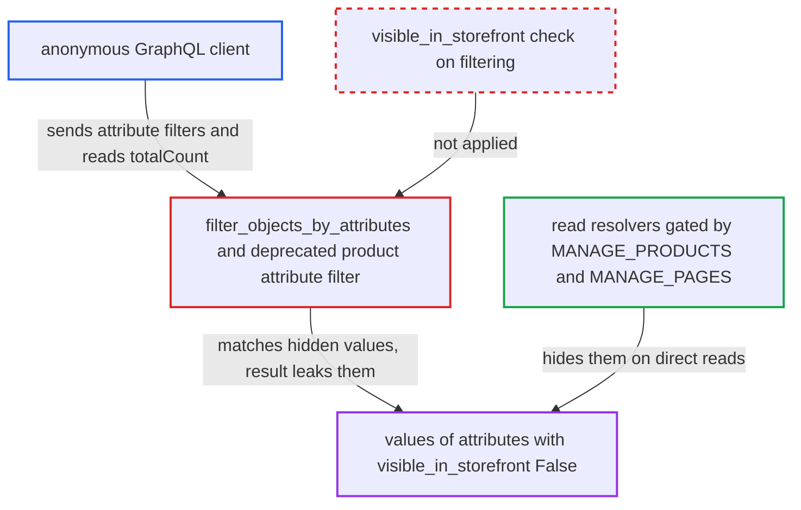

# Attribute filters ignore visible_in_storefront, giving anonymous users an oracle on hidden attribute values

| Field | Value |
|---|---|
| ID | `find_01DW4kQ1fyAGF3G2Ccrf11s2` |
| Severity | **Medium** |
| Status | open |
| CWE | CWE-862 — Missing authorization |
| Created | 2026-10-27T21:13:36.251119Z |
| Claude Security | https://claude.ai/security/findings/find_01DW4kQ1fyAGF3G2Ccrf11s2 |

## Description

An anonymous visitor to the GraphQL API can work out the values of attributes the merchant hid from the storefront. This covers products, variants and pages the visitor can already see, and it works by asking yes/no filter questions. It needs only that the merchant stores values in an attribute with `visible_in_storefront=False`. `filter_objects_by_attributes` and the deprecated product attribute filter never apply the visibility rule that the read paths enforce.

1. **anonymous client** finds the slug of a hidden attribute. An unknown slug makes the filter return no results, so a guessed slug that exists behaves differently from one that does not. A type-mismatch error, or leaving the slug out, can also expose it. ([`saleor/graphql/attribute/shared_filters.py:819-905`](https://github.com/cx-benchmark/saleor/blob/c982006cc04c77a97def93218dedac8d715eb041/saleor/graphql/attribute/shared_filters.py#L819-L905))
2. **anonymous client** sends a `products` query with `where:{attributes}` for a known visible product. The query limits results to one product id and filters on the hidden attribute, for example a numeric `range`, and asks for `totalCount`. The same filter is reachable through `productVariants` and `pages`, and through the deprecated `filter` input. ([`saleor/graphql/product/filters/product_attributes.py:391-403`](https://github.com/cx-benchmark/saleor/blob/c982006cc04c77a97def93218dedac8d715eb041/saleor/graphql/product/filters/product_attributes.py#L391-L403))
3. **`filter_objects_by_attributes`** looks up the attribute by the caller's slug without any visibility restriction. It receives no requestor and uses an unrestricted `Attribute.objects.filter(slug__in=...)`, so hidden attributes are found like any other. ([`saleor/graphql/attribute/shared_filters.py:819-905`](https://github.com/cx-benchmark/saleor/blob/c982006cc04c77a97def93218dedac8d715eb041/saleor/graphql/attribute/shared_filters.py#L819-L905))
4. **the `get_attribute_values_by_*` helpers** match `AttributeValue` rows of the hidden attribute against the caller's condition. They check slug, name, numeric, boolean, date and date-time values without looking at the owning attribute's visibility. With no slug they match values of every attribute of that type. ([`saleor/graphql/attribute/shared_filters.py:120-189`](https://github.com/cx-benchmark/saleor/blob/c982006cc04c77a97def93218dedac8d715eb041/saleor/graphql/attribute/shared_filters.py#L120-L189))
5. **anonymous client** reads whether the product is in the result or what `totalCount` is, and repeats with narrower ranges. Each response answers a yes/no question about the hidden value. Repeated queries, such as bisecting a numeric range, reveal the value.

## Assessment

The attacker is an anonymous client of `/graphql/` and needs no login. The merchant must keep per-product values in an attribute with `visible_in_storefront=False`. The attacker learns the slug by guessing, using the unknown-slug behaviour, using the type-mismatch error, or by omitting the slug. The attacker then sends `products(where:{ids:[P], attributes:[...]})` and reads `totalCount` or whether the product is returned. Dropdown, boolean, date and reference values are confirmed with `slug`, `name`, `boolean`, `date` or `reference` filters. `pages(where:{attributes})`, `productVariants(where:{attributes})` and the deprecated `products(filter:{attributes})` work the same way.

Impact: The attacker can reconstruct hidden attribute values, such as internal costs, supplier codes, internal flags or hidden references, for products, variants or pages they can already list. The leak is an inference oracle, so it is limited to attribute values on objects the caller can already see. The report names no integrity or availability effect.

## Recommendation

`filter_objects_by_attributes` and the deprecated product attribute filter helpers accept any attribute slug, or match across all attributes when no slug is given. The `visible_in_storefront` rule enforced on reads is therefore not applied when filtering.

Fix criteria: For requestors without the permission the read path requires (`MANAGE_PRODUCTS` for products and variants, `MANAGE_PAGES` for pages), attribute filters consider only attributes with `visible_in_storefront=True`. This holds in both the `where` and the deprecated `filter` inputs, with and without a slug. A filter naming a hidden attribute behaves as for a nonexistent one. An anonymous `products(where:{attributes:[{slug:<hidden>, value:{numeric:{range:...}}}]})` response no longer varies with the hidden value. A permitted staff client can still filter by that attribute.

## Evidence

**https://github.com/cx-benchmark/saleor**

- [`saleor/graphql/attribute/shared_filters.py:819-905`](https://github.com/cx-benchmark/saleor/blob/c982006cc04c77a97def93218dedac8d715eb041/saleor/graphql/attribute/shared_filters.py#L819-L905)
- [`saleor/graphql/attribute/shared_filters.py:120-189`](https://github.com/cx-benchmark/saleor/blob/c982006cc04c77a97def93218dedac8d715eb041/saleor/graphql/attribute/shared_filters.py#L120-L189)
- [`saleor/graphql/product/filters/product_attributes.py:85-120`](https://github.com/cx-benchmark/saleor/blob/c982006cc04c77a97def93218dedac8d715eb041/saleor/graphql/product/filters/product_attributes.py#L85-L120)
- [`saleor/graphql/product/filters/product_attributes.py:391-403`](https://github.com/cx-benchmark/saleor/blob/c982006cc04c77a97def93218dedac8d715eb041/saleor/graphql/product/filters/product_attributes.py#L391-L403)
- [`saleor/graphql/product/filters/product_variant.py:72-79`](https://github.com/cx-benchmark/saleor/blob/c982006cc04c77a97def93218dedac8d715eb041/saleor/graphql/product/filters/product_variant.py#L72-L79)
- [`saleor/graphql/page/filters.py:84-124`](https://github.com/cx-benchmark/saleor/blob/c982006cc04c77a97def93218dedac8d715eb041/saleor/graphql/page/filters.py#L84-L124)
- [`saleor/graphql/product/resolvers.py:265-293`](https://github.com/cx-benchmark/saleor/blob/c982006cc04c77a97def93218dedac8d715eb041/saleor/graphql/product/resolvers.py#L265-L293)

