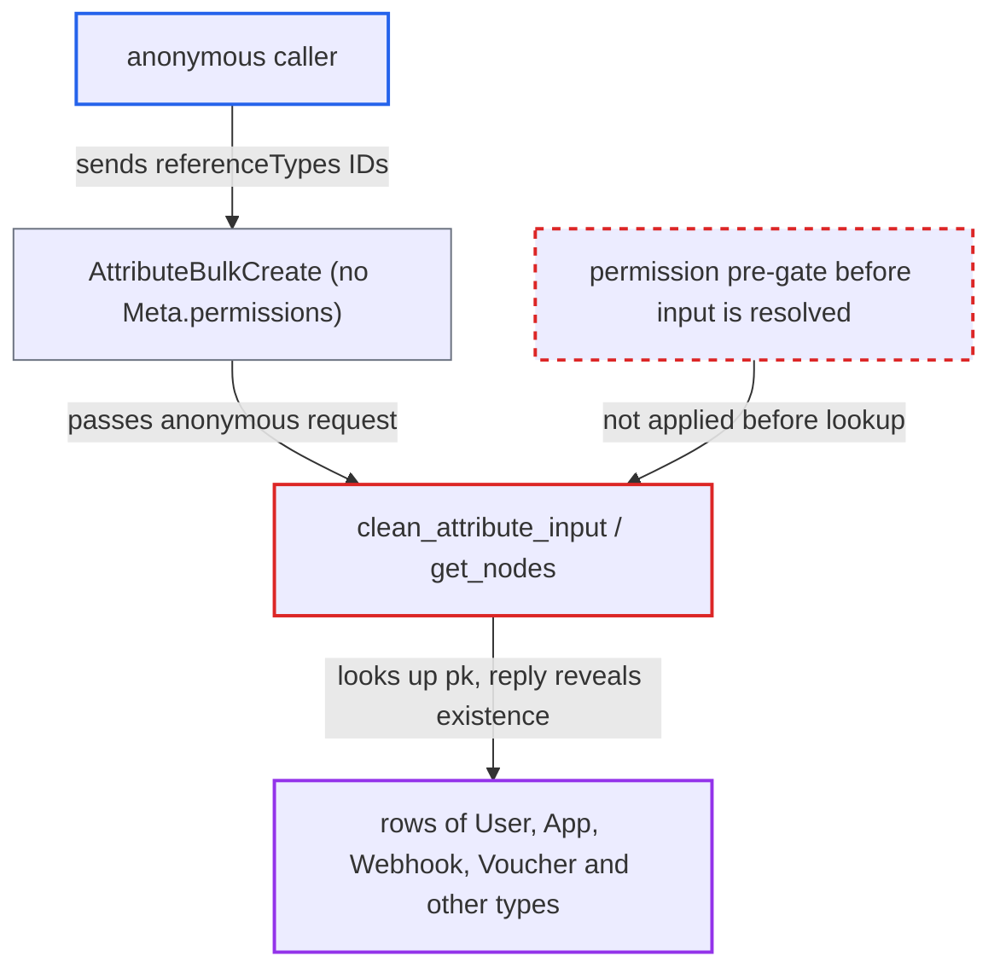

# attributeBulkCreate resolves arbitrary global IDs before permission check, enabling anonymous object-existence oracle

| Field | Value |
|---|---|
| ID | `find_01H2rkqFctjU5ZxHtvHjyJVc` |
| Severity | **Medium** |
| Status | open |
| CWE | CWE-204 — Observable response discrepancy |
| Created | 2026-10-27T21:18:07.112967Z |
| Claude Security | https://claude.ai/security/findings/find_01H2rkqFctjU5ZxHtvHjyJVc |

## Description

An anonymous internet user can find out which database rows exist for many object types, including staff-only ones such as apps, webhooks, vouchers, gift cards, payments and unpublished products. Only existence is revealed, not contents, and nothing is written. No login is needed. `AttributeBulkCreate` has no permission gate and looks up the caller's `referenceTypes` IDs before its per-attribute permission check.

1. **anonymous caller** sends `attributeBulkCreate` with a `referenceTypes` global ID of another type. The ID names a type such as `App` and a pk such as 7, and the request needs no login. ([`saleor/graphql/attribute/mutations/attribute_bulk_create.py:214-247`](https://github.com/cx-benchmark/saleor/blob/c982006cc04c77a97def93218dedac8d715eb041/saleor/graphql/attribute/mutations/attribute_bulk_create.py#L214-L247))
2. **`BaseMutation.check_permissions`** lets the request through to `perform_mutation`. `AttributeBulkCreate` declares no `Meta.permissions`, so the check returns `True`. ([`saleor/graphql/core/mutations.py:499-532`](https://github.com/cx-benchmark/saleor/blob/c982006cc04c77a97def93218dedac8d715eb041/saleor/graphql/core/mutations.py#L499-L532))
3. **`clean_attribute_input`** calls `DeprecatedModelMutation.clean_input` on the attribute data. This happens before the attribute-type permission check later in the same function. ([`saleor/graphql/attribute/mutations/attribute_bulk_create.py:345-387`](https://github.com/cx-benchmark/saleor/blob/c982006cc04c77a97def93218dedac8d715eb041/saleor/graphql/attribute/mutations/attribute_bulk_create.py#L345-L387))
4. **`get_nodes`** queries the model named in the caller's ID. It takes the type name from the ID, finds it in the schema and runs `qs.filter(pk__in=pks)`, with no `only_type` restriction. ([`saleor/graphql/utils/__init__.py:118-159`](https://github.com/cx-benchmark/saleor/blob/c982006cc04c77a97def93218dedac8d715eb041/saleor/graphql/utils/__init__.py#L118-L159))
5. **`get_nodes`** raises an error when no row matches. The error becomes a `ValidationError`, and `handle_errors` builds an `AttributeBulkCreateError` with a `field` keyword that `BulkError` does not have. Assuming graphene 2.1.9 as pinned in `uv.lock`, this ends in a `TypeError` and a top-level `Internal Server Error`. ([`saleor/graphql/core/mutations.py:87-118`](https://github.com/cx-benchmark/saleor/blob/c982006cc04c77a97def93218dedac8d715eb041/saleor/graphql/core/mutations.py#L87-L118))
6. **`clean_attribute_input`** returns the permission error when the row exists. The reply is a normal payload whose `results[i].errors[0].message` is `You have no permission to manage this type of attributes`. ([`saleor/graphql/attribute/mutations/attribute_bulk_create.py:345-387`](https://github.com/cx-benchmark/saleor/blob/c982006cc04c77a97def93218dedac8d715eb041/saleor/graphql/attribute/mutations/attribute_bulk_create.py#L345-L387))
7. **anonymous caller** compares the two replies and repeats over sequential integers. A permission error means the row exists. An `Internal Server Error` means it does not.

## Assessment

The attacker is an anonymous user of `/graphql/`. No login, special configuration or victim action is needed. They send `attributeBulkCreate` with `referenceTypes` holding a global ID such as base64 of `App:7`, and compare replies while stepping through sequential integer keys. A list mixing existing and missing IDs trips the `assert` in `get_nodes` and returns `There is no node of type X with pk N`, a third distinguishable reply. A second, smaller route is `clean_attributes`. It reports `External reference already exists.` for attribute and attribute-value external references before any permission check. `AttributeBulkUpdate` resolves `referenceTypes` only after its permission check, so only its attribute lookup (`find_attribute`) comes first.

Impact: The attacker learns which primary keys exist for any model-backed type keyed by sequential integers, so they also learn counts and growth, including for staff-only objects. They also learn whether attribute external references exist. No field contents are returned and nothing is written, so the disclosure is limited.

## Recommendation

(1) `AttributeBulkCreate` runs database lookups driven by caller input (resolving `referenceTypes` nodes and checking external references) before it checks that the caller holds any attribute-management permission. It also resolves `referenceTypes` without restricting the node type.

Fix criteria: A caller with no attribute-type permission is rejected before any lookup driven by its input, with the same response whatever IDs or external references it sends. `referenceTypes` resolves only `ProductType` or `PageType` IDs. To verify, send anonymous `attributeBulkCreate` requests whose `referenceTypes` name existing and non-existing `User`/`App` IDs. Both must return the same permission-denied response, with no query against those tables.

(2) When the bulk mutation's `ValidationError` reaches `BaseMutation.handle_errors`, it is converted with a `field` keyword that `BulkError` types do not have. The failure surfaces as an unhandled `TypeError` whose reply differs from other outcomes.

Fix criteria: Validation failures raised inside `AttributeBulkCreate` produce a well-formed typed error reply rather than an internal server error. Error handling can then no longer be used to tell rows apart.

## Evidence

**https://github.com/cx-benchmark/saleor**

- [`saleor/graphql/attribute/mutations/attribute_bulk_create.py:345-387`](https://github.com/cx-benchmark/saleor/blob/c982006cc04c77a97def93218dedac8d715eb041/saleor/graphql/attribute/mutations/attribute_bulk_create.py#L345-L387)
- [`saleor/graphql/attribute/mutations/attribute_bulk_create.py:214-247`](https://github.com/cx-benchmark/saleor/blob/c982006cc04c77a97def93218dedac8d715eb041/saleor/graphql/attribute/mutations/attribute_bulk_create.py#L214-L247)
- [`saleor/graphql/core/mutations.py:499-532`](https://github.com/cx-benchmark/saleor/blob/c982006cc04c77a97def93218dedac8d715eb041/saleor/graphql/core/mutations.py#L499-L532)
- [`saleor/graphql/core/mutations.py:705-732`](https://github.com/cx-benchmark/saleor/blob/c982006cc04c77a97def93218dedac8d715eb041/saleor/graphql/core/mutations.py#L705-L732)
- [`saleor/graphql/utils/__init__.py:118-159`](https://github.com/cx-benchmark/saleor/blob/c982006cc04c77a97def93218dedac8d715eb041/saleor/graphql/utils/__init__.py#L118-L159)
- [`saleor/graphql/core/mutations.py:87-118`](https://github.com/cx-benchmark/saleor/blob/c982006cc04c77a97def93218dedac8d715eb041/saleor/graphql/core/mutations.py#L87-L118)
- [`saleor/graphql/attribute/mutations/attribute_create.py:145-155`](https://github.com/cx-benchmark/saleor/blob/c982006cc04c77a97def93218dedac8d715eb041/saleor/graphql/attribute/mutations/attribute_create.py#L145-L155)
- [`saleor/graphql/attribute/mutations/permissions.py:24-36`](https://github.com/cx-benchmark/saleor/blob/c982006cc04c77a97def93218dedac8d715eb041/saleor/graphql/attribute/mutations/permissions.py#L24-L36)
- [`saleor/graphql/attribute/mutations/attribute_bulk_create.py:258-318`](https://github.com/cx-benchmark/saleor/blob/c982006cc04c77a97def93218dedac8d715eb041/saleor/graphql/attribute/mutations/attribute_bulk_create.py#L258-L318)

