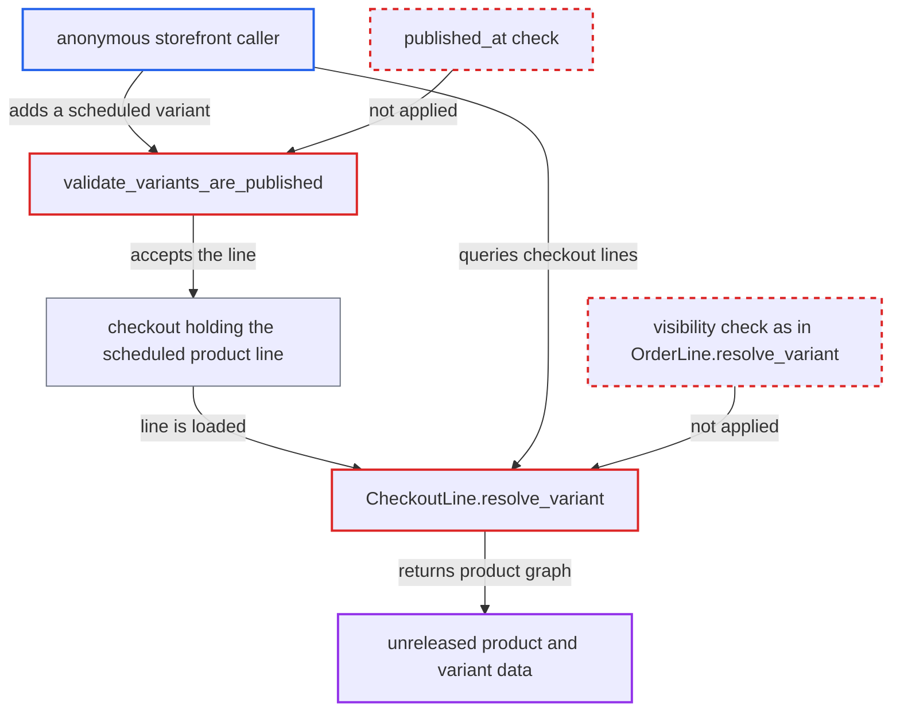

# Checkout publication check ignores publishedAt, exposing scheduled products via CheckoutLine.variant

| Field | Value |
|---|---|
| ID | `find_01BPEQW4eXPd7xN64bSs73ze` |
| Severity | **Medium** |
| Status | open |
| CWE | CWE-863 — Incorrect Authorization |
| Created | 2026-10-27T21:43:19.527538Z |
| Claude Security | https://claude.ai/security/findings/find_01BPEQW4eXPd7xN64bSs73ze |

## Description

An anonymous storefront user can read the name, description, SEO text, media URLs, attributes and prices of products that are scheduled for a future publication date. The attacker adds such a product's variant to a checkout and reads it back through the checkout. The checkout check looks only at `is_published`, and `CheckoutLine.resolve_variant` applies no visibility check.

1. **anonymous caller** guesses a sequential `ProductVariant:<n>` ID and sends `checkoutCreate`, `checkoutLinesAdd` or `checkoutLinesUpdate`. The target is a variant whose channel listing has `is_published=True`, a future `published_at` and `available_for_purchase_at <= now`. ([`saleor/graphql/checkout/mutations/checkout_create.py:260-280`](https://github.com/cx-benchmark/saleor/blob/c982006cc04c77a97def93218dedac8d715eb041/saleor/graphql/checkout/mutations/checkout_create.py#L260-L280))
2. **`validate_variants_are_published`** accepts the variant because the listing has `is_published=True`. It ignores `published_at`, so a listing scheduled for the future passes, although the storefront treats it as hidden. ([`saleor/graphql/checkout/mutations/utils.py:203-230`](https://github.com/cx-benchmark/saleor/blob/c982006cc04c77a97def93218dedac8d715eb041/saleor/graphql/checkout/mutations/utils.py#L203-L230))
3. **`Checkout.lines` loader** returns the stored line to the caller. `CheckoutLineInfo` is built for every stored line, whatever the product's visibility. ([`saleor/graphql/checkout/dataloaders/checkout_infos.py:190-280`](https://github.com/cx-benchmark/saleor/blob/c982006cc04c77a97def93218dedac8d715eb041/saleor/graphql/checkout/dataloaders/checkout_infos.py#L190-L280))
4. **`CheckoutLine.resolve_variant`** loads the variant with the plain `ProductVariantByIdLoader`. No visibility check runs, unlike `OrderLine.resolve_variant`, which hides the variant from non-staff when the listing is not visible. ([`saleor/graphql/checkout/types.py:357-364`](https://github.com/cx-benchmark/saleor/blob/c982006cc04c77a97def93218dedac8d715eb041/saleor/graphql/checkout/types.py#L357-L364))
5. **`ProductVariant.resolve_product`** loads the parent product with the plain `ProductByIdLoader`. Once the variant is reachable, every `Product` field is readable, including description, media, pricing and attributes. ([`saleor/graphql/product/types/products.py:759-764`](https://github.com/cx-benchmark/saleor/blob/c982006cc04c77a97def93218dedac8d715eb041/saleor/graphql/product/types/products.py#L759-L764))

## Assessment

The attacker is an anonymous user of the public `/graphql/` storefront API and needs no login. They enumerate sequential `ProductVariant:<n>` global IDs and call `checkoutCreate`, `checkoutLinesAdd` or `checkoutLinesUpdate` for a channel. The target product must have a listing with `is_published=True`, a future `published_at` and `available_for_purchase_at <= now`. They then query `checkout(id){lines{variant{product{...}}}}`. Second route: a checkout owner can keep reading a product after staff unpublish it (`is_published=False`) while it sits in their cart.

Impact: The attacker reads catalogue data the merchant withheld until a launch date: names, descriptions, SEO text, media URLs, attribute values, channel prices and discounts. Nothing can be modified. `checkoutComplete` still rejects the line, so purchase stays blocked. The leak is limited to pre-release catalogue data, not credentials or personal data.

## Recommendation

(1) `validate_variants_are_published` treats a listing as published when `is_published` is true. It ignores `published_at`, so it differs from the storefront's definition of visibility.

Fix criteria: Adding a variant to a checkout is refused whenever the storefront `product`/`productVariant` queries would not return the product in that channel, meaning `is_published` is false or `published_at` is in the future. Create a listing with `isPublished: true, publishedAt: <future>` and confirm that `checkoutCreate`, `checkoutLinesAdd` and `checkoutLinesUpdate` all return `PRODUCT_NOT_PUBLISHED`.

(2) `CheckoutLine.resolve_variant` and, through it, `ProductVariant.resolve_product` use unfiltered loaders. A line whose product is not yet or no longer visible still exposes the product to the checkout holder.

Fix criteria: For requestors without product-management permissions, `CheckoutLine.variant` returns null, or otherwise withholds product details, when the product's channel listing is not visible. This mirrors `OrderLine.resolve_variant`. Unpublish or schedule a product that is already in a checkout and confirm that `checkout.lines[].variant` no longer exposes it to anonymous or customer callers.

## Evidence

**https://github.com/cx-benchmark/saleor**

- [`saleor/graphql/checkout/mutations/utils.py:203-230`](https://github.com/cx-benchmark/saleor/blob/c982006cc04c77a97def93218dedac8d715eb041/saleor/graphql/checkout/mutations/utils.py#L203-L230)
- [`saleor/graphql/checkout/types.py:357-364`](https://github.com/cx-benchmark/saleor/blob/c982006cc04c77a97def93218dedac8d715eb041/saleor/graphql/checkout/types.py#L357-L364)
- [`saleor/graphql/product/types/products.py:759-764`](https://github.com/cx-benchmark/saleor/blob/c982006cc04c77a97def93218dedac8d715eb041/saleor/graphql/product/types/products.py#L759-L764)
- [`saleor/product/managers.py:31-45`](https://github.com/cx-benchmark/saleor/blob/c982006cc04c77a97def93218dedac8d715eb041/saleor/product/managers.py#L31-L45)
- [`saleor/core/models.py:78-83`](https://github.com/cx-benchmark/saleor/blob/c982006cc04c77a97def93218dedac8d715eb041/saleor/core/models.py#L78-L83)
- [`saleor/graphql/order/types.py:1507-1536`](https://github.com/cx-benchmark/saleor/blob/c982006cc04c77a97def93218dedac8d715eb041/saleor/graphql/order/types.py#L1507-L1536)
- [`saleor/graphql/checkout/mutations/checkout_create.py:260-280`](https://github.com/cx-benchmark/saleor/blob/c982006cc04c77a97def93218dedac8d715eb041/saleor/graphql/checkout/mutations/checkout_create.py#L260-L280)
- [`saleor/graphql/checkout/dataloaders/checkout_infos.py:190-280`](https://github.com/cx-benchmark/saleor/blob/c982006cc04c77a97def93218dedac8d715eb041/saleor/graphql/checkout/dataloaders/checkout_infos.py#L190-L280)

