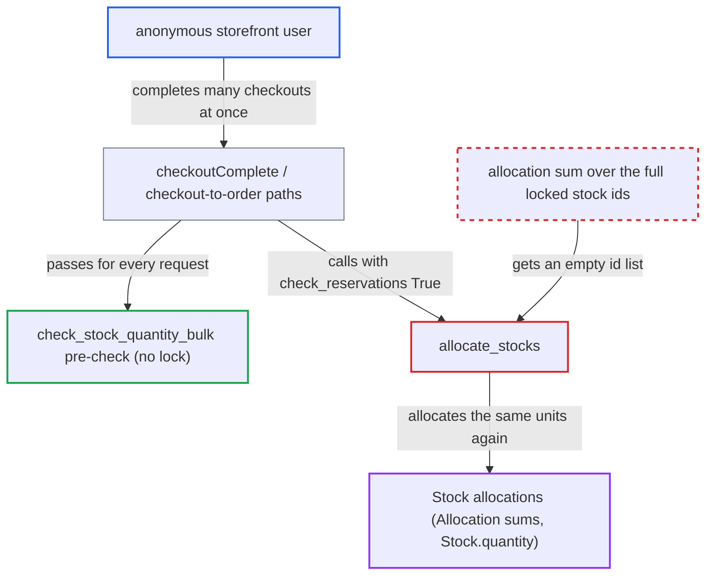

# Checkout stock allocation ignores existing allocations, defeating the oversell lock

| Field | Value |
|---|---|
| ID | `find_01Tn58n6HxWj1jKpahe95LAM` |
| Severity | **Medium** |
| Status | open |
| CWE | CWE-362 — Race condition |
| Created | 2026-10-27T21:19:51.814574Z |
| Claude Security | https://claude.ai/security/findings/find_01Tn58n6HxWj1jKpahe95LAM |

## Description

An anonymous storefront user can get confirmed orders for stock the merchant does not have, by completing several checkouts for the same variant at once. The limit is inventory integrity: the attacker still pays and the merchant can cancel and refund. The cause is `allocate_stocks`, which reuses the single-pass generator `stocks_id` in two queries. The second query, the one that sums existing allocations, gets an empty id list.

1. **attacker** creates several checkouts that each hold the remaining quantity Q of one variant. Each checkout is paid or authorized, so it can be completed.
2. **attacker** sends `checkoutComplete` for all the checkouts at the same time. The transaction flow behind `checkoutComplete` and `orderCreateFromCheckout` always passes `check_reservations=True` to `allocate_stocks`. ([`saleor/checkout/complete_checkout.py:1296-1307`](https://github.com/cx-benchmark/saleor/blob/c982006cc04c77a97def93218dedac8d715eb041/saleor/checkout/complete_checkout.py#L1296-L1307))
3. **the legacy payment flow `_create_order`** calls `allocate_stocks` with `check_reservations=True`. The flag is set unconditionally, so the faulty reservation path runs on every checkout completion. ([`saleor/checkout/complete_checkout.py:841-852`](https://github.com/cx-benchmark/saleor/blob/c982006cc04c77a97def93218dedac8d715eb041/saleor/checkout/complete_checkout.py#L841-L852))
4. **the pre-check `check_stock_quantity_bulk`** lets every concurrent request through. It counts allocations but takes no row lock, so each request still sees the full quantity as free. ([`saleor/warehouse/availability.py:242-330`](https://github.com/cx-benchmark/saleor/blob/c982006cc04c77a97def93218dedac8d715eb041/saleor/warehouse/availability.py#L242-L330))
5. **the function `allocate_stocks`** locks the matching `Stock` rows and builds `stocks_id` as a generator. The lock makes the requests run one after another, but the ids sit in a generator that can be read only once. ([`saleor/warehouse/management.py:150-163`](https://github.com/cx-benchmark/saleor/blob/c982006cc04c77a97def93218dedac8d715eb041/saleor/warehouse/management.py#L150-L163))
6. **the helper `_prepare_stock_to_reserved_quantity_map`** drains `stocks_id` in `Reservation.objects.filter(stock_id__in=stocks_id)`. Django consumes the iterator while building the `__in` lookup, so nothing is left for later queries. ([`saleor/warehouse/management.py:243-262`](https://github.com/cx-benchmark/saleor/blob/c982006cc04c77a97def93218dedac8d715eb041/saleor/warehouse/management.py#L243-L262))
7. **the function `allocate_stocks`** runs the `Allocation` aggregate over an empty id list. `quantity_allocation_for_stocks` stays empty, so `_create_allocations` subtracts 0 and treats units already allocated to other orders as free. ([`saleor/warehouse/management.py:316-345`](https://github.com/cx-benchmark/saleor/blob/c982006cc04c77a97def93218dedac8d715eb041/saleor/warehouse/management.py#L316-L345))
8. **each later request** allocates the full quantity Q again. It does not see the earlier request's committed allocation, so allocations exceed `Stock.quantity`. ([`saleor/warehouse/management.py:316-345`](https://github.com/cx-benchmark/saleor/blob/c982006cc04c77a97def93218dedac8d715eb041/saleor/warehouse/management.py#L316-L345))

## Assessment

The attacker is an anonymous user of the internet-facing `/graphql/` storefront. No login, victim action or special role is needed. The attacker creates several paid or authorized checkouts that each hold the remaining quantity Q of a variant, then fires `checkoutComplete` for all of them at once and has to win the race. Reservations are disabled by default, but both checkout-to-order paths (`_create_order` and `_handle_allocations_of_order_lines`) pass `check_reservations=True` anyway. Without any race, when a variant has several warehouses, existing allocations are also ignored for each stock. A new order can then be allocated to a stock that is already fully allocated, while the total stays within the pre-check.

Impact: The attacker gets confirmed orders for stock the merchant does not have. They can push `Allocation` sums and `Stock.quantity_allocated` above `Stock.quantity` for any variant, so other customers' orders compete for stock that is already gone. The attacker still pays, and the merchant can cancel and refund. The loss is limited to inventory integrity, with no disclosure and no outage.

## Recommendation

`allocate_stocks` keeps the locked stock ids in a single-pass generator, `stocks_id`, and uses it in two `__in` filters. The reservation filter drains it, so the allocation aggregate runs over an empty list whenever `check_reservations=True`. This breaks the rule that allocations never exceed stock quantity.

Fix criteria: The allocation aggregate in `allocate_stocks` is computed over the full set of locked stock ids, whatever the value of `check_reservations`. A test creates an existing `Allocation` on a stock and calls `allocate_stocks(..., check_reservations=True)` for the remaining quantity plus one. It asserts `InsufficientStock` and that no new allocation was made. A concurrency test has two transactions complete checkouts for the last unit and asserts that only one order gets the allocation.

## Evidence

**https://github.com/cx-benchmark/saleor**

- [`saleor/warehouse/management.py:150-163`](https://github.com/cx-benchmark/saleor/blob/c982006cc04c77a97def93218dedac8d715eb041/saleor/warehouse/management.py#L150-L163)
- [`saleor/warehouse/management.py:243-262`](https://github.com/cx-benchmark/saleor/blob/c982006cc04c77a97def93218dedac8d715eb041/saleor/warehouse/management.py#L243-L262)
- [`saleor/warehouse/management.py:316-345`](https://github.com/cx-benchmark/saleor/blob/c982006cc04c77a97def93218dedac8d715eb041/saleor/warehouse/management.py#L316-L345)
- [`saleor/checkout/complete_checkout.py:841-852`](https://github.com/cx-benchmark/saleor/blob/c982006cc04c77a97def93218dedac8d715eb041/saleor/checkout/complete_checkout.py#L841-L852)
- [`saleor/checkout/complete_checkout.py:1296-1307`](https://github.com/cx-benchmark/saleor/blob/c982006cc04c77a97def93218dedac8d715eb041/saleor/checkout/complete_checkout.py#L1296-L1307)
- [`saleor/warehouse/availability.py:242-330`](https://github.com/cx-benchmark/saleor/blob/c982006cc04c77a97def93218dedac8d715eb041/saleor/warehouse/availability.py#L242-L330)
- [`saleor/warehouse/reservations.py:123`](https://github.com/cx-benchmark/saleor/blob/c982006cc04c77a97def93218dedac8d715eb041/saleor/warehouse/reservations.py#L123)

