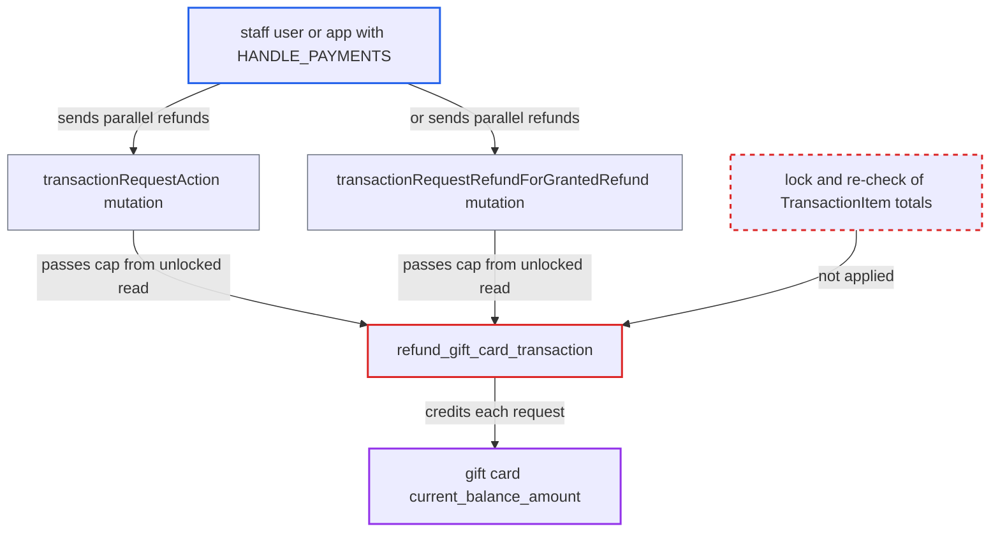

# Concurrent gift card refunds credit card beyond charged amount (unlocked refund cap)

| Field | Value |
|---|---|
| ID | `find_01VGv1ugKHHtfuxMk2a88VsH` |
| Severity | **Medium** |
| Status | open |
| CWE | CWE-362 — Race condition |
| Created | 2026-10-27T21:20:04.373185Z |
| Claude Security | https://claude.ai/security/findings/find_01VGv1ugKHHtfuxMk2a88VsH |

## Description

A staff user or app with `HANDLE_PAYMENTS` can send parallel refund requests for one gift-card transaction and raise a gift card's balance above what was charged. The attacker needs access to the order's channel and a gift card that paid for the order, which they hold or share with a colluding holder. The refund cap is checked on an unlocked `TransactionItem`, and `refund_gift_card_transaction` never re-checks it.

1. **attacker with `HANDLE_PAYMENTS`** sends many parallel refund requests for one gift-card transaction. The requests use `transactionRequestAction` with `actionType: REFUND` or `transactionRequestRefundForGrantedRefund`, sent to `/graphql/`. ([`saleor/graphql/payment/mutations/transaction/transaction_request_action.py:134-150`](https://github.com/cx-benchmark/saleor/blob/c982006cc04c77a97def93218dedac8d715eb041/saleor/graphql/payment/mutations/transaction/transaction_request_action.py#L134-L150))
2. **the refund mutations** read the `TransactionItem` without a lock and cap the amount at `charged_value`. Every request that reads before the first success is recalculated sees the full `charged_value`, so each passes the cap; the granted-refund path has the same unlocked checks. ([`saleor/graphql/payment/mutations/transaction/transaction_request_refund_for_granted_refund.py:82-189`](https://github.com/cx-benchmark/saleor/blob/c982006cc04c77a97def93218dedac8d715eb041/saleor/graphql/payment/mutations/transaction/transaction_request_refund_for_granted_refund.py#L82-L189))
3. **the gateway function `refund_gift_card_transaction`** adds the requested amount to the card's `current_balance_amount` under a lock on the `GiftCard` row only. It never locks or re-reads the `TransactionItem`, so it cannot tell that earlier refunds already used up the charged amount. ([`saleor/giftcard/gateway.py:408-472`](https://github.com/cx-benchmark/saleor/blob/c982006cc04c77a97def93218dedac8d715eb041/saleor/giftcard/gateway.py#L408-L472))
4. **the payment event code** records each `REFUND_SUCCESS` event without comparing refunded with charged. Each gift-card refund response carries a fresh `uuid4()` psp reference, so the duplicate check in `_create_event_from_response` does not reject any of them. ([`saleor/payment/utils.py:1201-1236`](https://github.com/cx-benchmark/saleor/blob/c982006cc04c77a97def93218dedac8d715eb041/saleor/payment/utils.py#L1201-L1236))
5. **the recalculation in `transaction_item_calculations.py`** lowers `charged_value` for every counted `REFUND_SUCCESS` event with no floor. The transaction ends with `refunded_value` above the charged amount and a negative `charged_value`, while the card holds extra balance. ([`saleor/payment/transaction_item_calculations.py:173-193`](https://github.com/cx-benchmark/saleor/blob/c982006cc04c77a97def93218dedac8d715eb041/saleor/payment/transaction_item_calculations.py#L173-L193))

## Assessment

The attacker is a staff user or app with `HANDLE_PAYMENTS` and access to the order's channel, for example a malicious refund agent or a compromised payment app. They also hold, or work with the holder of, a gift card that paid for an order. They must win a race: requests that read `charged_value` before the first request's recalculated save each credit the card again. Either `transactionRequestAction` or `transactionRequestRefundForGrantedRefund` works as the way in. The report says the attack can be repeated on new orders. Refunds sent one at a time stop at the charged amount. Gift-card transactions are created with `user=None, app=None`, so `check_if_requestor_has_access` stops `transactionUpdate` and `transactionEventReport` from raising `charged_value`. Concurrency is therefore the only way in.

Impact: The attacker can choose which gift card gains balance and can then spend it at checkout. The code limits neither how many requests land in the window nor how often the attack is repeated. Only `MANAGE_GIFT_CARD` is supposed to change a card's balance. Order and transaction totals are also corrupted. Nothing is disclosed and availability is not affected.

## Recommendation

The refund cap for gift-card transactions is checked on unlocked `TransactionItem` data and never checked again where the card is credited. Concurrent refunds are therefore not serialized against the transaction's charged and refunded totals.

Fix criteria: A gift-card refund is credited only if the transaction's cumulative refunded amount plus the new amount stays within the amount charged. That check runs atomically with the credit and with recording the success event, for example by locking the `TransactionItem` and reading its totals again. To verify, send N concurrent refund requests through both mutations for one gift-card transaction. The card gains at most the charged amount in total. The extra requests produce `REFUND_FAILURE`. `charged_value` never goes negative.

## Evidence

**https://github.com/cx-benchmark/saleor**

- [`saleor/giftcard/gateway.py:408-472`](https://github.com/cx-benchmark/saleor/blob/c982006cc04c77a97def93218dedac8d715eb041/saleor/giftcard/gateway.py#L408-L472)
- [`saleor/graphql/payment/mutations/transaction/transaction_request_action.py:134-150`](https://github.com/cx-benchmark/saleor/blob/c982006cc04c77a97def93218dedac8d715eb041/saleor/graphql/payment/mutations/transaction/transaction_request_action.py#L134-L150)
- [`saleor/graphql/payment/mutations/transaction/transaction_request_refund_for_granted_refund.py:82-189`](https://github.com/cx-benchmark/saleor/blob/c982006cc04c77a97def93218dedac8d715eb041/saleor/graphql/payment/mutations/transaction/transaction_request_refund_for_granted_refund.py#L82-L189)
- [`saleor/payment/transaction_item_calculations.py:173-193`](https://github.com/cx-benchmark/saleor/blob/c982006cc04c77a97def93218dedac8d715eb041/saleor/payment/transaction_item_calculations.py#L173-L193)
- [`saleor/payment/utils.py:1201-1236`](https://github.com/cx-benchmark/saleor/blob/c982006cc04c77a97def93218dedac8d715eb041/saleor/payment/utils.py#L1201-L1236)
- [`saleor/graphql/payment/utils.py:22-46`](https://github.com/cx-benchmark/saleor/blob/c982006cc04c77a97def93218dedac8d715eb041/saleor/graphql/payment/utils.py#L22-L46)

