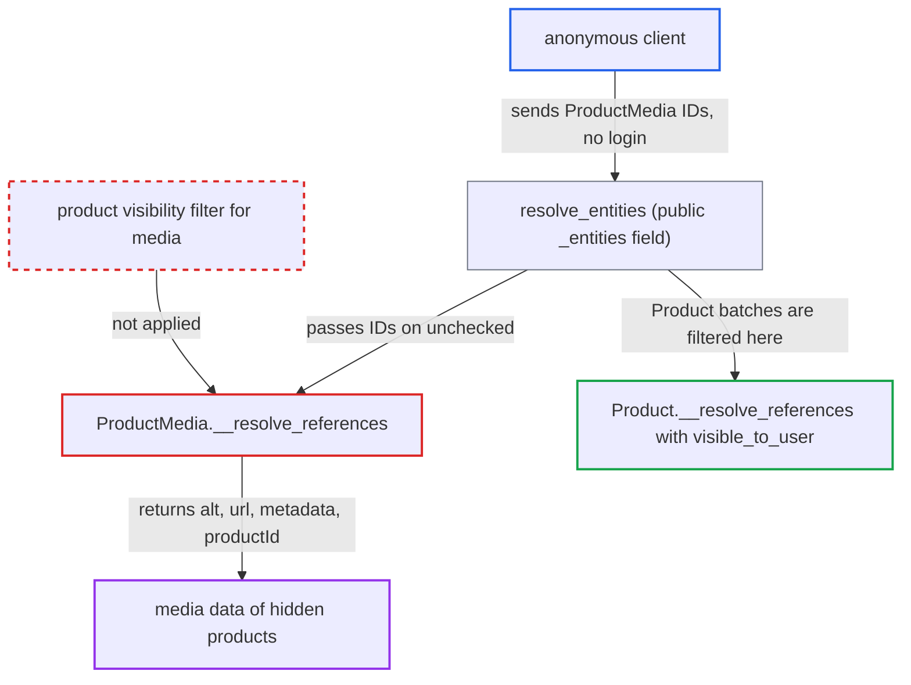

# Federation _entities returns ProductMedia of unpublished/hidden products to anonymous callers

| Field | Value |
|---|---|
| ID | `find_01PzAS5KTuvE9q3YD497aTB1` |
| Severity | **Medium** |
| Status | open |
| CWE | CWE-639 — Missing authorization |
| Created | 2026-10-27T21:24:43.562054Z |
| Claude Security | https://claude.ai/security/findings/find_01PzAS5KTuvE9q3YD497aTB1 |

## Description

An anonymous caller can read descriptive data of product media that belongs to unpublished, scheduled or channel-hidden products. This includes alt text, media URLs, public metadata and the parent product ID. No account or setting is needed. `ProductMedia.__resolve_references` looks up the supplied IDs without any visibility check, and the public `_entities` field forwards them. Private metadata stays protected.

1. **anonymous client** sends an `_entities` query to `/graphql/` with up to 100 `ProductMedia` representations. Each representation has `__typename` set to `ProductMedia` and an `id` that is the base64 of `ProductMedia:n`. The primary keys are sequential integers, so the client can sweep them.
2. **the resolver `resolve_entities`** accepts the request and passes each `ProductMedia` batch on. It requires no authentication or permission. It only limits the batch to `FEDERATED_QUERY_MAX_ENTITIES` (100 by default). ([`saleor/graphql/core/federation/schema.py:111-164`](https://github.com/cx-benchmark/saleor/blob/c982006cc04c77a97def93218dedac8d715eb041/saleor/graphql/core/federation/schema.py#L111-L164))
3. **the resolver `ProductMedia.__resolve_references`** looks up the supplied IDs in the unfiltered `models.ProductMedia.objects`. It applies no requestor, channel or product-publication filter. ([`saleor/graphql/product/types/products.py:2025-2032`](https://github.com/cx-benchmark/saleor/blob/c982006cc04c77a97def93218dedac8d715eb041/saleor/graphql/product/types/products.py#L2025-L2032))
4. **the function `resolve_federation_references`** decodes the global IDs and runs a plain `queryset.filter(id__in=ids)`. It adds no visibility logic, so media of hidden products is returned as well. ([`saleor/graphql/core/federation/resolvers.py:30-35`](https://github.com/cx-benchmark/saleor/blob/c982006cc04c77a97def93218dedac8d715eb041/saleor/graphql/core/federation/resolvers.py#L30-L35))
5. **anonymous client** reads the returned fields of the hidden products' media. The fields are `alt`, `type`, `sortOrder`, `oembedData`, `url`, public `metadata`, the alt `translation` and `productId`. `url` is the raw storage URL for images and the `external_url` for VIDEO media. ([`saleor/graphql/product/types/products.py:1986-2023`](https://github.com/cx-benchmark/saleor/blob/c982006cc04c77a97def93218dedac8d715eb041/saleor/graphql/product/types/products.py#L1986-L2023))

## Assessment

The attacker is any anonymous client of the public `/graphql/` endpoint. They need no account, no victim action and no non-default setting. They post `_entities` queries with up to 100 `ProductMedia` representations each and step through the sequential integer IDs. The ordinary routes to media, `Product.media` and `Product.mediaById`, only work through a product that already passed the visibility filter. The `_entities` field skips that filter for media. Separately, the image bytes of such media can be fetched through the unauthenticated `/image/` and `/thumbnail/` views. What the `_entities` path adds is the descriptive data and external video links.

Impact: The attacker reads alt text (often naming the product), oEmbed data, raw storage or external video URLs, public metadata, alt translations and the parent product ID of hidden products. The product ID also confirms that the hidden product exists. This is limited pre-launch catalogue disclosure. Private metadata stays gated by `product_permissions`, and nothing can be modified or disrupted.

## Recommendation

`ProductMedia.__resolve_references` resolves entity references without restricting them to media of products visible to the requestor. The other product-domain entity resolvers, such as `Product.__resolve_references`, do restrict them.

Fix criteria: `_entities` for `ProductMedia` returns `null` for any media whose product is not visible to the requestor. The rule is the same as in `Product.__resolve_references`: `visible_to_user` with the representation's or default channel, and all products for `ALL_PRODUCTS_PERMISSIONS` holders. An anonymous `_entities` request for media of an unpublished product yields `[null]`. The same request for media of a published product in an active channel still resolves.

## Evidence

**https://github.com/cx-benchmark/saleor**

- [`saleor/graphql/product/types/products.py:2025-2032`](https://github.com/cx-benchmark/saleor/blob/c982006cc04c77a97def93218dedac8d715eb041/saleor/graphql/product/types/products.py#L2025-L2032)
- [`saleor/graphql/core/federation/resolvers.py:30-35`](https://github.com/cx-benchmark/saleor/blob/c982006cc04c77a97def93218dedac8d715eb041/saleor/graphql/core/federation/resolvers.py#L30-L35)
- [`saleor/graphql/core/federation/schema.py:111-164`](https://github.com/cx-benchmark/saleor/blob/c982006cc04c77a97def93218dedac8d715eb041/saleor/graphql/core/federation/schema.py#L111-L164)
- [`saleor/graphql/product/types/products.py:1639-1667`](https://github.com/cx-benchmark/saleor/blob/c982006cc04c77a97def93218dedac8d715eb041/saleor/graphql/product/types/products.py#L1639-L1667)
- [`saleor/graphql/product/resolvers.py:135-158`](https://github.com/cx-benchmark/saleor/blob/c982006cc04c77a97def93218dedac8d715eb041/saleor/graphql/product/resolvers.py#L135-L158)
- [`saleor/graphql/product/types/products.py:1370-1376`](https://github.com/cx-benchmark/saleor/blob/c982006cc04c77a97def93218dedac8d715eb041/saleor/graphql/product/types/products.py#L1370-L1376)
- [`saleor/graphql/product/types/products.py:1986-2023`](https://github.com/cx-benchmark/saleor/blob/c982006cc04c77a97def93218dedac8d715eb041/saleor/graphql/product/types/products.py#L1986-L2023)

