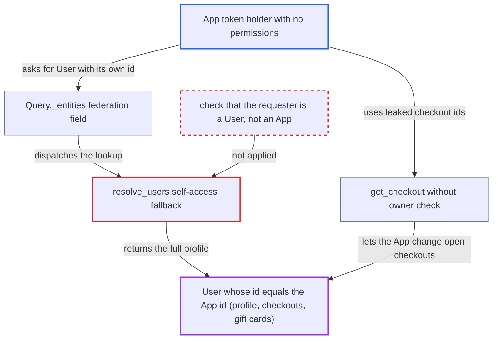

# Federation _entities User lookup treats an App's id as a User id, exposing that user's profile

| Field | Value |
|---|---|
| ID | `find_016q9sx1f3coP2JvJNk6RocE` |
| Severity | **Medium** |
| Status | open |
| CWE | CWE-863 — Incorrect authorization |
| Created | 2026-10-27T21:43:19.324215Z |
| Claude Security | https://claude.ai/security/findings/find_016q9sx1f3coP2JvJNk6RocE |

## Description

An app token with no permissions can read another user's full profile: email, names, addresses, open checkouts, gift cards and permission groups. It can also change that user's open checkouts. The attack needs only an App token, and it reaches one user per App id. The cause is `resolve_users`, whose self-access fallback compares the requester's id with `User` ids even when the requester is an `App`.

1. **attacker's App** sends an `_entities` query for its own id as a `User`. The App encodes its own primary key N as a `User` global id and posts `{__typename: "User", id: ...}` to `/graphql/`. It needs no `MANAGE_USERS` or `MANAGE_STAFF`. ([`saleor/graphql/core/federation/schema.py:108-162`](https://github.com/cx-benchmark/saleor/blob/c982006cc04c77a97def93218dedac8d715eb041/saleor/graphql/core/federation/schema.py#L108-L162))
2. **the context code** sets the App as the requester. For an app token, `request.app` is the `App` and `request.user` is None. `get_user_or_app_from_context` returns `context.app or context.user`, so the App is the requester. ([`saleor/graphql/context.py:77-91`](https://github.com/cx-benchmark/saleor/blob/c982006cc04c77a97def93218dedac8d715eb041/saleor/graphql/context.py#L77-L91))
3. **`User.__resolve_references`** passes the requested ids to `resolve_users`. It returns whatever `resolve_users` finds as entity results, with no further check. ([`saleor/graphql/account/types.py:949-970`](https://github.com/cx-benchmark/saleor/blob/c982006cc04c77a97def93218dedac8d715eb041/saleor/graphql/account/types.py#L949-L970))
4. **`resolve_users`** falls through to `elif requester.id` and filters `User` by the App's primary key. The App has neither permission, so it reaches the self-access fallback. The `App` and `User` models have independent id sequences, so the filter matches the `User` whose id equals the App's id. ([`saleor/graphql/account/resolvers.py:135-138`](https://github.com/cx-benchmark/saleor/blob/c982006cc04c77a97def93218dedac8d715eb041/saleor/graphql/account/resolvers.py#L135-L138))
5. **the `User` node resolvers** return the matched user's ungated fields to the App. The fields for addresses, checkouts, `checkoutIds`, `giftCards`, `userPermissions`, `permissionGroups` and similar apply no permission or owner check. ([`saleor/graphql/account/types.py:654-797`](https://github.com/cx-benchmark/saleor/blob/c982006cc04c77a97def93218dedac8d715eb041/saleor/graphql/account/types.py#L654-L797))
6. **attacker's App** uses the leaked checkout ids to modify the victim's open checkouts. `get_checkout` loads a checkout by id or token with no ownership check. Mutations such as `checkoutLinesAdd`, `checkoutEmailUpdate` and `checkoutShippingAddressUpdate` therefore accept the leaked ids. ([`saleor/graphql/checkout/mutations/utils.py:261-299`](https://github.com/cx-benchmark/saleor/blob/c982006cc04c77a97def93218dedac8d715eb041/saleor/graphql/checkout/mutations/utils.py#L261-L299))

## Assessment

The attacker is any installed or created App that has a token. It does not need `MANAGE_USERS` or `MANAGE_STAFF`, and no victim action is needed. It posts an `_entities` query with `User:N`, where N is its own primary key, to `/graphql/`. In practice the victim is an early account, such as the store's superuser or staff. Staff with `MANAGE_APPS` can choose the victim by calling `appCreate`, which returns a token, until the App sequence reaches the victim's id.

Impact: The App reads the profile of the one user whose id equals its own, including email, names, staff flag, addresses, permission groups, accessible channels, last login, public metadata and open checkouts. The leaked `giftCards` nodes also feed a separate owner check on `GiftCard.code`, which reveals the codes to the App. Through the leaked checkout ids it can alter those checkouts. `note`, `events`, `orders`, `privateMetadata` and `Group.users` stay gated. Reach is one user per App id unless `MANAGE_APPS` staff create more apps.

## Recommendation

`resolve_users` decides self-access by comparing the requester's primary key with `User` primary keys, without first establishing that the requester is a `User`. An `App` row with the same integer id is therefore treated as that user.

Fix criteria: The self-access fallback applies only to an authenticated `User` requester, for example the user in `info.context.user`. An App without `MANAGE_USERS` or `MANAGE_STAFF` receives no `User` entities. To verify, send the `_entities` query for `User:<app pk>` with a permission-less app token whose pk equals an existing user's id, and confirm the result is `[None]`. A federation test that uses an app client has been added.

## Evidence

**https://github.com/cx-benchmark/saleor**

- [`saleor/graphql/account/resolvers.py:135-138`](https://github.com/cx-benchmark/saleor/blob/c982006cc04c77a97def93218dedac8d715eb041/saleor/graphql/account/resolvers.py#L135-L138)
- [`saleor/graphql/account/resolvers.py:121-146`](https://github.com/cx-benchmark/saleor/blob/c982006cc04c77a97def93218dedac8d715eb041/saleor/graphql/account/resolvers.py#L121-L146)
- [`saleor/graphql/account/types.py:949-970`](https://github.com/cx-benchmark/saleor/blob/c982006cc04c77a97def93218dedac8d715eb041/saleor/graphql/account/types.py#L949-L970)
- [`saleor/graphql/core/federation/schema.py:108-162`](https://github.com/cx-benchmark/saleor/blob/c982006cc04c77a97def93218dedac8d715eb041/saleor/graphql/core/federation/schema.py#L108-L162)
- [`saleor/graphql/utils/__init__.py:204-207`](https://github.com/cx-benchmark/saleor/blob/c982006cc04c77a97def93218dedac8d715eb041/saleor/graphql/utils/__init__.py#L204-L207)
- [`saleor/graphql/context.py:77-91`](https://github.com/cx-benchmark/saleor/blob/c982006cc04c77a97def93218dedac8d715eb041/saleor/graphql/context.py#L77-L91)
- [`saleor/graphql/account/types.py:654-797`](https://github.com/cx-benchmark/saleor/blob/c982006cc04c77a97def93218dedac8d715eb041/saleor/graphql/account/types.py#L654-L797)
- [`saleor/graphql/checkout/mutations/utils.py:261-299`](https://github.com/cx-benchmark/saleor/blob/c982006cc04c77a97def93218dedac8d715eb041/saleor/graphql/checkout/mutations/utils.py#L261-L299)
- [`saleor/graphql/account/resolvers.py:258-270`](https://github.com/cx-benchmark/saleor/blob/c982006cc04c77a97def93218dedac8d715eb041/saleor/graphql/account/resolvers.py#L258-L270)

