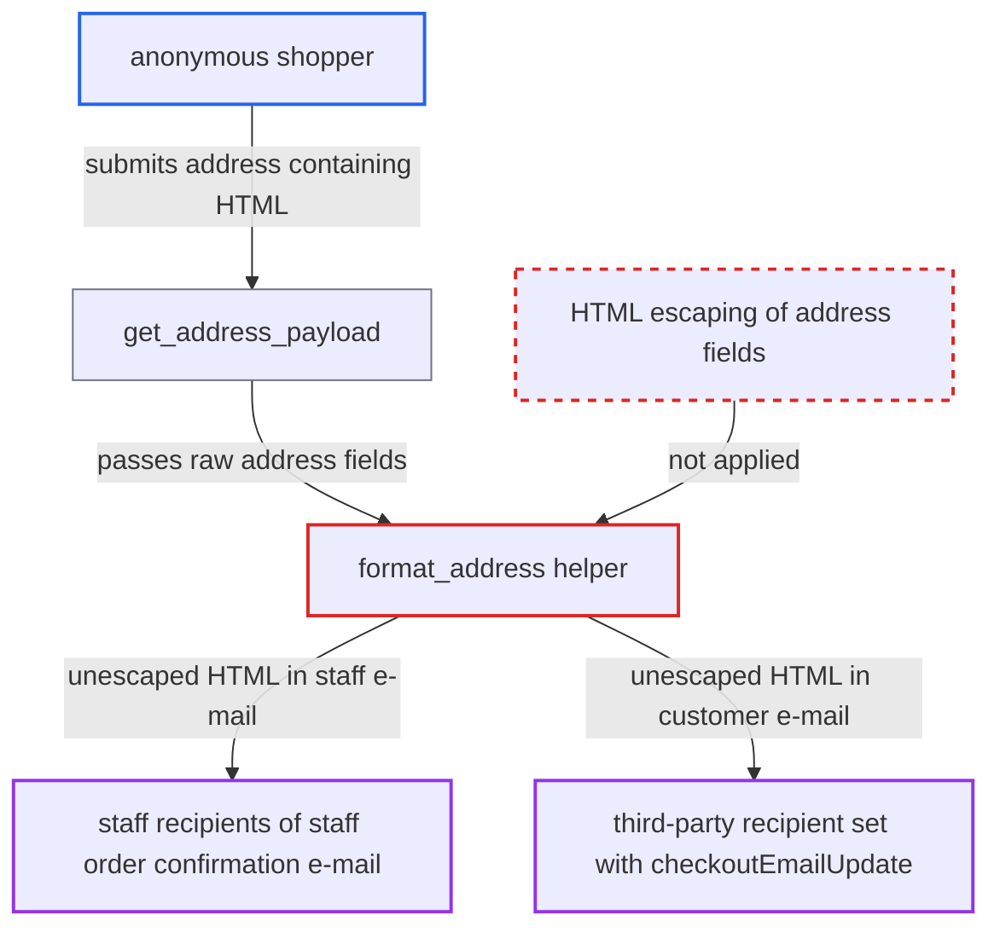

# format_address email helper emits customer address fields as unescaped HTML

| Field | Value |
|---|---|
| ID | `find_01Ac8PiTBjTH2sv271r42f3b` |
| Severity | **Medium** |
| Status | open |
| CWE | CWE-79 — HTML injection |
| Created | 2026-10-27T21:25:45.753554Z |
| Claude Security | https://claude.ai/security/findings/find_01Ac8PiTBjTH2sv271r42f3b |

## Description

An anonymous shopper can put their own HTML into order e-mails that the shop sends to staff and to any recipient address they enter at checkout. The shopper only needs to place an order with markup in an address field. The helper `format_address` marks the joined address text as safe with `pybars.strlist`, so the HTML is not escaped.

1. **anonymous shopper** enters HTML in the checkout address. Free-text fields such as `streetAddress1` and `firstName` accept markup, because address validation only checks required fields, postal-code format and country areas. ([`saleor/account/i18n.py:196-220`](https://github.com/cx-benchmark/saleor/blob/c982006cc04c77a97def93218dedac8d715eb041/saleor/account/i18n.py#L196-L220))
2. **anonymous shopper** completes the order. Completing the order triggers `send_order_confirmation`, which sends the notifications. ([`saleor/order/notifications.py:408-448`](https://github.com/cx-benchmark/saleor/blob/c982006cc04c77a97def93218dedac8d715eb041/saleor/order/notifications.py#L408-L448))
3. **`get_address_payload`** copies the address fields into the notification payload. The raw `Address` model fields go in without any sanitising. ([`saleor/order/notifications.py:247-253`](https://github.com/cx-benchmark/saleor/blob/c982006cc04c77a97def93218dedac8d715eb041/saleor/order/notifications.py#L247-L253))
4. **the helper `format_address`** joins the address lines with ` ` and returns them as `pybars.strlist`. In pybars3 a `strlist` is a safe string that skips HTML escaping, so the customer's text is written into the e-mail body as it is. ([`saleor/plugins/email_common.py:127-139`](https://github.com/cx-benchmark/saleor/blob/c982006cc04c77a97def93218dedac8d715eb041/saleor/plugins/email_common.py#L127-L139))
5. **the staff template `staff_confirm_order.html`** renders the billing and shipping address through the helper. `AdminEmailPlugin` is active by default (`DEFAULT_ACTIVE = True`) and sends this e-mail to every `StaffNotificationRecipient`. ([`saleor/plugins/admin_email/default_email_templates/staff_confirm_order.html:331-343`](https://github.com/cx-benchmark/saleor/blob/c982006cc04c77a97def93218dedac8d715eb041/saleor/plugins/admin_email/default_email_templates/staff_confirm_order.html#L331-L343))
6. **the customer template `confirm_order.html`** renders the same helper for the checkout e-mail recipient. For a guest checkout this recipient is whatever address the shopper set with `checkoutEmailUpdate`, and it is not verified. ([`saleor/plugins/user_email/default_email_templates/confirm_order.html:264-275`](https://github.com/cx-benchmark/saleor/blob/c982006cc04c77a97def93218dedac8d715eb041/saleor/plugins/user_email/default_email_templates/confirm_order.html#L264-L275))

## Assessment

The attacker is an anonymous storefront user and needs no account. They create a checkout, set a shipping or billing address with HTML in fields such as `streetAddress1` or `firstName`, and complete the order. There are two ways the HTML reaches a victim. First, the default `AdminEmailPlugin` sends `staff_confirm_order.html` to every `StaffNotificationRecipient`, and a staff member only has to open it. Second, `confirm_order.html` goes to the checkout e-mail, which a guest sets with `checkoutEmailUpdate` without verification. The shop then relays the attacker's HTML from its trusted sender address to any third party. The fulfillment and order-confirmed templates use the same helper.

Impact: The attacker can inject arbitrary HTML into trusted shop e-mails. Examples are links styled as dashboard actions to phish credentials, tracking images that show when and where staff read the mail, and layout that overrides the rest of the message. Mail clients do not run scripts, so the report does not claim code execution or data changes on Saleor.

## Recommendation

`format_address` returns a `pybars.strlist` that contains untrusted address fields. This marks the whole string as safe, so output encoding is off for attacker-controlled text. Only the ` ` separators needed to be trusted.

Fix criteria: Every address field is HTML-escaped before it is joined with the ` ` separator, or the helper returns a plain string and the template adds the line breaks. An order whose street address contains `<b>x</b>` produces `&lt;b&gt;x&lt;/b&gt;` in both the staff and the customer e-mails. The ` ` separators still work.

## Evidence

**https://github.com/cx-benchmark/saleor**

- [`saleor/plugins/email_common.py:127-139`](https://github.com/cx-benchmark/saleor/blob/c982006cc04c77a97def93218dedac8d715eb041/saleor/plugins/email_common.py#L127-L139)
- [`saleor/plugins/admin_email/default_email_templates/staff_confirm_order.html:331-343`](https://github.com/cx-benchmark/saleor/blob/c982006cc04c77a97def93218dedac8d715eb041/saleor/plugins/admin_email/default_email_templates/staff_confirm_order.html#L331-L343)
- [`saleor/plugins/user_email/default_email_templates/confirm_order.html:264-275`](https://github.com/cx-benchmark/saleor/blob/c982006cc04c77a97def93218dedac8d715eb041/saleor/plugins/user_email/default_email_templates/confirm_order.html#L264-L275)
- [`saleor/order/notifications.py:247-253`](https://github.com/cx-benchmark/saleor/blob/c982006cc04c77a97def93218dedac8d715eb041/saleor/order/notifications.py#L247-L253)
- [`saleor/order/notifications.py:408-448`](https://github.com/cx-benchmark/saleor/blob/c982006cc04c77a97def93218dedac8d715eb041/saleor/order/notifications.py#L408-L448)
- [`saleor/plugins/admin_email/plugin.py:47-51`](https://github.com/cx-benchmark/saleor/blob/c982006cc04c77a97def93218dedac8d715eb041/saleor/plugins/admin_email/plugin.py#L47-L51)
- [`saleor/account/i18n.py:196-220`](https://github.com/cx-benchmark/saleor/blob/c982006cc04c77a97def93218dedac8d715eb041/saleor/account/i18n.py#L196-L220)

