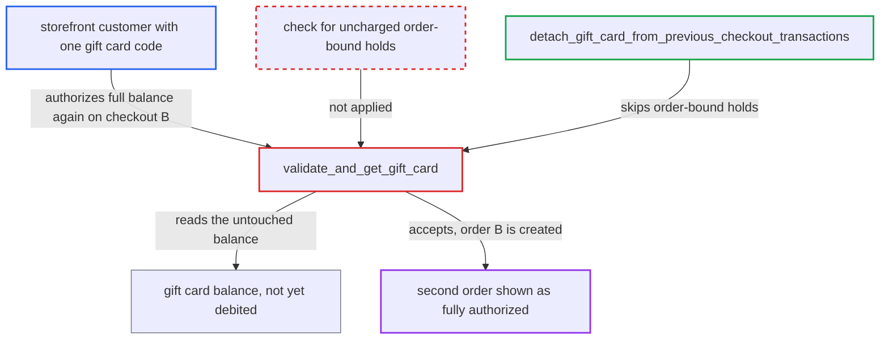

# Gift card gateway authorizations ignore uncharged order-bound holds, letting one balance back many orders

| Field | Value |
|---|---|
| ID | `find_01J5jrz3Lh9EkQLoSmznofWS` |
| Severity | **Medium** |
| Status | open |
| CWE | CWE-841 — Business logic flaw |
| Created | 2026-10-27T21:18:01.824458Z |
| Claude Security | https://claude.ai/security/findings/find_01J5jrz3Lh9EkQLoSmznofWS |

## Description

A customer with one gift card code can place several orders that each show as fully authorized against the same balance. Only the first order is backed by money, and the later charges fail. It needs only a storefront account. On default channels the attacker must win a short race, and on manual-confirm channels no race is needed. The cause is `validate_and_get_gift_card`, which checks the raw `current_balance_amount` and ignores holds that are already attached to orders but not yet charged.

1. **customer** authorizes the gift card on checkout A and completes it. `transactionInitialize` reaches `validate_and_get_gift_card`, which accepts any amount up to `current_balance_amount`, and `checkoutComplete` then creates the order. ([`saleor/giftcard/gateway.py:135-175`](https://github.com/cx-benchmark/saleor/blob/c982006cc04c77a97def93218dedac8d715eb041/saleor/giftcard/gateway.py#L135-L175))
2. **`checkoutComplete`** moves the authorized transaction from the checkout onto the new order and commits. The hold is now order-bound, and the card has not been debited yet. ([`saleor/checkout/complete_checkout.py:1550-1555`](https://github.com/cx-benchmark/saleor/blob/c982006cc04c77a97def93218dedac8d715eb041/saleor/checkout/complete_checkout.py#L1550-L1555))
3. **order flow** delays the actual charge. The charge runs in `order_confirmed`, which on default channels runs in an `on_commit` hook after the order commits, and on channels with `automatically_confirm_all_new_orders=False` only when staff call `orderConfirm`. ([`saleor/order/actions.py:348-380`](https://github.com/cx-benchmark/saleor/blob/c982006cc04c77a97def93218dedac8d715eb041/saleor/order/actions.py#L348-L380))
4. **customer** sends `transactionInitialize` with the same code on checkout B for the full balance. The balance is still untouched, so `validate_and_get_gift_card` accepts it, and `detach_gift_card_from_previous_checkout_transactions` only cancels holds with `Q(order_id__isnull=True)`, so it skips A's order-bound hold. ([`saleor/giftcard/gateway.py:203-250`](https://github.com/cx-benchmark/saleor/blob/c982006cc04c77a97def93218dedac8d715eb041/saleor/giftcard/gateway.py#L203-L250))
5. **customer** completes checkout B. The checkout reaches `CheckoutAuthorizeStatus.FULL`, which is all the `CHECKOUT_NOT_FULLY_PAID` gate requires, so B becomes an order. ([`saleor/checkout/complete_checkout.py:959-971`](https://github.com/cx-benchmark/saleor/blob/c982006cc04c77a97def93218dedac8d715eb041/saleor/checkout/complete_checkout.py#L959-L971))
6. **gift card charge** fails for the second order and records `CHARGE_FAILURE`. Order A's charge has already drained the balance, and a failure with no success leaves `authorized_value` unchanged, so order B keeps `authorizeStatus: FULL` with nothing behind it. ([`saleor/payment/transaction_item_calculations.py:91-124`](https://github.com/cx-benchmark/saleor/blob/c982006cc04c77a97def93218dedac8d715eb041/saleor/payment/transaction_item_calculations.py#L91-L124))
7. **`_expire_orders`** never expires the unfunded order. Unconfirmed orders that have any TransactionItem are skipped, so on manual-confirm channels the order and its stock allocations stay until staff act. ([`saleor/order/tasks.py:156-161`](https://github.com/cx-benchmark/saleor/blob/c982006cc04c77a97def93218dedac8d715eb041/saleor/order/tasks.py#L156-L161))

## Assessment

The attacker is a storefront customer, possibly anonymous, who holds one gift card code. They authorize and complete checkout A, then send `transactionInitialize` with the same code on checkout B before A's charge happens. On default auto-confirm channels this is a race in the gap between A's order commit and its `on_commit` charge, and the attacker can retry it. On channels with `automatically_confirm_all_new_orders=False` the gap lasts until staff call `orderConfirm`, so no race is needed. No staff action or victim step is needed to create the unfunded order.

Impact: The attacker can create extra orders that are recorded as fully authorized against a balance that already backs another order. Their charge later fails and they never show as charged. Goods are lost only if the merchant fulfils on authorization status. The report names no data disclosure.

## Recommendation

`validate_and_get_gift_card` authorizes against the raw `current_balance_amount` and ignores uncharged authorizations already bound to orders. `detach_gift_card_from_previous_checkout_transactions` cancels only checkout-bound ones, so an authorization reserves no funds.

Fix criteria: Under the card's row lock, a gift card never has outstanding gateway authorizations (authorized, not charged or cancelled, checkout- or order-bound) that sum to more than its balance. Alternatively, funds are debited or reserved at authorization or at order creation inside the same transaction. Test: place order A with the card's full balance and leave it uncharged. Then `transactionInitialize` with the same card on another checkout returns `AUTHORIZATION_FAILURE`. A's later charge still succeeds.

## Evidence

**https://github.com/cx-benchmark/saleor**

- [`saleor/giftcard/gateway.py:135-175`](https://github.com/cx-benchmark/saleor/blob/c982006cc04c77a97def93218dedac8d715eb041/saleor/giftcard/gateway.py#L135-L175)
- [`saleor/giftcard/gateway.py:203-250`](https://github.com/cx-benchmark/saleor/blob/c982006cc04c77a97def93218dedac8d715eb041/saleor/giftcard/gateway.py#L203-L250)
- [`saleor/checkout/complete_checkout.py:1550-1555`](https://github.com/cx-benchmark/saleor/blob/c982006cc04c77a97def93218dedac8d715eb041/saleor/checkout/complete_checkout.py#L1550-L1555)
- [`saleor/checkout/complete_checkout.py:1376-1386`](https://github.com/cx-benchmark/saleor/blob/c982006cc04c77a97def93218dedac8d715eb041/saleor/checkout/complete_checkout.py#L1376-L1386)
- [`saleor/order/actions.py:348-380`](https://github.com/cx-benchmark/saleor/blob/c982006cc04c77a97def93218dedac8d715eb041/saleor/order/actions.py#L348-L380)
- [`saleor/giftcard/gateway.py:325-370`](https://github.com/cx-benchmark/saleor/blob/c982006cc04c77a97def93218dedac8d715eb041/saleor/giftcard/gateway.py#L325-L370)
- [`saleor/checkout/complete_checkout.py:959-971`](https://github.com/cx-benchmark/saleor/blob/c982006cc04c77a97def93218dedac8d715eb041/saleor/checkout/complete_checkout.py#L959-L971)
- [`saleor/payment/transaction_item_calculations.py:91-124`](https://github.com/cx-benchmark/saleor/blob/c982006cc04c77a97def93218dedac8d715eb041/saleor/payment/transaction_item_calculations.py#L91-L124)
- [`saleor/order/tasks.py:156-161`](https://github.com/cx-benchmark/saleor/blob/c982006cc04c77a97def93218dedac8d715eb041/saleor/order/tasks.py#L156-L161)

