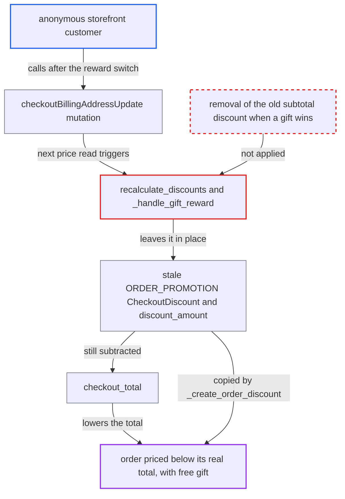

# Gift reward replacing a subtotal order promotion keeps the stale promotion discount

| Field | Value |
|---|---|
| ID | `find_01LumPucmyWmgfgwqoYDtK8j` |
| Severity | **Medium** |
| Status | open |
| CWE | CWE-840 — Business logic error |
| Created | 2026-10-27T21:25:50.934681Z |
| Claude Security | https://claude.ai/security/findings/find_01LumPucmyWmgfgwqoYDtK8j |

## Description

An anonymous storefront customer can place an order with a promotion discount the checkout no longer qualifies for, on top of a free gift. The loss per order is capped by the old discount amount. It needs a channel with both a subtotal-discount promotion and a gift promotion, and a switch from the first to the second. The cause is that `_handle_gift_reward` creates the gift but never removes the earlier `ORDER_PROMOTION` `CheckoutDiscount` or resets `discount_amount`.

1. **Customer** builds a checkout while a subtotal-discount order promotion wins. The checkout gets a `CheckoutDiscount` of type `ORDER_PROMOTION` and a `discount_amount` (50 in the report's example).
2. **Merchant's promotion setup** changes which reward wins, with no customer action. The subtotal promotion ends (`Promotion.objects.active()` filters on `end_date`), or a gift promotion starts, or the gift variant becomes stocked or purchasable.
3. **Customer** calls `checkoutBillingAddressUpdate` and then reads prices. The mutation invalidates prices with `recalculate_discount=False`, so `remove_voucher_from_checkout` never zeroes the amount and the next read goes straight to `recalculate_discounts`. The same happens right after `checkoutAddPromoCode` with a gift card, or when the price TTL expires. ([`saleor/graphql/checkout/mutations/checkout_billing_address_update.py:102-108`](https://github.com/cx-benchmark/saleor/blob/c982006cc04c77a97def93218dedac8d715eb041/saleor/graphql/checkout/mutations/checkout_billing_address_update.py#L102-L108))
4. **`recalculate_discounts`** re-runs order promotions and the gift rule wins. It does not reset `checkout.discount_amount` first, so the full old amount stays and is saved. ([`saleor/checkout/calculations.py:513-552`](https://github.com/cx-benchmark/saleor/blob/c982006cc04c77a97def93218dedac8d715eb041/saleor/checkout/calculations.py#L513-L552))
5. **`create_checkout_discount_objects_for_order_promotions`** skips `_clear_checkout_discount` because a gift applied. `_handle_gift_reward` only creates the gift line and its line discount and returns `discount_object=None`. The old `CheckoutDiscount` row, `checkout_info.discounts`, `discount_name` and `translated_discount_name` stay unchanged. ([`saleor/discount/utils/checkout.py:243-261`](https://github.com/cx-benchmark/saleor/blob/c982006cc04c77a97def93218dedac8d715eb041/saleor/discount/utils/checkout.py#L243-L261))
6. **`checkout_total`** subtracts the stale discount while the gift line is priced at zero. The subtraction happens because `checkout_info.discounts` is not empty. For flat-rate taxes, `get_line_total_price_with_propagated_checkout_discount` spreads the same amount across the lines. ([`saleor/checkout/base_calculations.py:212-221`](https://github.com/cx-benchmark/saleor/blob/c982006cc04c77a97def93218dedac8d715eb041/saleor/checkout/base_calculations.py#L212-L221))
7. **`checkoutComplete`** creates the order with the stale discount. `_create_order_discount` copies the stale row into `order.discounts`, and nothing at completion checks that the promotion is still valid. ([`saleor/checkout/complete_checkout.py:1316-1337`](https://github.com/cx-benchmark/saleor/blob/c982006cc04c77a97def93218dedac8d715eb041/saleor/checkout/complete_checkout.py#L1316-L1337))

## Assessment

The attacker is an anonymous storefront customer. The merchant must have a channel with a subtotal-discount order promotion (for example `>=100: 25% off`) and a gift order promotion (for example `>=50: gift worth 20`). The customer builds a checkout while the subtotal rule wins. After that promotion ends, or once the gift becomes stocked or purchasable, the customer calls `checkoutBillingAddressUpdate` and reads prices. `checkoutAddPromoCode` with a gift card, or expiry of the price TTL, reaches the same recalculation. The same gap exists for draft and unconfirmed orders in `create_order_discount_objects_for_order_promotions`, where `propagate_order_discount_on_order_prices` re-applies the stale discount. Only staff-driven recalculations reach that path.

Impact: Orders are placed at the subtotal minus a discount the checkout no longer qualifies for, plus a free gift that should exclude it. The loss is capped by the stale rule's discount amount as computed when it last applied legitimately. An inconsistent `OrderDiscount` is also stored. Nothing is disclosed and service is not affected.

## Recommendation

The gift-reward branch of order-promotion evaluation leaves the mutually exclusive subtotal-discount object (`CheckoutDiscount` or `OrderDiscount` of type `ORDER_PROMOTION`) in place. It also does not reset `discount_amount`, `discount_name` and `translated_discount_name`, so two exclusive rewards coexist and the stale one keeps lowering the total.

Fix criteria: After every evaluation exactly one order-promotion reward is represented. When a gift rule wins, no `ORDER_PROMOTION` checkout or order discount remains, `checkout_info.discounts` holds none, and the discount amount and name fields are reset. This holds on the checkout and order paths and through every entry point: `recalculate_discounts`, `recalculate_checkout_discount` and order recalculation. Check: a checkout with a subtotal-promotion discount is re-evaluated after that promotion ends while a gift promotion applies. It ends with zero `ORDER_PROMOTION` checkout discounts and `discount_amount == 0`. Its total is subtotal plus shipping, and the resulting order has no stale discount.

## Evidence

**https://github.com/cx-benchmark/saleor**

- [`saleor/discount/utils/promotion.py:778-795`](https://github.com/cx-benchmark/saleor/blob/c982006cc04c77a97def93218dedac8d715eb041/saleor/discount/utils/promotion.py#L778-L795)
- [`saleor/discount/utils/checkout.py:243-261`](https://github.com/cx-benchmark/saleor/blob/c982006cc04c77a97def93218dedac8d715eb041/saleor/discount/utils/checkout.py#L243-L261)
- [`saleor/checkout/calculations.py:513-552`](https://github.com/cx-benchmark/saleor/blob/c982006cc04c77a97def93218dedac8d715eb041/saleor/checkout/calculations.py#L513-L552)
- [`saleor/graphql/checkout/mutations/checkout_billing_address_update.py:102-108`](https://github.com/cx-benchmark/saleor/blob/c982006cc04c77a97def93218dedac8d715eb041/saleor/graphql/checkout/mutations/checkout_billing_address_update.py#L102-L108)
- [`saleor/checkout/base_calculations.py:212-221`](https://github.com/cx-benchmark/saleor/blob/c982006cc04c77a97def93218dedac8d715eb041/saleor/checkout/base_calculations.py#L212-L221)
- [`saleor/checkout/complete_checkout.py:1316-1337`](https://github.com/cx-benchmark/saleor/blob/c982006cc04c77a97def93218dedac8d715eb041/saleor/checkout/complete_checkout.py#L1316-L1337)
- [`saleor/discount/utils/order.py:212-214`](https://github.com/cx-benchmark/saleor/blob/c982006cc04c77a97def93218dedac8d715eb041/saleor/discount/utils/order.py#L212-L214)

