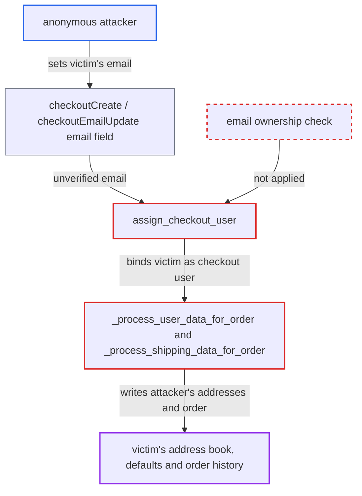

# Guest checkout email lets anonymous users write addresses and orders into another account

| Field | Value |
|---|---|
| ID | `find_014ruMywuSEMVDimToR1dvSU` |
| Severity | **Medium** |
| Status | open |
| CWE | CWE-639 — Authorization bypass |
| Created | 2026-10-27T21:18:51.642090Z |
| Claude Security | https://claude.ai/security/findings/find_014ruMywuSEMVDimToR1dvSU |

## Description

An anonymous user who knows a registered customer's email can add their own addresses to that customer's address book and plant orders in the customer's order history. The attacker needs no login and the victim does nothing. The cause is `assign_checkout_user`, which picks the account from the unverified `checkout.email`, and the order code then writes to that account. The attacker cannot read the victim's data.

1. **Anonymous attacker** sets a victim's email on a checkout. The attacker calls `checkoutCreate` with `email` set to the victim's address, or uses `checkoutEmailUpdate`. Neither call verifies that the caller owns the email, and the attacker also supplies their own billing and shipping addresses. ([`saleor/graphql/checkout/mutations/checkout_email_update.py:75-83`](https://github.com/cx-benchmark/saleor/blob/c982006cc04c77a97def93218dedac8d715eb041/saleor/graphql/checkout/mutations/checkout_email_update.py#L75-L83))
2. **Anonymous attacker** completes the checkout. The attacker picks a delivery method, pays for the order themselves (or uses a zero-total checkout) and calls `checkoutComplete`, which reaches the order code with `user=None`. ([`saleor/checkout/complete_checkout.py:1642`](https://github.com/cx-benchmark/saleor/blob/c982006cc04c77a97def93218dedac8d715eb041/saleor/checkout/complete_checkout.py#L1642))
3. **the function `assign_checkout_user`** binds the checkout to the victim's account. With an anonymous requester and no user on the checkout, it looks up an active `User` by `checkout.email` through `retrieve_user_by_email` and sets `checkout_info.user` to that account without checking ownership. ([`saleor/checkout/complete_checkout.py:1704-1714`](https://github.com/cx-benchmark/saleor/blob/c982006cc04c77a97def93218dedac8d715eb041/saleor/checkout/complete_checkout.py#L1704-L1714))
4. **the function `_process_user_data_for_order`** sets the order owner and stores the billing address on the victim. `order.user` becomes the victim. Because `save_billing_address` defaults to `True`, `store_user_address` is called with the attacker's billing address. ([`saleor/checkout/complete_checkout.py:277-294`](https://github.com/cx-benchmark/saleor/blob/c982006cc04c77a97def93218dedac8d715eb041/saleor/checkout/complete_checkout.py#L277-L294))
5. **the function `_process_shipping_data_for_order`** stores the attacker's shipping address on the victim. `_should_store_shipping_address_in_user_addresses` returns true for the bound user because `save_shipping_address` defaults to `True`. ([`saleor/checkout/complete_checkout.py:196-213`](https://github.com/cx-benchmark/saleor/blob/c982006cc04c77a97def93218dedac8d715eb041/saleor/checkout/complete_checkout.py#L196-L213))
6. **the function `store_user_address`** creates the addresses in the victim's address book. It stops at `MAX_USER_ADDRESSES`. If the victim has no default billing or shipping address, the attacker's address becomes the default. ([`saleor/account/utils.py:76-101`](https://github.com/cx-benchmark/saleor/blob/c982006cc04c77a97def93218dedac8d715eb041/saleor/account/utils.py#L76-L101))

## Assessment

The attacker is an anonymous internet user who knows a registered customer's email. No login, special setting or victim action is needed. Every completion path reaches the flawed code with `user=None`: `checkoutComplete` in the transaction flow and the legacy flow, `orderCreateFromCheckout` called by an app, and the automatic completion task. Linking guest orders to accounts by matching email is an intended feature. The report notes that nothing documents that an unverified guest may also change that account's address book and default addresses.

Impact: The attacker can add addresses of their choosing to the victim's address book, up to `MAX_USER_ADDRESSES`. They become the victim's default billing and shipping addresses when the victim has none, so a storefront that pre-fills defaults may suggest the attacker's address at the victim's next checkout. The attacker can also plant orders in the victim's order history and raise `number_of_orders`. Nothing is disclosed, because the `Order.user` resolver is limited to the owner or staff, and the service stays available.

## Recommendation

(1) `_process_user_data_for_order` and `_process_shipping_data_for_order` write addresses into the address book of `checkout_info.user` and set its defaults. They do this even when `assign_checkout_user` took that user from the unverified checkout email instead of from the authenticated requester.

Fix criteria: A guest checkout completed with a registered email creates no addresses on that account and changes none of its default addresses. Only the authenticated owner, or a privileged attach such as `checkoutCustomerAttach`, may cause address-book writes. To verify, complete an anonymous checkout with a registered user's email, leaving `saveBillingAddress` and `saveShippingAddress` at their defaults. The user's `addresses`, `default_billing_address` and `default_shipping_address` must stay unchanged.

(2) An unverified, attacker-supplied email decides which existing account owns the new order.

Fix criteria: If guest orders stay linked to accounts by email, the link gives the guest no power to change that account beyond adding the order. Alternatively, the link waits until the account owner confirms the email, as `match_orders_with_new_user` already does. An anonymous checkout with a registered email changes only what the owner has accepted.

## Evidence

**https://github.com/cx-benchmark/saleor**

- [`saleor/checkout/complete_checkout.py:1704-1714`](https://github.com/cx-benchmark/saleor/blob/c982006cc04c77a97def93218dedac8d715eb041/saleor/checkout/complete_checkout.py#L1704-L1714)
- [`saleor/checkout/complete_checkout.py:277-294`](https://github.com/cx-benchmark/saleor/blob/c982006cc04c77a97def93218dedac8d715eb041/saleor/checkout/complete_checkout.py#L277-L294)
- [`saleor/checkout/complete_checkout.py:196-213`](https://github.com/cx-benchmark/saleor/blob/c982006cc04c77a97def93218dedac8d715eb041/saleor/checkout/complete_checkout.py#L196-L213)
- [`saleor/checkout/complete_checkout.py:1642`](https://github.com/cx-benchmark/saleor/blob/c982006cc04c77a97def93218dedac8d715eb041/saleor/checkout/complete_checkout.py#L1642)
- [`saleor/account/utils.py:76-101`](https://github.com/cx-benchmark/saleor/blob/c982006cc04c77a97def93218dedac8d715eb041/saleor/account/utils.py#L76-L101)
- [`saleor/graphql/checkout/mutations/checkout_email_update.py:75-83`](https://github.com/cx-benchmark/saleor/blob/c982006cc04c77a97def93218dedac8d715eb041/saleor/graphql/checkout/mutations/checkout_email_update.py#L75-L83)

