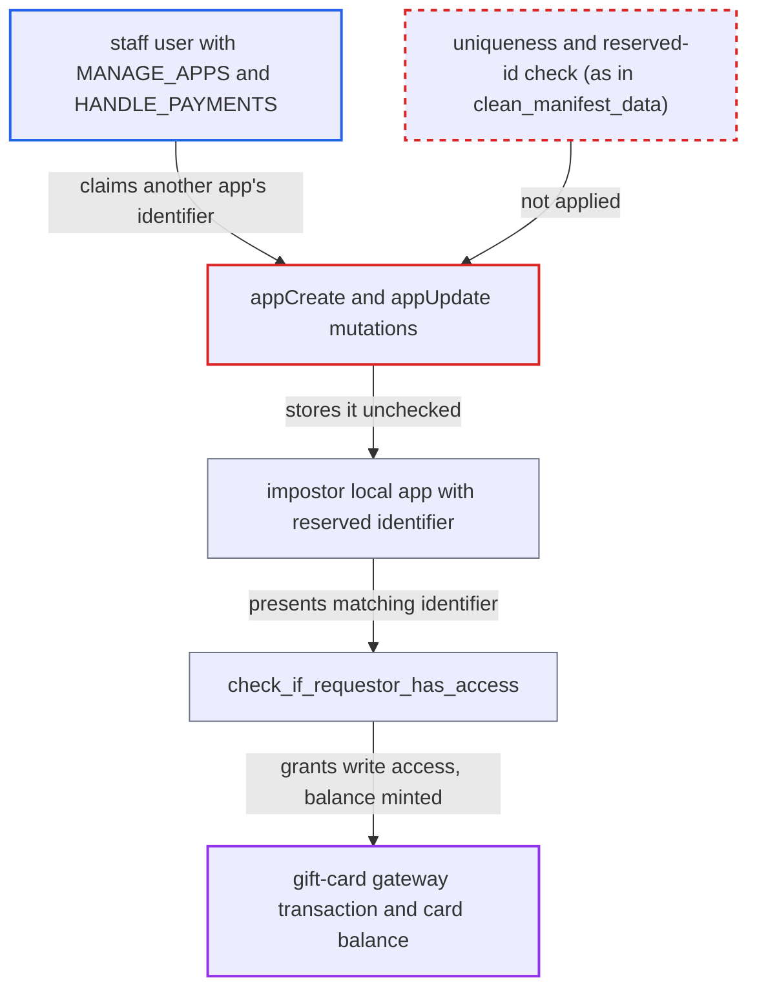

# Local apps can claim any app identifier, including the reserved gift-card gateway id

| Field | Value |
|---|---|
| ID | `find_01LvqYzfzbNgNGHqMmRS5nF4` |
| Severity | **Medium** |
| Status | open |
| CWE | CWE-290 — Authentication bypass by spoofing |
| Created | 2026-10-27T21:19:51.642546Z |
| Claude Security | https://claude.ai/security/findings/find_01LvqYzfzbNgNGHqMmRS5nF4 |

## Description

A staff user with `MANAGE_APPS` and `HANDLE_PAYMENTS` can create gift-card balance from nothing. They can also forge payment events on transactions owned by any installed payment app. The local-app mutations `appCreate` and `appUpdate` store a caller-supplied `identifier` without the uniqueness and reserved-id checks that the manifest install path applies.

1. **staff attacker** creates a local app with the reserved identifier. The attacker calls `appCreate` with `identifier` set to `saleor.io.gift-card-payment-gateway` and `permissions` set to `HANDLE_PAYMENTS`, and receives a token. ([`saleor/graphql/app/mutations/app_create.py:64-74`](https://github.com/cx-benchmark/saleor/blob/c982006cc04c77a97def93218dedac8d715eb041/saleor/graphql/app/mutations/app_create.py#L64-L74))
2. **`appCreate` and `appUpdate`** store the identifier unchanged. Both mutations validate only `permissions`, and `App.identifier` has no uniqueness constraint, so nothing stops the duplicate. ([`saleor/app/models.py:63`](https://github.com/cx-benchmark/saleor/blob/c982006cc04c77a97def93218dedac8d715eb041/saleor/app/models.py#L63))
3. **staff attacker** starts a gift-card gateway transaction on a checkout. Using a gift card they hold, the attacker runs `transactionInitialize` with the gift-card gateway, which creates a transaction with `app_identifier` set to `GIFT_CARD_PAYMENT_GATEWAY_ID` and no app or user owner. ([`saleor/giftcard/gateway.py:107-112`](https://github.com/cx-benchmark/saleor/blob/c982006cc04c77a97def93218dedac8d715eb041/saleor/giftcard/gateway.py#L107-L112))
4. **`check_if_requestor_has_access()`** accepts the impostor token as the owner. The check passes any app whose `identifier` equals `transaction.app_identifier`. ([`saleor/graphql/payment/utils.py:40-46`](https://github.com/cx-benchmark/saleor/blob/c982006cc04c77a97def93218dedac8d715eb041/saleor/graphql/payment/utils.py#L40-L46))
5. **staff attacker** reports a CHARGE_SUCCESS of any amount with `transactionEventReport`. The mutation records the event and recalculates the amounts, which raises `charged_value` to the forged amount, for example 10000. ([`saleor/graphql/payment/mutations/transaction/transaction_event_report.py:320-330`](https://github.com/cx-benchmark/saleor/blob/c982006cc04c77a97def93218dedac8d715eb041/saleor/graphql/payment/mutations/transaction/transaction_event_report.py#L320-L330))
6. **staff attacker** requests a REFUND with `transactionRequestAction`. The refund is capped only at `charged_value`, which the attacker has inflated. ([`saleor/graphql/payment/mutations/transaction/transaction_request_action.py:134-150`](https://github.com/cx-benchmark/saleor/blob/c982006cc04c77a97def93218dedac8d715eb041/saleor/graphql/payment/mutations/transaction/transaction_request_action.py#L134-L150))
7. **`refund_gift_card_transaction()`** credits the refund amount to the attached gift card. It adds the amount to `current_balance_amount`, so spendable balance is created from nothing. ([`saleor/giftcard/gateway.py:418-444`](https://github.com/cx-benchmark/saleor/blob/c982006cc04c77a97def93218dedac8d715eb041/saleor/giftcard/gateway.py#L418-L444))

## Assessment

The attacker is a staff user who holds both `MANAGE_APPS` and `HANDLE_PAYMENTS`. No victim action is needed. For the gift-card case the attacker also needs a gift card they hold. The same identifier collision also works against any installed payment app: the impostor can use `appCreate`, or `appUpdate` to change an existing app's identifier, and then forge events of any amount on that app's transactions. The report says diverting payment sessions and refund requests is not an extra gain, because `MANAGE_APPS` staff can already retarget webhooks through `webhookUpdate`.

Impact: The attacker can mint any amount of gift-card balance, which is spendable store credit that normally only `MANAGE_GIFT_CARD` can set. They can also forge payment state on transactions that the API reserves to the owning app. The report says no extra data is disclosed and the service is not degraded.

## Recommendation

`appCreate` and `appUpdate` trust a caller-supplied `identifier`, although the identifier decides who owns a payment transaction in `check_if_requestor_has_access`. The uniqueness and reserved-id rules exist only in the manifest path.

Fix criteria: `appCreate` and `appUpdate` reject an `identifier` equal to any non-removed app's identifier or to `GIFT_CARD_PAYMENT_GATEWAY_ID`, using the same rules as `clean_manifest_data`. A database constraint on non-removed apps backs this. Creating or updating a local app with an installed app's identifier, or with `saleor.io.gift-card-payment-gateway`, fails. No app token passes the ownership check on gift-card gateway transactions.

## Evidence

**https://github.com/cx-benchmark/saleor**

- [`saleor/graphql/app/mutations/app_create.py:64-74`](https://github.com/cx-benchmark/saleor/blob/c982006cc04c77a97def93218dedac8d715eb041/saleor/graphql/app/mutations/app_create.py#L64-L74)
- [`saleor/graphql/app/mutations/app_update.py:49-66`](https://github.com/cx-benchmark/saleor/blob/c982006cc04c77a97def93218dedac8d715eb041/saleor/graphql/app/mutations/app_update.py#L49-L66)
- [`saleor/app/models.py:63`](https://github.com/cx-benchmark/saleor/blob/c982006cc04c77a97def93218dedac8d715eb041/saleor/app/models.py#L63)
- [`saleor/app/manifest_validations.py:150-168`](https://github.com/cx-benchmark/saleor/blob/c982006cc04c77a97def93218dedac8d715eb041/saleor/app/manifest_validations.py#L150-L168)
- [`saleor/graphql/payment/utils.py:40-46`](https://github.com/cx-benchmark/saleor/blob/c982006cc04c77a97def93218dedac8d715eb041/saleor/graphql/payment/utils.py#L40-L46)
- [`saleor/graphql/payment/mutations/transaction/transaction_event_report.py:320-330`](https://github.com/cx-benchmark/saleor/blob/c982006cc04c77a97def93218dedac8d715eb041/saleor/graphql/payment/mutations/transaction/transaction_event_report.py#L320-L330)
- [`saleor/giftcard/gateway.py:107-112`](https://github.com/cx-benchmark/saleor/blob/c982006cc04c77a97def93218dedac8d715eb041/saleor/giftcard/gateway.py#L107-L112)
- [`saleor/graphql/payment/mutations/transaction/transaction_request_action.py:134-150`](https://github.com/cx-benchmark/saleor/blob/c982006cc04c77a97def93218dedac8d715eb041/saleor/graphql/payment/mutations/transaction/transaction_request_action.py#L134-L150)
- [`saleor/giftcard/gateway.py:418-444`](https://github.com/cx-benchmark/saleor/blob/c982006cc04c77a97def93218dedac8d715eb041/saleor/giftcard/gateway.py#L418-L444)

