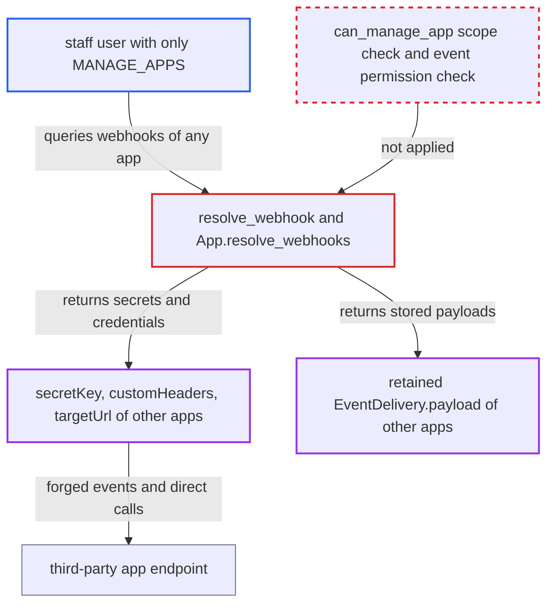

# MANAGE_APPS staff read secrets and retained payloads of out-of-scope apps' webhooks

| Field | Value |
|---|---|
| ID | `find_014DVRuKeoBedNjAQfD3auqi` |
| Severity | **Medium** |
| Status | open |
| CWE | CWE-285 — Missing authorization |
| Created | 2026-10-27T21:44:31.997065Z |
| Claude Security | https://claude.ai/security/findings/find_014DVRuKeoBedNjAQfD3auqi |

## Description

A staff user whose only permission is `MANAGE_APPS` can read the signing secrets, request headers, endpoint credentials and retained event payloads of other apps' webhooks. This includes apps that hold wider permissions than the staff user. The webhook read paths `resolve_webhook` and `App.resolve_webhooks` check only `MANAGE_APPS`. They skip the `can_manage_app` scope rule and the event-permission rule that the project applies elsewhere.

1. **staff user with only `MANAGE_APPS`** sends a GraphQL query to `/graphql/` asking for apps and their webhooks. The query asks for `secretKey`, `customHeaders`, `targetUrl` and `eventDeliveries` with `status` and `payload`, and can also list each app's `permissions`. ([`saleor/graphql/app/types.py:777-781`](https://github.com/cx-benchmark/saleor/blob/c982006cc04c77a97def93218dedac8d715eb041/saleor/graphql/app/types.py#L777-L781))
2. **the resolvers `resolve_webhook` and `App.resolve_webhooks`** return the webhooks of every app that is not removed. The only check is that the requester holds `MANAGE_APPS`. `can_manage_app` is never called and the requester's permissions are never compared with the app's. ([`saleor/graphql/webhook/resolvers.py:16-33`](https://github.com/cx-benchmark/saleor/blob/c982006cc04c77a97def93218dedac8d715eb041/saleor/graphql/webhook/resolvers.py#L16-L33))
3. **the `Webhook` type** hands out `secretKey`, `customHeaders` and `targetUrl` of each webhook. These fields have no check beyond reaching the node. ([`saleor/graphql/webhook/types.py:187-206`](https://github.com/cx-benchmark/saleor/blob/c982006cc04c77a97def93218dedac8d715eb041/saleor/graphql/webhook/types.py#L187-L206))
4. **`EventDelivery.payload`** returns the stored payload of each delivery reachable through `eventDeliveries`. The payload was rendered with the owning app's permissions, so it can hold data that the reader may not see, such as orders, customer personal data, gift-card codes or a `StaffSetPasswordRequested.token`. ([`saleor/webhook/transport/asynchronous/transport.py:129-139`](https://github.com/cx-benchmark/saleor/blob/c982006cc04c77a97def93218dedac8d715eb041/saleor/webhook/transport/asynchronous/transport.py#L129-L139))
5. **Saleor's delivery cleanup** keeps payloads of deliveries that did not succeed. Failed deliveries keep their payload until `delete_event_payloads_task` removes them, which is 14 days by default. ([`saleor/webhook/transport/asynchronous/transport.py:869-886`](https://github.com/cx-benchmark/saleor/blob/c982006cc04c77a97def93218dedac8d715eb041/saleor/webhook/transport/asynchronous/transport.py#L869-L886))
6. **staff user with only `MANAGE_APPS`** uses what was read. The `secretKey` signs forged events, `customHeaders` and `targetUrl` credentials reach the app's endpoint, and a retained token can be redeemed through `setPassword`.

## Assessment

The attacker is a staff user whose only permission is `MANAGE_APPS`, logged in to `/graphql/`. They query `apps` with `webhooks` and their fields. The response then includes webhooks of apps holding `MANAGE_ORDERS`, `MANAGE_USERS`, `MANAGE_STAFF` or `HANDLE_PAYMENTS`. Another way in is `resolve_webhook`, which returns a single webhook of any app that is not removed. Payloads appear only for deliveries that did not succeed and are still within the retention period. Secrets appear only where the app has set them.

Impact: The attacker reads credentials and permission-gated business data that `MANAGE_APPS` alone does not grant, and that `webhookDryRun` and `webhookTrigger` refuse to render for them. A retained `StaffSetPasswordRequested` token can be redeemed through `setPassword` to take over a staff account, but only if such a payload exists.

Subsequent-system impact: The third-party apps that receive webhooks are affected. With the `secretKey` the attacker can send forged, validly signed events to the app's `targetUrl`. With credentials from `customHeaders` or `targetUrl` they can call the app's protected endpoint or queue directly. The effect is limited by what the app does with inbound events.

## Recommendation

`resolve_webhook` and `App.resolve_webhooks` give access to any app's webhooks on `MANAGE_APPS` alone. The `Webhook` and `EventDelivery` types return secrets and stored payloads to anyone who reaches the node.

Fix criteria: A requester who is neither the owning app nor a superuser gets no `secretKey`, `customHeaders`, credentials embedded in `targetUrl`, `EventDelivery.payload` or attempt `requestHeaders` of a webhook. The exception is when `can_manage_app(requester, webhook.app)` holds, or, for payloads, when they hold the event's permission. Test: a staff user holding only `MANAGE_APPS` queries a webhook of an app with `MANAGE_ORDERS` and gets a permission error or null for these fields. The owning app still reads them.

## Evidence

**https://github.com/cx-benchmark/saleor**

- [`saleor/graphql/webhook/resolvers.py:16-33`](https://github.com/cx-benchmark/saleor/blob/c982006cc04c77a97def93218dedac8d715eb041/saleor/graphql/webhook/resolvers.py#L16-L33)
- [`saleor/graphql/app/types.py:777-781`](https://github.com/cx-benchmark/saleor/blob/c982006cc04c77a97def93218dedac8d715eb041/saleor/graphql/app/types.py#L777-L781)
- [`saleor/graphql/webhook/types.py:187-206`](https://github.com/cx-benchmark/saleor/blob/c982006cc04c77a97def93218dedac8d715eb041/saleor/graphql/webhook/types.py#L187-L206)
- [`saleor/graphql/webhook/types.py:144-148`](https://github.com/cx-benchmark/saleor/blob/c982006cc04c77a97def93218dedac8d715eb041/saleor/graphql/webhook/types.py#L144-L148)
- [`saleor/webhook/transport/asynchronous/transport.py:129-139`](https://github.com/cx-benchmark/saleor/blob/c982006cc04c77a97def93218dedac8d715eb041/saleor/webhook/transport/asynchronous/transport.py#L129-L139)
- [`saleor/webhook/transport/asynchronous/transport.py:869-886`](https://github.com/cx-benchmark/saleor/blob/c982006cc04c77a97def93218dedac8d715eb041/saleor/webhook/transport/asynchronous/transport.py#L869-L886)
- [`saleor/core/tasks.py:66-77`](https://github.com/cx-benchmark/saleor/blob/c982006cc04c77a97def93218dedac8d715eb041/saleor/core/tasks.py#L66-L77)
- [`saleor/graphql/webhook/mutations/webhook_dry_run.py:86-98`](https://github.com/cx-benchmark/saleor/blob/c982006cc04c77a97def93218dedac8d715eb041/saleor/graphql/webhook/mutations/webhook_dry_run.py#L86-L98)
- [`saleor/webhook/transport/__init__.py:7-11`](https://github.com/cx-benchmark/saleor/blob/c982006cc04c77a97def93218dedac8d715eb041/saleor/webhook/transport/__init__.py#L7-L11)
- [`saleor/graphql/account/utils.py:101-106`](https://github.com/cx-benchmark/saleor/blob/c982006cc04c77a97def93218dedac8d715eb041/saleor/graphql/account/utils.py#L101-L106)

