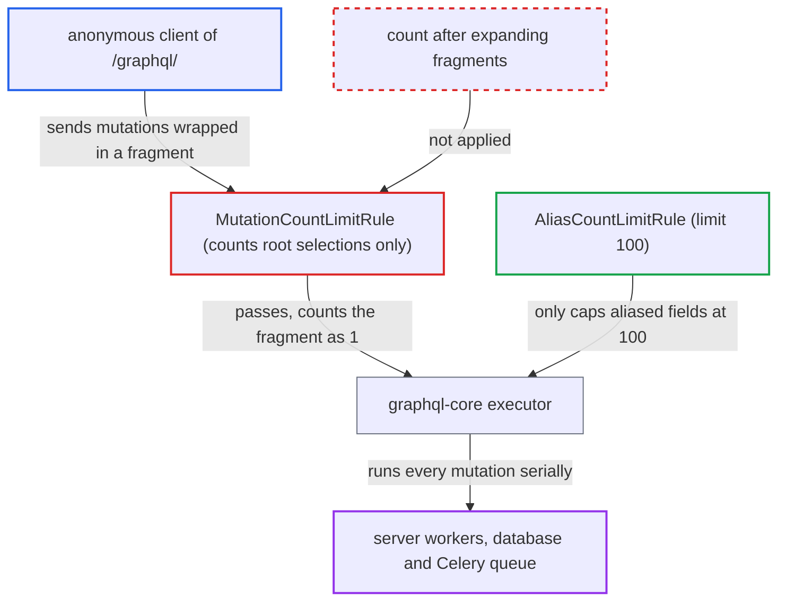

# Mutation count limit bypassed by placing mutations inside root fragments

| Field | Value |
|---|---|
| ID | `find_018J2CQKCTASo4SHdwowuFmH` |
| Severity | **Medium** |
| Status | open |
| CWE | CWE-770 — Resource allocation without limits |
| Created | 2026-10-27T21:25:37.775395Z |
| Claude Security | https://claude.ai/security/findings/find_018J2CQKCTASo4SHdwowuFmH |

## Description

An anonymous client can make one request to `/graphql/` run roughly 100 times more mutations than the intended limit of 4. That can tie up workers with password hashing, database writes and Celery tasks. No data is disclosed or changed. The rule `MutationCountLimitRule` counts only the operation's direct children, so mutations wrapped in a fragment count as 1.

1. **anonymous client** posts one mutation document whose only root selection is a fragment. The fragment is `... on Mutation { ... }` or a spread `...M` with `fragment M on Mutation`, and it holds many mutation fields, for example aliased `accountRegister` calls.
2. **the rule `MutationCountLimitRule`** counts the operation's root selections with `len(node.selection_set.selections)`. A fragment spread or inline fragment at the root counts as 1, however many mutation fields it expands to, so the count stays under `GRAPHQL_MUTATION_COUNT_LIMIT` (default 4). ([`saleor/graphql/core/validators/mutation_count_limit_rule.py:23-25`](https://github.com/cx-benchmark/saleor/blob/c982006cc04c77a97def93218dedac8d715eb041/saleor/graphql/core/validators/mutation_count_limit_rule.py#L23-L25))
3. **the function `validate_query`** runs the other rules and finds nothing to reject. `AliasCountLimitRule` allows up to 100 aliased fields, and the cost validator gives `Mutation` fields no cost, so no rule reports an error. ([`saleor/graphql/core/validators/__init__.py:36-59`](https://github.com/cx-benchmark/saleor/blob/c982006cc04c77a97def93218dedac8d715eb041/saleor/graphql/core/validators/__init__.py#L36-L59))
4. **the view in `views.py`** executes the document because no rule reported an error. The request is rejected only when a validation rule reports an error, and `document.execute` then runs every root field the executor collects through the fragments. ([`saleor/graphql/views.py:478-500`](https://github.com/cx-benchmark/saleor/blob/c982006cc04c77a97def93218dedac8d715eb041/saleor/graphql/views.py#L478-L500))
5. **the executor (graphql-core 2.3.2)** expands the fragments and runs every collected mutation field one after another. Each `accountRegister` call hashes the supplied password and enqueues `finish_creating_user`, even when the email already exists. ([`saleor/graphql/account/mutations/account/account_register.py:232-251`](https://github.com/cx-benchmark/saleor/blob/c982006cc04c77a97def93218dedac8d715eb041/saleor/graphql/account/mutations/account/account_register.py#L232-L251))

## Assessment

Any anonymous client of `/graphql/` can do this, such as a storefront user. No login, victim action or special configuration is needed. The attacker posts a mutation whose root selection is an inline fragment `... on Mutation { ... }`, or a fragment spread `...M` with `fragment M on Mutation`. Inside it go up to 100 aliased fields, such as `accountRegister`, optionally followed by other distinct mutation fields. The remaining bound is 100 aliased fields (`GRAPHQL_ALIAS_COUNT_LIMIT`) plus one run of each distinct unaliased `Mutation` field (346 in the schema). Batching is held separately to `GRAPHQL_BATCH_MAX_COUNT=1`.

Impact: One request can do about 100 times the mutation work the shipped limit allows: password hashing, database writes, Celery tasks and webhooks. A few such requests can hold workers for long periods, and per-request rate limiting in front of the API loses its effect. Not every mutation gains from this. `tokenCreate` is still throttled per attempt, with an IP block of at least 1 s, so extra login attempts in the same request fail. The total per request stays bounded by the alias limit and the schema size.

## Recommendation

`MutationCountLimitRule` counts only the operation's direct selections. It does not expand fragment spreads or inline fragments on the `Mutation` root type, so a document can run far more root mutation fields than `GRAPHQL_MUTATION_COUNT_LIMIT` allows.

Fix criteria: The limit applies to the number of root mutation fields actually executed, counted after recursively expanding fragment spreads and inline fragments. `mutation { ...M }` with a fragment of 5 mutation fields is rejected with the same error as 5 direct fields. `mutation { ... on Mutation { ... on Mutation { 5 fields } } }` is rejected the same way. The existing alias and multiple-operation cases are still rejected.

## Evidence

**https://github.com/cx-benchmark/saleor**

- [`saleor/graphql/core/validators/mutation_count_limit_rule.py:23-25`](https://github.com/cx-benchmark/saleor/blob/c982006cc04c77a97def93218dedac8d715eb041/saleor/graphql/core/validators/mutation_count_limit_rule.py#L23-L25)
- [`saleor/graphql/core/validators/__init__.py:36-59`](https://github.com/cx-benchmark/saleor/blob/c982006cc04c77a97def93218dedac8d715eb041/saleor/graphql/core/validators/__init__.py#L36-L59)
- [`saleor/graphql/views.py:478-500`](https://github.com/cx-benchmark/saleor/blob/c982006cc04c77a97def93218dedac8d715eb041/saleor/graphql/views.py#L478-L500)
- [`saleor/graphql/core/validators/alias_count_limit_rule.py:23-28`](https://github.com/cx-benchmark/saleor/blob/c982006cc04c77a97def93218dedac8d715eb041/saleor/graphql/core/validators/alias_count_limit_rule.py#L23-L28)
- [`saleor/settings.py:898-902`](https://github.com/cx-benchmark/saleor/blob/c982006cc04c77a97def93218dedac8d715eb041/saleor/settings.py#L898-L902)
- [`saleor/graphql/account/mutations/account/account_register.py:232-251`](https://github.com/cx-benchmark/saleor/blob/c982006cc04c77a97def93218dedac8d715eb041/saleor/graphql/account/mutations/account/account_register.py#L232-L251)

