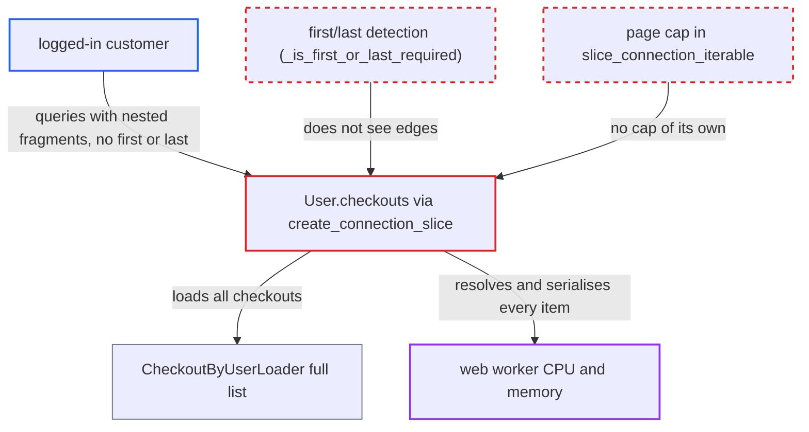

# Nested or merged selections bypass first/last requirement on list-backed connections

| Field | Value |
|---|---|
| ID | `find_012THZzNSyVsCxLQVwZK2MuR` |
| Severity | **Medium** |
| Status | open |
| CWE | CWE-770 — Resource exhaustion |
| Created | 2026-10-27T21:25:45.886254Z |
| Claude Security | https://claude.ai/security/findings/find_012THZzNSyVsCxLQVwZK2MuR |

## Description

A logged-in customer can make one cheap GraphQL request that returns an unbounded list of their own objects, such as checkouts. This can degrade the shared web worker's CPU and memory. The attacker needs a customer account and many checkouts, and the query must nest fragments or select the same field twice. The cause is `_is_first_or_last_required` and `_edges_in_selections` missing `edges`, so no `first` or `last` is demanded and `slice_connection_iterable` returns the whole list.

1. **attacker (customer)** creates many checkouts with `checkoutCreate`. The mutation assigns the caller as the checkout's user with no per-user cap, so the attacker controls how long the list grows. ([`saleor/graphql/checkout/mutations/checkout_create.py:525-531`](https://github.com/cx-benchmark/saleor/blob/c982006cc04c77a97def93218dedac8d715eb041/saleor/graphql/checkout/mutations/checkout_create.py#L525-L531))
2. **attacker** sends a query on `me { checkouts }` with no `first` or `last`, hiding `edges` in nested fragments or a second selection of the same field. The query is either `...A` leading to `...B` where `B` holds `edges`, or `checkouts { totalCount } checkouts { edges { ... } }`, optionally repeated under up to 100 aliases. ([`saleor/graphql/account/types.py:723-743`](https://github.com/cx-benchmark/saleor/blob/c982006cc04c77a97def93218dedac8d715eb041/saleor/graphql/account/types.py#L723-L743))
3. **the check `_is_first_or_last_required`** fails to see `edges` and returns False. It reads only `info.field_asts[0]`, and `_edges_in_selections` does not recurse into a fragment spread nested in another fragment. ([`saleor/graphql/core/connection.py:404-441`](https://github.com/cx-benchmark/saleor/blob/c982006cc04c77a97def93218dedac8d715eb041/saleor/graphql/core/connection.py#L404-L441))
4. **the function `_validate_slice_args`** raises no error and applies no clamp. The 'must provide first or last' error and the `max_limit` clamp apply only when detection succeeds or an argument is present. ([`saleor/graphql/core/connection.py:369-401`](https://github.com/cx-benchmark/saleor/blob/c982006cc04c77a97def93218dedac8d715eb041/saleor/graphql/core/connection.py#L369-L401))
5. **the function `slice_connection_iterable`** passes the whole dataloader list to `connection_from_list_slice`. It has no page cap of its own, so every element becomes an edge and is resolved and serialised with its nested fields. ([`saleor/graphql/core/connection.py:444-462`](https://github.com/cx-benchmark/saleor/blob/c982006cc04c77a97def93218dedac8d715eb041/saleor/graphql/core/connection.py#L444-L462))

## Assessment

The attacker registers or logs in as a customer and creates many checkouts with `checkoutCreate`. They then query `me { checkouts }` without `first` or `last`, using one of two shapes. One is a fragment spread nested inside another fragment. The other is the same field selected twice under one response key, where graphql-core 2.3.2 merges both selections and runs the second one's `edges`. The query can be repeated under up to 100 aliases. An inline fragment inside a named fragment makes `_edges_in_selections` raise instead. The threat model exposes `/graphql/` to internet customers. Other list-backed fields are affected the same way: `User.giftCards`, `Category.children` and, for staff, `Warehouse.stocks`. Queryset-backed connections are safe, because they return no edges when no `first` or `last` is given.

Impact: The attacker defeats the documented limit of 100 objects per connection on list-backed fields. One cheap request then resolves and serialises a result set whose size the attacker grows, which degrades the shared web worker's CPU and memory. The data returned is the requester's own, and the report does not show a total outage.

## Recommendation

(1) `_is_first_or_last_required` and `_edges_in_selections` do not walk the full merged selection set. They read only the first field AST and do not follow fragment spreads nested in fragments or inline fragments inside named fragments, so the `first`/`last` requirement can be evaded.

Fix criteria: Detection of `edges` covers every valid selection shape: all merged field ASTs of the field, with fragment spreads and inline fragments followed at any depth. The query `connection { ...A } fragment A on X { ...B } fragment B on X { edges { node { id } } }` without `first`/`last` is rejected with the 'You must provide a `first` or `last` value' error. The query `connection { totalCount } connection { edges { node { id } } }` without `first`/`last` is rejected with the same error.

(2) `slice_connection_iterable` has no page cap of its own and relies entirely on the upstream argument check, so any evasion of that check returns the whole list.

Fix criteria: A list-backed connection never returns more than `GRAPHQL_PAGINATION_LIMIT` (or the field's `max_limit`) edges, whatever arguments are supplied. A list-backed connection queried without `first`/`last` returns at most that many edges.

## Evidence

**https://github.com/cx-benchmark/saleor**

- [`saleor/graphql/core/connection.py:404-441`](https://github.com/cx-benchmark/saleor/blob/c982006cc04c77a97def93218dedac8d715eb041/saleor/graphql/core/connection.py#L404-L441)
- [`saleor/graphql/core/connection.py:369-401`](https://github.com/cx-benchmark/saleor/blob/c982006cc04c77a97def93218dedac8d715eb041/saleor/graphql/core/connection.py#L369-L401)
- [`saleor/graphql/core/connection.py:444-462`](https://github.com/cx-benchmark/saleor/blob/c982006cc04c77a97def93218dedac8d715eb041/saleor/graphql/core/connection.py#L444-L462)
- [`saleor/graphql/account/types.py:723-743`](https://github.com/cx-benchmark/saleor/blob/c982006cc04c77a97def93218dedac8d715eb041/saleor/graphql/account/types.py#L723-L743)
- [`saleor/graphql/checkout/dataloaders/models.py:19-29`](https://github.com/cx-benchmark/saleor/blob/c982006cc04c77a97def93218dedac8d715eb041/saleor/graphql/checkout/dataloaders/models.py#L19-L29)
- [`saleor/graphql/checkout/mutations/checkout_create.py:525-531`](https://github.com/cx-benchmark/saleor/blob/c982006cc04c77a97def93218dedac8d715eb041/saleor/graphql/checkout/mutations/checkout_create.py#L525-L531)
- [`saleor/graphql/core/fields.py:88-109`](https://github.com/cx-benchmark/saleor/blob/c982006cc04c77a97def93218dedac8d715eb041/saleor/graphql/core/fields.py#L88-L109)

