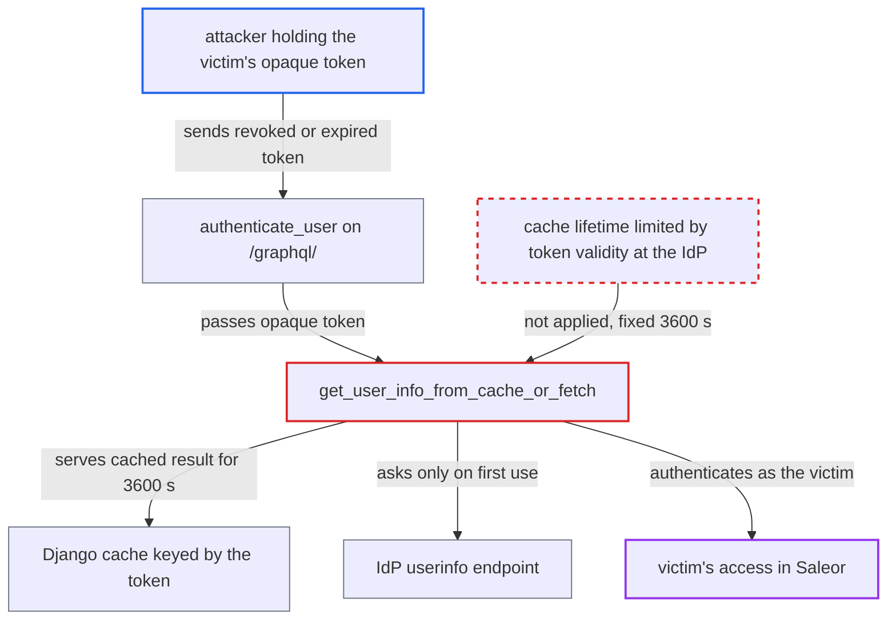

# OIDC opaque access tokens accepted for a fixed hour regardless of IdP expiry or revocation

| Field | Value |
|---|---|
| ID | `find_01PQHKJSSjkGpTmPCJJ4zety` |
| Severity | **Medium** |
| Status | open |
| CWE | CWE-613 — Insufficient session expiration |
| Created | 2026-10-27T21:21:28.740260Z |
| Claude Security | https://claude.ai/security/findings/find_01PQHKJSSjkGpTmPCJJ4zety |

## Description

An attacker who holds a victim's opaque IdP access token can keep using it on `/graphql/` for up to an hour after the IdP revoked it or it expired. Requests run as the victim, with only the victim's rights. The attack needs the OpenID Connect plugin in access-token mode with an opaque-token IdP. The cause is `get_user_info_from_cache_or_fetch`, which caches the userinfo result for a fixed 3600 s when `exp_time` is `None`.

1. **the victim or the attacker** sends the opaque access token once to `/graphql/` while it is still valid. This first use fills the cache, and the one-hour window starts here. ([`saleor/plugins/openid_connect/plugin.py:561-573`](https://github.com/cx-benchmark/saleor/blob/c982006cc04c77a97def93218dedac8d715eb041/saleor/plugins/openid_connect/plugin.py#L561-L573))
2. **`decode_access_token`** returns `None` for the token. A token that is not JWT-shaped, or a JWT-shaped token that fails local decoding, gets no local check. Its only check is the IdP userinfo call. ([`saleor/plugins/openid_connect/utils.py:176-182`](https://github.com/cx-benchmark/saleor/blob/c982006cc04c77a97def93218dedac8d715eb041/saleor/plugins/openid_connect/utils.py#L176-L182))
3. **`get_user_from_oauth_access_token`** calls the cache helper with `exp_time=None`. With no expiry passed, the cache lifetime is not tied to the token's real lifetime. ([`saleor/plugins/openid_connect/utils.py:305-307`](https://github.com/cx-benchmark/saleor/blob/c982006cc04c77a97def93218dedac8d715eb041/saleor/plugins/openid_connect/utils.py#L305-L307))
4. **`get_user_info_from_cache_or_fetch`** stores the userinfo response in the Django cache under the raw token for 3600 s. The fixed `USER_INFO_DEFAULT_CACHE_TIME` is used. Later cache hits do not extend it and do not contact the IdP. ([`saleor/plugins/openid_connect/utils.py:107-127`](https://github.com/cx-benchmark/saleor/blob/c982006cc04c77a97def93218dedac8d715eb041/saleor/plugins/openid_connect/utils.py#L107-L127))
5. **the IdP or the victim** revokes the token, or the token expires. Examples of revocation are logout, an admin session kill, withdrawn consent, or an account disabled at the IdP. Saleor is not told.
6. **the attacker** sends the same token as `Authorization: Bearer` to `/graphql/`. `authenticate_user` passes it on, and the answer comes from the cache without asking the IdP. ([`saleor/plugins/openid_connect/plugin.py:561-573`](https://github.com/cx-benchmark/saleor/blob/c982006cc04c77a97def93218dedac8d715eb041/saleor/plugins/openid_connect/plugin.py#L561-L573))
7. **Saleor** authenticates the request as the victim until the hour ends. Only Saleor's own `is_active` flag is rechecked, and `tokensDeactivateAll` has no effect on this path. ([`saleor/plugins/openid_connect/utils.py:497-498`](https://github.com/cx-benchmark/saleor/blob/c982006cc04c77a97def93218dedac8d715eb041/saleor/plugins/openid_connect/utils.py#L497-L498))

## Assessment

The attacker holds a victim's opaque IdP access token, for example leaked from a client, a log or a proxy. The token has to be used once against Saleor while it is valid, by the victim or by the attacker. The victim or the IdP admin then revokes it, or it expires. The attacker then sends it to the public `/graphql/` endpoint. This needs the plugin to accept IdP access tokens as bearer credentials (`user_info_url` and `json_web_key_set_url` set) and an IdP that issues opaque tokens. A JWT-shaped token that fails local decoding takes the same path. Many opaque-token providers issue tokens that live an hour or longer, so revocation is the main case. Expiry matters only for IdPs set to shorter lifetimes.

Impact: The attacker keeps the victim's access for up to one hour after the IdP stopped honouring the token. That means the victim's customer orders, addresses and checkout actions, or the victim's staff permissions. The gain is limited in time and to the victim's rights. It is access the attacker already had before the revocation or expiry. A Saleor admin can still cut it off by deactivating the user.

## Recommendation

`get_user_info_from_cache_or_fetch` caches userinfo for opaque tokens (`exp_time=None`) for a fixed 3600 s. Saleor's acceptance of the token is therefore separated from the IdP's view of its expiry and revocation.

Fix criteria: Saleor's acceptance of an opaque IdP access token never outlasts the token's validity at the provider by more than a short, documented interval. The cache TTL is limited by a known expiry (for example from token introspection) or kept short enough that revocation takes effect quickly. To verify, revoke an opaque token at the IdP, or let it expire there. `/graphql/` must then reject it within that short interval rather than after up to an hour.

## Evidence

**https://github.com/cx-benchmark/saleor**

- [`saleor/plugins/openid_connect/utils.py:107-127`](https://github.com/cx-benchmark/saleor/blob/c982006cc04c77a97def93218dedac8d715eb041/saleor/plugins/openid_connect/utils.py#L107-L127)
- [`saleor/plugins/openid_connect/utils.py:305-307`](https://github.com/cx-benchmark/saleor/blob/c982006cc04c77a97def93218dedac8d715eb041/saleor/plugins/openid_connect/utils.py#L305-L307)
- [`saleor/plugins/openid_connect/utils.py:176-182`](https://github.com/cx-benchmark/saleor/blob/c982006cc04c77a97def93218dedac8d715eb041/saleor/plugins/openid_connect/utils.py#L176-L182)
- [`saleor/plugins/openid_connect/utils.py:213-217`](https://github.com/cx-benchmark/saleor/blob/c982006cc04c77a97def93218dedac8d715eb041/saleor/plugins/openid_connect/utils.py#L213-L217)
- [`saleor/plugins/openid_connect/plugin.py:561-573`](https://github.com/cx-benchmark/saleor/blob/c982006cc04c77a97def93218dedac8d715eb041/saleor/plugins/openid_connect/plugin.py#L561-L573)
- [`saleor/plugins/openid_connect/utils.py:497-498`](https://github.com/cx-benchmark/saleor/blob/c982006cc04c77a97def93218dedac8d715eb041/saleor/plugins/openid_connect/utils.py#L497-L498)

