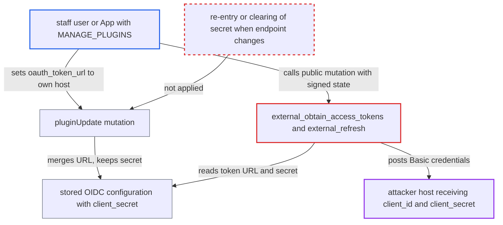

# OIDC plugin sends stored client_secret to a MANAGE_PLUGINS-controlled token URL

| Field | Value |
|---|---|
| ID | `find_01ES6sigrCSBDKxdbryE1Rx6` |
| Severity | **Medium** |
| Status | open |
| CWE | CWE-522 — Credential Exposure |
| Created | 2026-10-27T21:45:42.533105Z |
| Claude Security | https://claude.ai/security/findings/find_01ES6sigrCSBDKxdbryE1Rx6 |

## Description

A staff user or App with `MANAGE_PLUGINS` can obtain the OpenID Connect provider's `client_secret`, which that permission is not meant to let them read. They only need to point `oauth_token_url` at a host they control. The plugin must be active and configured. The weakness is that `pluginUpdate` keeps the stored secret when only the URL changes, and Saleor then sends the secret to the new URL.

1. **attacker with `MANAGE_PLUGINS`** calls `pluginUpdate` with only `oauth_token_url` set to a host they control. The mutation needs only `MANAGE_PLUGINS`, and Apps may call it as well as staff. ([`saleor/graphql/plugins/mutations.py:34-56`](https://github.com/cx-benchmark/saleor/blob/c982006cc04c77a97def93218dedac8d715eb041/saleor/graphql/plugins/mutations.py#L34-L56))
2. **`_update_config_items`** merges only the submitted fields into the stored configuration. The write-only `client_secret` is left untouched, so the real secret stays in place beside the new URL. ([`saleor/plugins/base_plugin.py:1741-1757`](https://github.com/cx-benchmark/saleor/blob/c982006cc04c77a97def93218dedac8d715eb041/saleor/plugins/base_plugin.py#L1741-L1757))
3. **`get_incorrect_fields`** accepts the changed configuration. It checks only that the URLs are syntactically valid and that `client_id` and `client_secret` exist, so no re-entry of the secret is required. ([`saleor/plugins/openid_connect/utils.py:701-757`](https://github.com/cx-benchmark/saleor/blob/c982006cc04c77a97def93218dedac8d715eb041/saleor/plugins/openid_connect/utils.py#L701-L757))
4. **attacker** calls the public `externalAuthenticationUrl` and copies the `state` value. The returned authorization URL carries a `state` signed by Saleor, which the next call accepts.
5. **attacker** calls the public `externalObtainAccessTokens` with `code` set to "x" and that `state`. The `code` value is chosen by the attacker. ([`saleor/plugins/openid_connect/plugin.py:323-326`](https://github.com/cx-benchmark/saleor/blob/c982006cc04c77a97def93218dedac8d715eb041/saleor/plugins/openid_connect/plugin.py#L323-L326))
6. **`external_obtain_access_tokens`** posts to the configured token URL through `self.oauth.fetch_token`. authlib's default `client_secret_basic` puts `client_id:client_secret` in the Basic `Authorization` header, so the attacker's host receives the secret, and the attacker can then restore the original URL. ([`saleor/plugins/openid_connect/plugin.py:323-326`](https://github.com/cx-benchmark/saleor/blob/c982006cc04c77a97def93218dedac8d715eb041/saleor/plugins/openid_connect/plugin.py#L323-L326))

## Assessment

The attacker is a staff user or App with `MANAGE_PLUGINS` who cannot read `client_secret`. The OpenID Connect plugin must be active and configured, which is not the default. The attacker also calls two public mutations, `externalAuthenticationUrl` and `externalObtainAccessTokens`. A second route is `external_refresh`, which sends the same credentials to the configured token URL. A third route is `user_info_url`. When the bearer-token mode is active, every request made with an IdP access token is forwarded to that URL, so re-pointing it collects the IdP access tokens of all users. The outbound client `requests_hardened` blocks only private and loopback ranges, so a public attacker host is reachable.

Impact: The attacker obtains the stored IdP `client_secret` and `client_id`, which the permission does not allow reading. Through `user_info_url` they can also collect every user's IdP access token. The report names no direct effect on Saleor's integrity or availability beyond the configuration change the permission already allows.

Subsequent-system impact: With `client_id` and `client_secret` the attacker can act as Saleor's OAuth client against the real identity provider. They can redeem authorization codes or refresh tokens meant for Saleor, such as ones harvested through the `user_info_url` swap or captured otherwise. This yields IdP tokens and ID tokens for the organisation's users, within the scopes granted to the Saleor client. Harvested user access tokens can also be replayed against other resource servers that accept them.

## Recommendation

The stored `client_secret` is sent to endpoints (`oauth_token_url`, `user_info_url`, `json_web_key_set_url`) that can be changed independently of the secret. Editing the URL therefore defeats the write-only property of the `SECRET` field.

Fix criteria: Changing an endpoint is no longer possible while a previously stored `client_secret` is kept. An update that alters an endpoint must either require the secret to be submitted again or clear it. Alternatively, the endpoint must be pinned to the issuer the secret was entered for, for example through OIDC discovery. After a `pluginUpdate` that changes only `oauth_token_url`, `externalObtainAccessTokens` no longer sends the old secret to the new host.

## Evidence

**https://github.com/cx-benchmark/saleor**

- [`saleor/plugins/openid_connect/plugin.py:323-326`](https://github.com/cx-benchmark/saleor/blob/c982006cc04c77a97def93218dedac8d715eb041/saleor/plugins/openid_connect/plugin.py#L323-L326)
- [`saleor/plugins/openid_connect/plugin.py:438-443`](https://github.com/cx-benchmark/saleor/blob/c982006cc04c77a97def93218dedac8d715eb041/saleor/plugins/openid_connect/plugin.py#L438-L443)
- [`saleor/plugins/base_plugin.py:1741-1757`](https://github.com/cx-benchmark/saleor/blob/c982006cc04c77a97def93218dedac8d715eb041/saleor/plugins/base_plugin.py#L1741-L1757)
- [`saleor/plugins/openid_connect/plugin.py:57-61`](https://github.com/cx-benchmark/saleor/blob/c982006cc04c77a97def93218dedac8d715eb041/saleor/plugins/openid_connect/plugin.py#L57-L61)
- [`saleor/plugins/openid_connect/utils.py:701-757`](https://github.com/cx-benchmark/saleor/blob/c982006cc04c77a97def93218dedac8d715eb041/saleor/plugins/openid_connect/utils.py#L701-L757)
- [`saleor/graphql/plugins/mutations.py:34-56`](https://github.com/cx-benchmark/saleor/blob/c982006cc04c77a97def93218dedac8d715eb041/saleor/graphql/plugins/mutations.py#L34-L56)
- [`saleor/plugins/openid_connect/utils.py:129-135`](https://github.com/cx-benchmark/saleor/blob/c982006cc04c77a97def93218dedac8d715eb041/saleor/plugins/openid_connect/utils.py#L129-L135)

