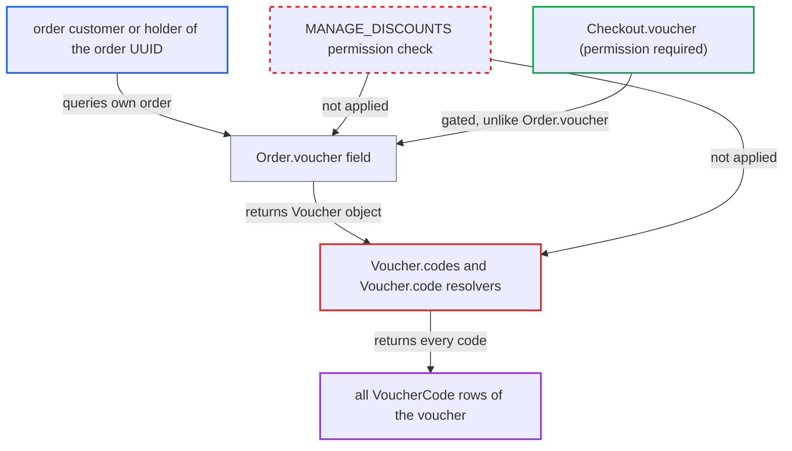

# Order.voucher exposes every code of a multi-code voucher to the order's customer

| Field | Value |
|---|---|
| ID | `find_01BUCY1TKeFBX9zv3MyCbEbP` |
| Severity | **Medium** |
| Status | open |
| CWE | CWE-862 — Missing Authorization |
| Created | 2026-10-27T21:13:25.810598Z |
| Claude Security | https://claude.ai/security/findings/find_01BUCY1TKeFBX9zv3MyCbEbP |

## Description

A customer who bought with one code of a multi-code voucher can read every other code of that voucher, with each code's `used` and `isActive` state. The same goes for anyone who holds the order UUID, and for staff or apps with only `MANAGE_ORDERS`. A multi-code voucher must exist. The cause is that `Voucher.codes` and `Voucher.code` have no permission check, and `Order.voucher` lets customers reach the `Voucher` type.

1. **attacker (storefront customer)** completes a checkout using one code of a multi-code voucher. The resulting order records the voucher, and `checkoutComplete` returns that `Order` to the caller, guest or registered. ([`saleor/graphql/checkout/mutations/checkout_complete.py:50`](https://github.com/cx-benchmark/saleor/blob/c982006cc04c77a97def93218dedac8d715eb041/saleor/graphql/checkout/mutations/checkout_complete.py#L50))
2. **attacker** queries `Order.voucher` on their own order. The field is a plain `graphene.Field(Voucher)` with no permission wrapper, unlike `Checkout.voucher`, which requires `MANAGE_DISCOUNTS`. ([`saleor/graphql/order/types.py:1803`](https://github.com/cx-benchmark/saleor/blob/c982006cc04c77a97def93218dedac8d715eb041/saleor/graphql/order/types.py#L1803))
3. **the resolver `resolve_voucher`** loads the full voucher for the order without checking the requester. It loads the voucher by `order.voucher_id` and wraps it in a `ChannelContext`, so a customer gets the staff-oriented `Voucher` object. ([`saleor/graphql/order/types.py:2843-2855`](https://github.com/cx-benchmark/saleor/blob/c982006cc04c77a97def93218dedac8d715eb041/saleor/graphql/order/types.py#L2843-L2855))
4. **the resolver `resolve_codes`** returns every `VoucherCode` row of the voucher. It returns `root.node.codes.all()` with `code`, `used` and `isActive`, and `codes` has no `permissions` set, so the attacker can page through all codes. ([`saleor/graphql/discount/types/vouchers.py:197-215`](https://github.com/cx-benchmark/saleor/blob/c982006cc04c77a97def93218dedac8d715eb041/saleor/graphql/discount/types/vouchers.py#L197-L215))
5. **attacker** reads the codes that are still unused and active, and redeems or shares them. The deprecated `code` field also leaks a sibling code, because `CodeByVoucherIDLoader` returns an arbitrary code of the voucher rather than the one the order used. ([`saleor/graphql/discount/dataloaders.py:54-69`](https://github.com/cx-benchmark/saleor/blob/c982006cc04c77a97def93218dedac8d715eb041/saleor/graphql/discount/dataloaders.py#L54-L69))

## Assessment

The attacker is a storefront customer, guest or registered, who received one code of a multi-code voucher. They need no further privilege and reach `/graphql/` as an anonymous internet user. They complete a checkout with their code. Then they query `checkoutComplete { order { voucher { codes } } }`, `me { orders }`, or `order(id:)` with their order UUID. Anyone holding the order UUID can do the same, since `Query.order` needs no authentication. A staff user or app with only `MANAGE_ORDERS` can also read the codes. Subscription (webhook) payloads built from `Order` expose them in the same way.

Impact: Every bearer code of the voucher is disclosed, with flags showing which are still unused and active. The attacker, or anyone they share the codes with, can redeem codes meant for other customers and use them up before the recipients can. The voucher's configured discount value and usage limits still bound the gain.

## Recommendation

(1) `Voucher.codes` and the deprecated `Voucher.code` return all `VoucherCode` rows of a voucher to anyone who can reach a `Voucher` object, and customer-owned orders can reach it.

Fix criteria: A requester without `MANAGE_DISCOUNTS` cannot read any voucher code other than the one on their own order (`Order.voucherCode`). Query `order { voucher { codes { edges { node { code } } } } code }` as the order's customer and as an anonymous holder of the order UUID. Both fields must be denied or return nothing. A staff user with `MANAGE_DISCOUNTS` must still receive the list.

(2) `Order.voucher` has no permission check, unlike `Checkout.voucher`, so customers can traverse into the staff-oriented `Voucher` type.

Fix criteria: `Order.voucher` has the same `MANAGE_DISCOUNTS` requirement as `Checkout.voucher`, or returns a customer-safe projection. A customer querying `order { voucher { id } }` is denied. `order { voucherCode }` still works for that customer.

## Evidence

**https://github.com/cx-benchmark/saleor**

- [`saleor/graphql/discount/types/vouchers.py:94-100`](https://github.com/cx-benchmark/saleor/blob/c982006cc04c77a97def93218dedac8d715eb041/saleor/graphql/discount/types/vouchers.py#L94-L100)
- [`saleor/graphql/discount/types/vouchers.py:197-215`](https://github.com/cx-benchmark/saleor/blob/c982006cc04c77a97def93218dedac8d715eb041/saleor/graphql/discount/types/vouchers.py#L197-L215)
- [`saleor/graphql/order/types.py:1803`](https://github.com/cx-benchmark/saleor/blob/c982006cc04c77a97def93218dedac8d715eb041/saleor/graphql/order/types.py#L1803)
- [`saleor/graphql/order/types.py:2843-2855`](https://github.com/cx-benchmark/saleor/blob/c982006cc04c77a97def93218dedac8d715eb041/saleor/graphql/order/types.py#L2843-L2855)
- [`saleor/graphql/checkout/types.py:639-643`](https://github.com/cx-benchmark/saleor/blob/c982006cc04c77a97def93218dedac8d715eb041/saleor/graphql/checkout/types.py#L639-L643)
- [`saleor/graphql/checkout/mutations/checkout_complete.py:50`](https://github.com/cx-benchmark/saleor/blob/c982006cc04c77a97def93218dedac8d715eb041/saleor/graphql/checkout/mutations/checkout_complete.py#L50)
- [`saleor/graphql/order/resolvers.py:90-102`](https://github.com/cx-benchmark/saleor/blob/c982006cc04c77a97def93218dedac8d715eb041/saleor/graphql/order/resolvers.py#L90-L102)
- [`saleor/graphql/discount/dataloaders.py:54-69`](https://github.com/cx-benchmark/saleor/blob/c982006cc04c77a97def93218dedac8d715eb041/saleor/graphql/discount/dataloaders.py#L54-L69)

