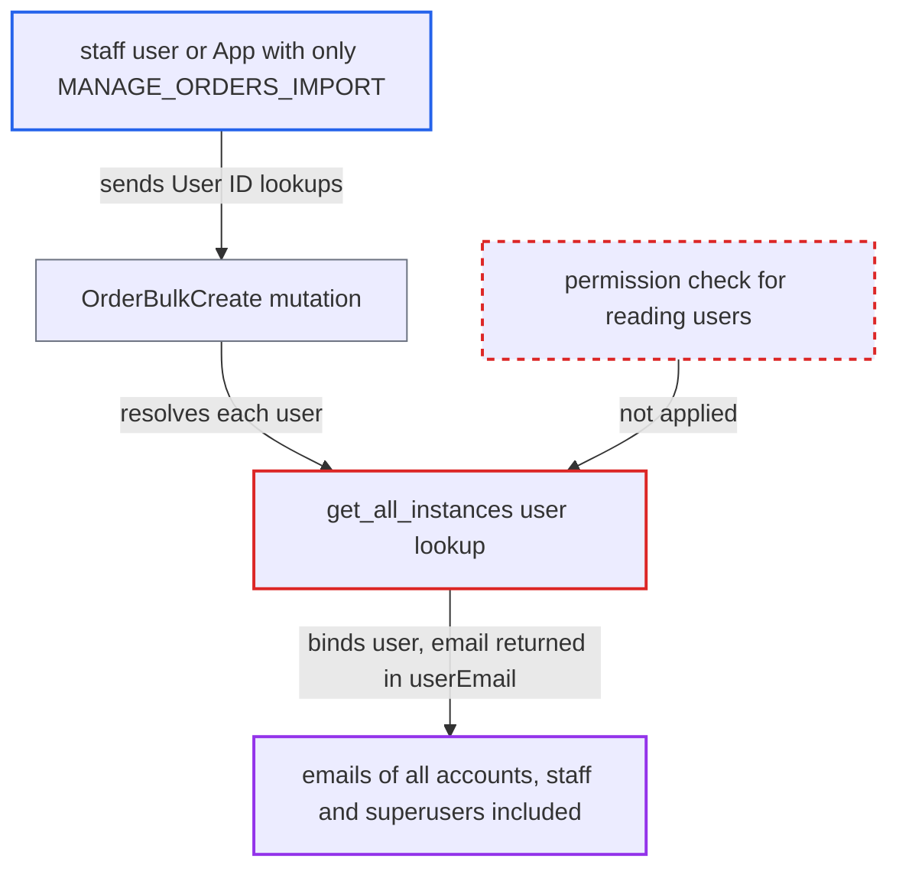

# orderBulkCreate discloses any user's email to import-only callers via user ID lookup

| Field | Value |
|---|---|
| ID | `find_018CAJaV2yYdsrRn3eQ8W1i5` |
| Severity | **Medium** |
| Status | open |
| CWE | CWE-359 — Information exposure |
| Created | 2026-10-27T21:25:07.791215Z |
| Claude Security | https://claude.ai/security/findings/find_018CAJaV2yYdsrRn3eQ8W1i5 |

## Description

A staff user or App with only `MANAGE_ORDERS_IMPORT` can read the real email address of any account, staff and superusers included, and can test whether user IDs or external references exist. Only the email leaks. The cause is that `OrderBulkCreate` looks up users by ID or external reference with no permission check, then copies the email into the order it returns.

1. **attacker with `MANAGE_ORDERS_IMPORT`** calls `orderBulkCreate` with up to 50 orders. Each order has a valid channel, billing address and one line, plus `user: {id: "User:<n>"}` for a different n. The mutation requires only `MANAGE_ORDERS_IMPORT`. ([`saleor/graphql/order/bulk_mutations/order_bulk_create.py:685-692`](https://github.com/cx-benchmark/saleor/blob/c982006cc04c77a97def93218dedac8d715eb041/saleor/graphql/order/bulk_mutations/order_bulk_create.py#L685-L692))
2. **the method `get_all_instances`** loads each referenced user with an unscoped `User.objects.filter(...)`. The lookup uses ID, email or external reference. It has no permission check and no customer or staff scoping, so staff and superuser accounts resolve too. ([`saleor/graphql/order/bulk_mutations/order_bulk_create.py:774-778`](https://github.com/cx-benchmark/saleor/blob/c982006cc04c77a97def93218dedac8d715eb041/saleor/graphql/order/bulk_mutations/order_bulk_create.py#L774-L778))
3. **the method `get_instances_related_to_order`** binds the found `User` to the order. A lookup that misses returns a distinct `NOT_FOUND` error, so the attacker can also tell which IDs and external references exist. ([`saleor/graphql/order/bulk_mutations/order_bulk_create.py:1047-1066`](https://github.com/cx-benchmark/saleor/blob/c982006cc04c77a97def93218dedac8d715eb041/saleor/graphql/order/bulk_mutations/order_bulk_create.py#L1047-L1066))
4. **the function `create_single_order`** copies the bound user's email into `order.user_email`. The caller never supplied this value. They identified the user only by ID or external reference. ([`saleor/graphql/order/bulk_mutations/order_bulk_create.py:2151-2155`](https://github.com/cx-benchmark/saleor/blob/c982006cc04c77a97def93218dedac8d715eb041/saleor/graphql/order/bulk_mutations/order_bulk_create.py#L2151-L2155))
5. **the mutation response** returns each created order, and `Order.resolve_user_email` returns `user_email` unmasked. The email is returned unmasked because `use_old_id` is False, the default for new orders. The attacker reads it in `results.order.userEmail`. ([`saleor/graphql/order/types.py:2638-2665`](https://github.com/cx-benchmark/saleor/blob/c982006cc04c77a97def93218dedac8d715eb041/saleor/graphql/order/types.py#L2638-L2665))

## Assessment

The attacker is a staff user or an App that holds `MANAGE_ORDERS_IMPORT` but not `MANAGE_USERS`, `MANAGE_ORDERS` or `MANAGE_STAFF`. They send `orderBulkCreate(errorPolicy: REJECT_FAILED_ROWS, stockUpdatePolicy: SKIP, orders: [...])` with `user: {id: "User:<n>"}` for n=1..50, where the IDs are sequential integers. They then read `results { order { userEmail } errors { code } }`. A user can also be named by external reference. No victim is involved and the default configuration is enough.

Impact: The attacker can list the email of every customer, staff member and superuser, 50 IDs per call (`MAX_ORDERS`). Misses also confirm which IDs and external references exist. Only the email field leaks, so the exposure is partial personal data. Each successful probe leaves a real order in the store.

## Recommendation

`OrderBulkCreate` resolves arbitrary `User` records by ID or external reference without checking that the requester may read users. It then returns the bound user's stored email through `Order.userEmail`. This breaks the permission boundary between order import and customer or staff data.

Fix criteria: A requester holding only `MANAGE_ORDERS_IMPORT` cannot learn a user's email, or whether an ID or external reference exists, from an ID or external-reference lookup. Either the lookup requires the permissions the `user` query requires (customers versus staff), or the response withholds the derived email. To verify, an import-only client sends `user: {id: "User:<n>"}` for another user's ID and gets neither that user's email nor a distinguishing error.

## Evidence

**https://github.com/cx-benchmark/saleor**

- [`saleor/graphql/order/bulk_mutations/order_bulk_create.py:2151-2155`](https://github.com/cx-benchmark/saleor/blob/c982006cc04c77a97def93218dedac8d715eb041/saleor/graphql/order/bulk_mutations/order_bulk_create.py#L2151-L2155)
- [`saleor/graphql/order/bulk_mutations/order_bulk_create.py:774-778`](https://github.com/cx-benchmark/saleor/blob/c982006cc04c77a97def93218dedac8d715eb041/saleor/graphql/order/bulk_mutations/order_bulk_create.py#L774-L778)
- [`saleor/graphql/order/bulk_mutations/order_bulk_create.py:1047-1066`](https://github.com/cx-benchmark/saleor/blob/c982006cc04c77a97def93218dedac8d715eb041/saleor/graphql/order/bulk_mutations/order_bulk_create.py#L1047-L1066)
- [`saleor/graphql/order/types.py:2638-2665`](https://github.com/cx-benchmark/saleor/blob/c982006cc04c77a97def93218dedac8d715eb041/saleor/graphql/order/types.py#L2638-L2665)
- [`saleor/graphql/order/bulk_mutations/order_bulk_create.py:2507-2514`](https://github.com/cx-benchmark/saleor/blob/c982006cc04c77a97def93218dedac8d715eb041/saleor/graphql/order/bulk_mutations/order_bulk_create.py#L2507-L2514)
- [`saleor/graphql/order/bulk_mutations/order_bulk_create.py:685-692`](https://github.com/cx-benchmark/saleor/blob/c982006cc04c77a97def93218dedac8d715eb041/saleor/graphql/order/bulk_mutations/order_bulk_create.py#L685-L692)
- [`saleor/graphql/order/types.py:2668-2683`](https://github.com/cx-benchmark/saleor/blob/c982006cc04c77a97def93218dedac8d715eb041/saleor/graphql/order/types.py#L2668-L2683)
- [`saleor/graphql/account/resolvers.py:76-116`](https://github.com/cx-benchmark/saleor/blob/c982006cc04c77a97def93218dedac8d715eb041/saleor/graphql/account/resolvers.py#L76-L116)

