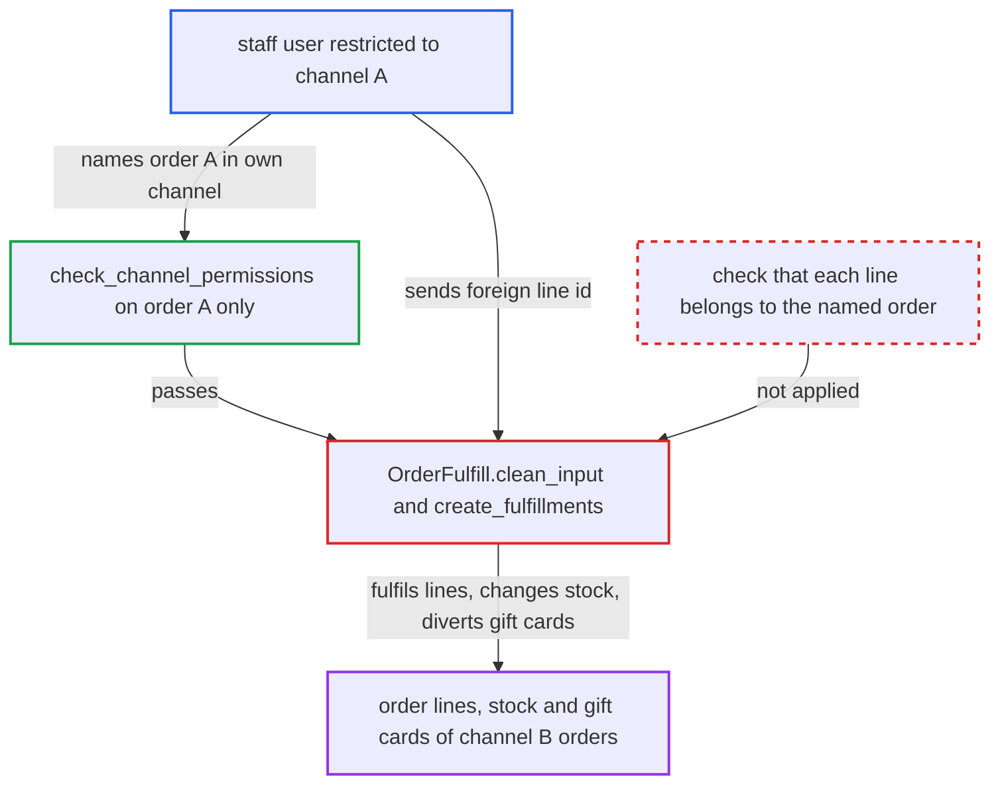

# orderFulfill fulfils other orders' lines, bypassing channel-restricted access

| Field | Value |
|---|---|
| ID | `find_01XycwjidYLy1hshAvqasisp` |
| Severity | **Medium** |
| Status | open |
| CWE | CWE-639 — Authorization bypass |
| Created | 2026-10-27T21:19:25.442713Z |
| Claude Security | https://claude.ai/security/findings/find_01XycwjidYLy1hshAvqasisp |

## Description

A staff user limited to one sales channel can fulfil order lines that belong to orders in other channels. This changes those orders' fulfilment state, allocations and stock, and sends their gift-card codes to the attacker's own order address. It needs `MANAGE_ORDERS` in a channel-restricted group and a foreign line id. `OrderFulfill.clean_input` looks up lines by primary key only and never checks that they belong to the named order.

1. **Attacker (staff user restricted to channel A)** obtains the id of an order line from an order in channel B. Line ids are UUIDs, so the attacker needs one from elsewhere: an accomplice customer's `me.orders.lines.id`, a leaked id, or the integer `old_id` form on installations migrated with legacy ids. ([`saleor/graphql/utils/__init__.py:100-181`](https://github.com/cx-benchmark/saleor/blob/c982006cc04c77a97def93218dedac8d715eb041/saleor/graphql/utils/__init__.py#L100-L181))
2. **Attacker** sends `orderFulfill` naming an order A in channel A, with the foreign line id as `orderLineId`. The request goes to `/graphql/` and may set `allowStockToBeExceeded: true`. ([`saleor/graphql/order/mutations/order_fulfill.py:259-296`](https://github.com/cx-benchmark/saleor/blob/c982006cc04c77a97def93218dedac8d715eb041/saleor/graphql/order/mutations/order_fulfill.py#L259-L296))
3. **the mutation `perform_mutation`** checks channel permission only for the named order. `check_channel_permissions(info, [instance.channel_id])` passes because order A is in the attacker's channel. ([`saleor/graphql/order/mutations/order_fulfill.py:259-296`](https://github.com/cx-benchmark/saleor/blob/c982006cc04c77a97def93218dedac8d715eb041/saleor/graphql/order/mutations/order_fulfill.py#L259-L296))
4. **the method `clean_input`** resolves each `lines[].orderLineId` across all orders. `get_nodes_or_error` filters by primary key only, and nothing compares `order_line.order_id` with the `order` argument. ([`saleor/graphql/order/mutations/order_fulfill.py:216-248`](https://github.com/cx-benchmark/saleor/blob/c982006cc04c77a97def93218dedac8d715eb041/saleor/graphql/order/mutations/order_fulfill.py#L216-L248))
5. **the function `create_fulfillments`** creates a `Fulfillment` on order A pointing at the foreign lines. It re-locks the lines by pk only, decreases allocations and stock for their variants and increments their `quantity_fulfilled`, so the real order can no longer be fulfilled for that quantity. ([`saleor/order/actions.py:1223-1346`](https://github.com/cx-benchmark/saleor/blob/c982006cc04c77a97def93218dedac8d715eb041/saleor/order/actions.py#L1223-L1346))
6. **the function `gift_cards_create`** mints gift cards for foreign gift-card lines and e-mails the codes to order A's address. Cards are created at the foreign line's price, with order A's user and e-mail as creator and recipient. ([`saleor/giftcard/utils.py:292-345`](https://github.com/cx-benchmark/saleor/blob/c982006cc04c77a97def93218dedac8d715eb041/saleor/giftcard/utils.py#L292-L345))

## Assessment

The attacker is a staff user with `MANAGE_ORDERS` in a permission group restricted to channel A. They pick or create any order A in channel A and need a line id L of an order B in channel B. L can come from an accomplice customer reading their own `me.orders.lines.id`, from a leaked id, or from the enumerable integer `old_id` form that `OrderLine` global ids also accept on installations migrated with legacy ids. They send `orderFulfill` for order A with L as `orderLineId`. No victim action is needed. The `CANNOT_FULFILL_UNPAID_ORDER` gate is also checked only on the named order, but it is active only when `fulfillment_allow_unpaid` is off. The default is `True`. Apps and unrestricted staff can fulfil any order directly, so for them the only gain is bypassing that non-default unpaid gate.

Impact: The attacker changes `quantity_fulfilled`, allocations and stock on lines of orders in channels they are barred from, and creates fulfillment records there. They also receive the diverted gift-card codes, and the returned fulfillment shows the foreign line's details. This is limited to lines whose ids the attacker knows, and the report names no availability impact.

## Recommendation

(1) The lines passed to `orderFulfill` are not verified to belong to the order whose permissions were checked. `clean_input` resolves them by primary key across all orders.

Fix criteria: Every `orderLineId` resolves within `order.lines`, for example through a lookup scoped to the target order. A foreign id produces a validation error before any state change. Calling `orderFulfill(order: A, lines: [line of B])` is rejected, with no `Fulfillment`, stock or `quantity_fulfilled` change.

(2) `create_fulfillments` in `saleor/order/actions.py` trusts the lines its caller provides. It does not assert `line.order_id == order.id`, so any other caller has the same exposure.

Fix criteria: The action layer rejects lines whose `order_id` differs from the target order, so an omission in a mutation cannot create cross-order fulfillments. A direct call of `create_fulfillments` with a foreign line is rejected.

## Evidence

**https://github.com/cx-benchmark/saleor**

- [`saleor/graphql/order/mutations/order_fulfill.py:216-248`](https://github.com/cx-benchmark/saleor/blob/c982006cc04c77a97def93218dedac8d715eb041/saleor/graphql/order/mutations/order_fulfill.py#L216-L248)
- [`saleor/graphql/order/mutations/order_fulfill.py:259-296`](https://github.com/cx-benchmark/saleor/blob/c982006cc04c77a97def93218dedac8d715eb041/saleor/graphql/order/mutations/order_fulfill.py#L259-L296)
- [`saleor/graphql/utils/__init__.py:100-181`](https://github.com/cx-benchmark/saleor/blob/c982006cc04c77a97def93218dedac8d715eb041/saleor/graphql/utils/__init__.py#L100-L181)
- [`saleor/order/actions.py:1223-1346`](https://github.com/cx-benchmark/saleor/blob/c982006cc04c77a97def93218dedac8d715eb041/saleor/order/actions.py#L1223-L1346)
- [`saleor/giftcard/utils.py:292-345`](https://github.com/cx-benchmark/saleor/blob/c982006cc04c77a97def93218dedac8d715eb041/saleor/giftcard/utils.py#L292-L345)
- [`saleor/graphql/order/mutations/order_grant_refund_utils.py:195-215`](https://github.com/cx-benchmark/saleor/blob/c982006cc04c77a97def93218dedac8d715eb041/saleor/graphql/order/mutations/order_grant_refund_utils.py#L195-L215)

