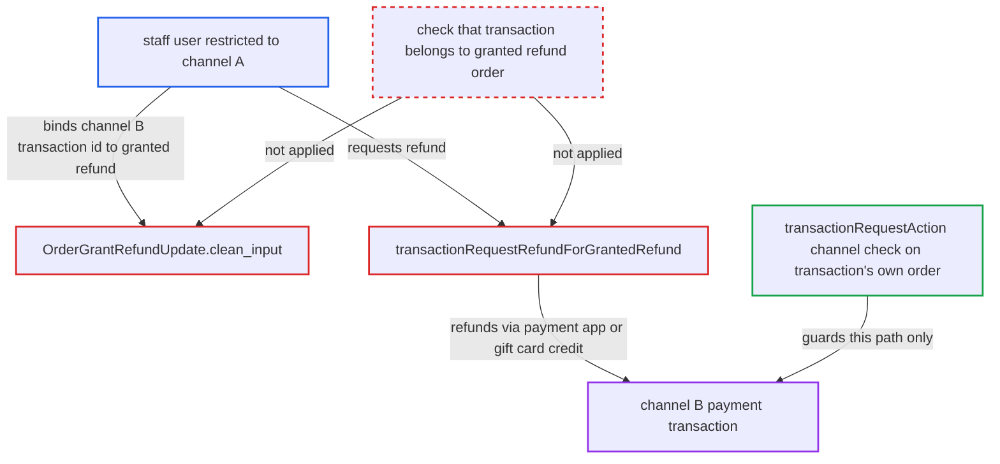

# orderGrantRefundUpdate binds granted refund to another channel's transaction, enabling cross-channel refunds

| Field | Value |
|---|---|
| ID | `find_0121rQziQ17774pMqHqZSXWo` |
| Severity | **Medium** |
| Status | open |
| CWE | CWE-639 — Insecure Direct Object Reference |
| Created | 2026-10-27T21:19:05.798718Z |
| Claude Security | https://claude.ai/security/findings/find_0121rQziQ17774pMqHqZSXWo |

## Description

A staff member restricted to one sales channel can trigger real refunds on payments in another channel they have no access to. This needs `MANAGE_ORDERS` and `HANDLE_PAYMENTS` in a channel-restricted group, plus the token of a charged transaction in the other channel. The cause is `OrderGrantRefundUpdate.clean_input`, which accepts any transaction for `transactionId`, and `transactionRequestRefundForGrantedRefund`, which then trusts it.

1. **staff attacker** creates a granted refund on an order in their own channel A. The attacker calls `orderGrantRefundCreate` on a channel-A order they are allowed to manage. ([`saleor/graphql/order/mutations/order_grant_refund_create.py:253-261`](https://github.com/cx-benchmark/saleor/blob/c982006cc04c77a97def93218dedac8d715eb041/saleor/graphql/order/mutations/order_grant_refund_create.py#L253-L261))
2. **staff attacker** calls `orderGrantRefundUpdate` with the `transactionId` of a channel-B transaction. The attacker can learn the token from their own channel-B purchase, since `transactionInitialize` returns it, or use a legacy integer id. ([`saleor/graphql/order/mutations/order_grant_refund_update.py:332-336`](https://github.com/cx-benchmark/saleor/blob/c982006cc04c77a97def93218dedac8d715eb041/saleor/graphql/order/mutations/order_grant_refund_update.py#L332-L336))
3. **the lookup `TransactionItem.get_node`** returns the foreign transaction. It matches by token, or by pk for `use_old_id` legacy rows, over all transactions, with no order or channel filter. ([`saleor/graphql/payment/types.py:929-940`](https://github.com/cx-benchmark/saleor/blob/c982006cc04c77a97def93218dedac8d715eb041/saleor/graphql/payment/types.py#L929-L940))
4. **the handler `OrderGrantRefundUpdate.clean_input`** checks the amount against the foreign transaction and saves it as `granted_refund.transaction_item`. The amount guard uses the foreign transaction's `charged_value`, and nothing checks that the transaction belongs to `granted_refund.order`. ([`saleor/graphql/order/mutations/order_grant_refund_update.py:345-403`](https://github.com/cx-benchmark/saleor/blob/c982006cc04c77a97def93218dedac8d715eb041/saleor/graphql/order/mutations/order_grant_refund_update.py#L345-L403))
5. **staff attacker** calls `transactionRequestRefundForGrantedRefund`. The mutation trusts the pre-linked transaction and checks channel access only against the channel of `granted_refund.order`, which is channel A, so the check passes. ([`saleor/graphql/payment/mutations/transaction/transaction_request_refund_for_granted_refund.py:82-158`](https://github.com/cx-benchmark/saleor/blob/c982006cc04c77a97def93218dedac8d715eb041/saleor/graphql/payment/mutations/transaction/transaction_request_refund_for_granted_refund.py#L82-L158))
6. **the mutation `transactionRequestRefundForGrantedRefund`** sends the refund for the foreign transaction. It sends `request_refund_action` to the payment app that owns the transaction, whatever the channel, or credits a gift-card transaction immediately with `refund_gift_card_transaction`. ([`saleor/graphql/payment/mutations/transaction/transaction_request_refund_for_granted_refund.py:163-203`](https://github.com/cx-benchmark/saleor/blob/c982006cc04c77a97def93218dedac8d715eb041/saleor/graphql/payment/mutations/transaction/transaction_request_refund_for_granted_refund.py#L163-L203))

## Assessment

The attacker is a staff user whose group grants `MANAGE_ORDERS` and `HANDLE_PAYMENTS` but is limited to channel A. This only matters where channel-restricted groups are in use. The attacker needs the token of a charged channel-B transaction, for example from their own channel-B purchase, or a legacy integer id. For unrestricted staff with `HANDLE_PAYMENTS`, the effect is limited to corrupting granted-refund bookkeeping.

Impact: The attacker can trigger real refunds, up to each transaction's charged amount, on payments in channels their group excludes. This includes refunding their own channel-B purchase while keeping the goods, repeatedly, and immediate gift-card credits. The granted refund on order A also becomes tied to order B's payment, which corrupts refund accounting. Beyond the linked transaction being shown on the granted refund, the report sees no confidentiality or availability effect.

## Recommendation

(1) `OrderGrantRefundUpdate.clean_input` resolves `transactionId` against every transaction, without checking that it belongs to the granted refund's order. A granted refund can therefore be bound to another order's or channel's payment.

Fix criteria: `orderGrantRefundUpdate` rejects a `transactionId` that is not among `granted_refund.order.payment_transactions`, as `orderGrantRefundCreate` does. It returns a not-found or validation error and leaves `transaction_item` and `amount_value` unchanged. A test passes a transaction from a second order or channel and asserts the error and an unchanged granted refund.

(2) `transactionRequestRefundForGrantedRefund` trusts a pre-linked `granted_refund.transaction_item` without matching its order. It checks channel access on the granted refund's order, not the transaction's, so any wrongly linked row results in a refund on a foreign payment.

Fix criteria: Before requesting a refund, the mutation verifies `transaction_item.order_id == granted_refund.order_id` in both branches. A test uses a granted refund whose `transaction_item` points to another order. The request must be refused, and no refund-request event or webhook is created.

## Evidence

**https://github.com/cx-benchmark/saleor**

- [`saleor/graphql/order/mutations/order_grant_refund_update.py:332-336`](https://github.com/cx-benchmark/saleor/blob/c982006cc04c77a97def93218dedac8d715eb041/saleor/graphql/order/mutations/order_grant_refund_update.py#L332-L336)
- [`saleor/graphql/order/mutations/order_grant_refund_update.py:345-403`](https://github.com/cx-benchmark/saleor/blob/c982006cc04c77a97def93218dedac8d715eb041/saleor/graphql/order/mutations/order_grant_refund_update.py#L345-L403)
- [`saleor/graphql/payment/types.py:929-940`](https://github.com/cx-benchmark/saleor/blob/c982006cc04c77a97def93218dedac8d715eb041/saleor/graphql/payment/types.py#L929-L940)
- [`saleor/graphql/order/mutations/order_grant_refund_create.py:253-261`](https://github.com/cx-benchmark/saleor/blob/c982006cc04c77a97def93218dedac8d715eb041/saleor/graphql/order/mutations/order_grant_refund_create.py#L253-L261)
- [`saleor/graphql/payment/mutations/transaction/transaction_request_refund_for_granted_refund.py:82-158`](https://github.com/cx-benchmark/saleor/blob/c982006cc04c77a97def93218dedac8d715eb041/saleor/graphql/payment/mutations/transaction/transaction_request_refund_for_granted_refund.py#L82-L158)
- [`saleor/graphql/payment/mutations/transaction/transaction_request_refund_for_granted_refund.py:163-203`](https://github.com/cx-benchmark/saleor/blob/c982006cc04c77a97def93218dedac8d715eb041/saleor/graphql/payment/mutations/transaction/transaction_request_refund_for_granted_refund.py#L163-L203)
- [`saleor/graphql/payment/mutations/transaction/transaction_request_action.py:266-276`](https://github.com/cx-benchmark/saleor/blob/c982006cc04c77a97def93218dedac8d715eb041/saleor/graphql/payment/mutations/transaction/transaction_request_action.py#L266-L276)

