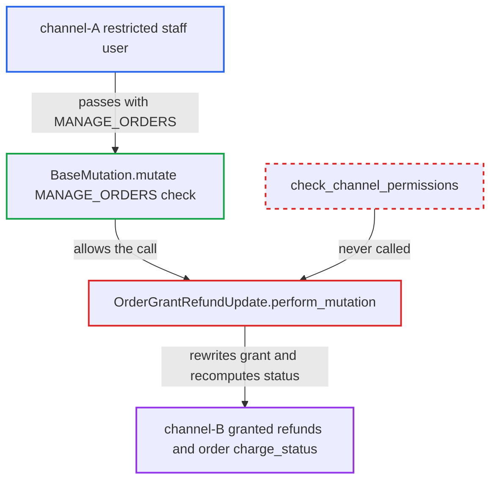

# orderGrantRefundUpdate skips staff channel-restriction check

| Field | Value |
|---|---|
| ID | `find_01HrVnsvQzxQiAsM9iLCo7Sn` |
| Severity | **Medium** |
| Status | open |
| CWE | CWE-862 — Missing Authorization |
| Created | 2026-10-27T21:16:16.648561Z |
| Claude Security | https://claude.ai/security/findings/find_01HrVnsvQzxQiAsM9iLCo7Sn |

## Description

A staff user restricted to one sales channel can change refund grants on orders in other channels. Changes include the amount, lines, shipping flag, linked transaction or reason, and the order's `charge_status` is recomputed. The attacker needs `MANAGE_ORDERS` in a channel-restricted group. `OrderGrantRefundUpdate.perform_mutation` never calls `check_channel_permissions`.

1. **channel-A staff user** obtains the id of a channel-B granted refund. Ids look like `OrderGrantedRefund:<sequential int>`, so they can be guessed or read from a channel-B order.
2. **channel-A staff user** sends `orderGrantRefundUpdate` to `/graphql/`. The input can carry `amount`, `addLines`, `removeLines`, `grantRefundForShipping`, `transactionId` or `reason`. ([`saleor/graphql/core/mutations.py:519-532`](https://github.com/cx-benchmark/saleor/blob/c982006cc04c77a97def93218dedac8d715eb041/saleor/graphql/core/mutations.py#L519-L532))
3. **`BaseMutation.mutate`** checks only `MANAGE_ORDERS`. Channel scoping is not applied generically, so the user passes because the group holds that permission. ([`saleor/graphql/core/mutations.py:519-532`](https://github.com/cx-benchmark/saleor/blob/c982006cc04c77a97def93218dedac8d715eb041/saleor/graphql/core/mutations.py#L519-L532))
4. **`OrderGrantRefundUpdate.perform_mutation`** loads the granted refund and its order without a channel check. It never calls `check_channel_permissions(info, [order.channel_id])`, so the user's channel restriction is not consulted. ([`saleor/graphql/order/mutations/order_grant_refund_update.py:450-467`](https://github.com/cx-benchmark/saleor/blob/c982006cc04c77a97def93218dedac8d715eb041/saleor/graphql/order/mutations/order_grant_refund_update.py#L450-L467))
5. **`OrderGrantRefundUpdate.perform_mutation`** rewrites the grant and calls `update_order_charge_data(order)`. The channel-B grant is changed and the order's `charge_status` is recomputed from the new values. ([`saleor/graphql/order/mutations/order_grant_refund_update.py:450-467`](https://github.com/cx-benchmark/saleor/blob/c982006cc04c77a97def93218dedac8d715eb041/saleor/graphql/order/mutations/order_grant_refund_update.py#L450-L467))

## Assessment

The attacker is an authenticated staff user with `MANAGE_ORDERS` in a permission group whose `restricted_access_to_channels` limits it to channel A. They send `orderGrantRefundUpdate` for a granted refund on a channel-B order, using an id they guess or read from a channel-B order. No other setting or victim action is needed. The report names no other way in.

Impact: The attacker can change refund approvals on orders in channels they are excluded from. If the grant status is `NONE` or `FAILURE`, they can change the amount, lines, shipping flag and linked transaction. The amount is unbounded when no transaction is linked, and otherwise capped at the linked transaction's charged value. If the status is `PENDING` or `SUCCESS`, they can change only the reason. No money moves in this mutation and nothing beyond this integrity issue is established. A grant enlarged this way is paid out at the new amount, capped at the charged value, when channel-B staff or apps later run `transactionRequestRefundForGrantedRefund`.

## Recommendation

`OrderGrantRefundUpdate.perform_mutation` authorises only on `MANAGE_ORDERS`. It never checks that `granted_refund.order.channel_id` is among the staff user's accessible channels, unlike the other order mutations.

Fix criteria: A staff user whose permission group excludes the granted refund's order channel gets `PermissionDenied` from `orderGrantRefundUpdate`. The `OrderGrantedRefund` row and the order's `charge_status` stay unchanged. A test modelled on `test_order_note_add_by_user_no_channel_access` (USD-only group, order in PLN channel) asserts `assert_no_permission`. Apps keep access to all channels.

## Evidence

**https://github.com/cx-benchmark/saleor**

- [`saleor/graphql/order/mutations/order_grant_refund_update.py:450-467`](https://github.com/cx-benchmark/saleor/blob/c982006cc04c77a97def93218dedac8d715eb041/saleor/graphql/order/mutations/order_grant_refund_update.py#L450-L467)
- [`saleor/graphql/core/mutations.py:519-532`](https://github.com/cx-benchmark/saleor/blob/c982006cc04c77a97def93218dedac8d715eb041/saleor/graphql/core/mutations.py#L519-L532)
- [`saleor/graphql/core/mutations.py:584-598`](https://github.com/cx-benchmark/saleor/blob/c982006cc04c77a97def93218dedac8d715eb041/saleor/graphql/core/mutations.py#L584-L598)
- [`saleor/graphql/payment/mutations/transaction/transaction_request_refund_for_granted_refund.py:149-158`](https://github.com/cx-benchmark/saleor/blob/c982006cc04c77a97def93218dedac8d715eb041/saleor/graphql/payment/mutations/transaction/transaction_request_refund_for_granted_refund.py#L149-L158)
- [`saleor/graphql/order/mutations/order_discount_update.py:58-71`](https://github.com/cx-benchmark/saleor/blob/c982006cc04c77a97def93218dedac8d715eb041/saleor/graphql/order/mutations/order_discount_update.py#L58-L71)
- [`saleor/graphql/order/mutations/order_grant_refund_update.py:332-356`](https://github.com/cx-benchmark/saleor/blob/c982006cc04c77a97def93218dedac8d715eb041/saleor/graphql/order/mutations/order_grant_refund_update.py#L332-L356)

