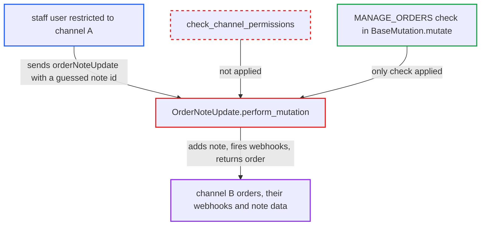

# orderNoteUpdate skips staff channel-restriction check

| Field | Value |
|---|---|
| ID | `find_01UombYLW7x5Eqn2S2a26LhB` |
| Severity | **Medium** |
| Status | open |
| CWE | CWE-862 — Missing Authorization |
| Created | 2026-10-27T21:16:16.576078Z |
| Claude Security | https://claude.ai/security/findings/find_01UombYLW7x5Eqn2S2a26LhB |

## Description

A staff user restricted to one channel can edit order notes on orders in other channels. They can also trigger those orders' update webhooks and read the order data returned by the mutation. The attacker needs `MANAGE_ORDERS` in a permission group with `restricted_access_to_channels`. The cause is that `OrderNoteUpdate.perform_mutation` never calls `check_channel_permissions` for the order's channel.

1. **channel-restricted staff user** enumerates note ids of orders in another channel. `OrderEvent` primary keys are sequential integers, so ids of the form `OrderEvent:<n>` can be guessed, and non-note events just return not_found.
2. **channel-restricted staff user** sends `orderNoteUpdate` with a note id and a message to `/graphql/`. The user holds `MANAGE_ORDERS` but is in a group whose accessible channels exclude the channel of the target order.
3. **the base mutation `BaseMutation.mutate`** checks only the `MANAGE_ORDERS` permission. `get_node_or_error` applies no channel filter, so the note event is found whatever channel its order belongs to.
4. **the handler `OrderNoteUpdate.perform_mutation`** takes the order from the note event without calling `check_channel_permissions`. The sibling `OrderNoteAdd.perform_mutation` makes this call right after resolving the order, but the update path does not. ([`saleor/graphql/order/mutations/order_note_update.py:46-71`](https://github.com/cx-benchmark/saleor/blob/c982006cc04c77a97def93218dedac8d715eb041/saleor/graphql/order/mutations/order_note_update.py#L46-L71))
5. **the handler `OrderNoteUpdate.perform_mutation`** records a `NOTE_UPDATED` event, fires the webhooks, rewrites the search vector and returns the order. The event carries the caller's message. The `ORDER_UPDATED` or `DRAFT_ORDER_UPDATED` webhook fires for the other channel's order, and the payload returns that `order` and the `event`. ([`saleor/graphql/order/mutations/order_note_update.py:46-71`](https://github.com/cx-benchmark/saleor/blob/c982006cc04c77a97def93218dedac8d715eb041/saleor/graphql/order/mutations/order_note_update.py#L46-L71))

## Assessment

The attacker is a staff user with `MANAGE_ORDERS` in a permission group that has `restricted_access_to_channels`, so they can use only channel A. They need the global id of a note `OrderEvent` on an order in channel B. They can find it by enumerating the sequential ids, and ids of non-note events just return not_found. They then send `orderNoteUpdate(note: <id>, input: {message})` to `/graphql/`. The report names no other entry point.

Impact: The attacker's text becomes the current note on orders of channels they are excluded from. Order-updated webhooks and search-vector updates fire for those orders. The returned payload exposes the order's customer and address fields that `MANAGE_ORDERS` can see, which is a limited disclosure. No money, line or fulfillment state changes, and availability is not affected.

## Recommendation

`OrderNoteUpdate.perform_mutation` authorises only on `MANAGE_ORDERS`. It never checks that the note's order channel is accessible to the requesting staff user, unlike `OrderNoteAdd`.

Fix criteria: A channel-restricted staff user whose accessible channels exclude the order's channel gets `PermissionDenied` from `orderNoteUpdate`. No `NOTE_UPDATED` event, webhook or search-vector update happens in that case. A new test for the update mutation, mirroring `test_order_note_add_by_user_no_channel_access`, confirms this. Apps keep all-channel access.

## Evidence

**https://github.com/cx-benchmark/saleor**

- [`saleor/graphql/order/mutations/order_note_update.py:46-71`](https://github.com/cx-benchmark/saleor/blob/c982006cc04c77a97def93218dedac8d715eb041/saleor/graphql/order/mutations/order_note_update.py#L46-L71)
- [`saleor/graphql/order/mutations/order_note_add.py:52-54`](https://github.com/cx-benchmark/saleor/blob/c982006cc04c77a97def93218dedac8d715eb041/saleor/graphql/order/mutations/order_note_add.py#L52-L54)
- [`saleor/graphql/core/mutations.py:584-599`](https://github.com/cx-benchmark/saleor/blob/c982006cc04c77a97def93218dedac8d715eb041/saleor/graphql/core/mutations.py#L584-L599)

