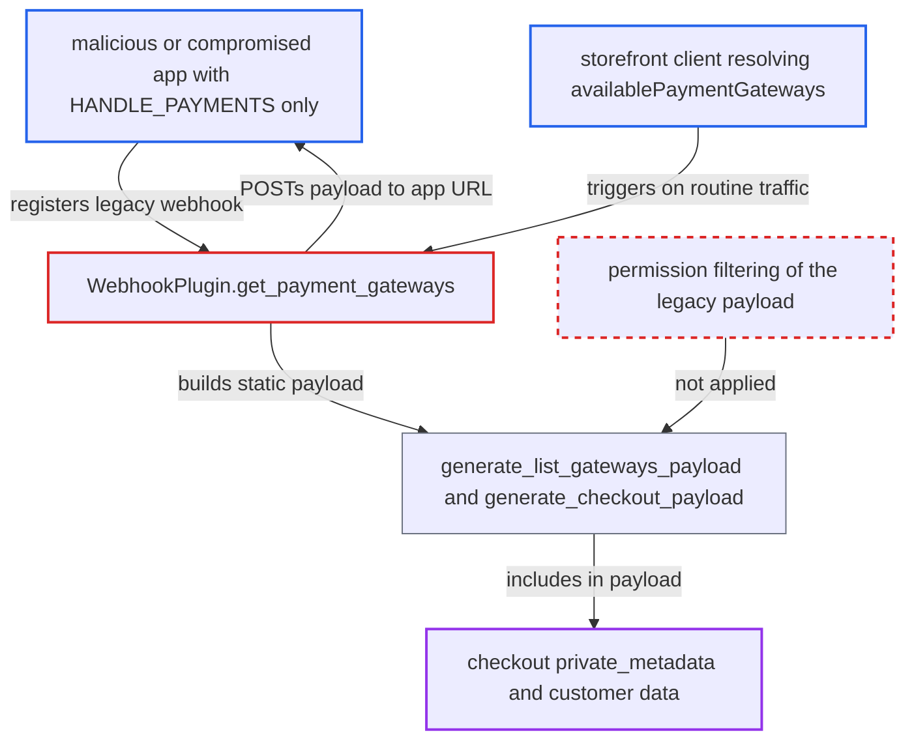

# PAYMENT_LIST_GATEWAYS legacy payload discloses checkout private metadata to HANDLE_PAYMENTS apps

| Field | Value |
|---|---|
| ID | `find_018fvki7KaeN4znymLCzEaE3` |
| Severity | **Medium** |
| Status | open |
| CWE | CWE-285 — Improper Authorization |
| Created | 2026-10-27T21:18:51.570802Z |
| Claude Security | https://claude.ai/security/findings/find_018fvki7KaeN4znymLCzEaE3 |

## Description

An app that holds only the `HANDLE_PAYMENTS` permission can read checkout private metadata and customer name and address data for all checkouts in all channels. It only needs a legacy (non-subscription) webhook registered for `PAYMENT_LIST_GATEWAYS`. The cause is `generate_list_gateways_payload`, which embeds the full legacy checkout payload without trimming it by the app's permissions.

1. **malicious or compromised app** registers a legacy webhook for `PAYMENT_LIST_GATEWAYS`. The app has only `HANDLE_PAYMENTS`, and the webhook has no subscription query, so it receives the static legacy payload. ([`saleor/plugins/webhook/plugin.py:3338-3362`](https://github.com/cx-benchmark/saleor/blob/c982006cc04c77a97def93218dedac8d715eb041/saleor/plugins/webhook/plugin.py#L3338-L3362))
2. **storefront client** resolves `checkout.availablePaymentGateways`. This is routine, anonymous storefront traffic. It triggers `get_payment_gateways` with the checkout, so no staff action is needed. ([`saleor/graphql/checkout/types.py:1149-1171`](https://github.com/cx-benchmark/saleor/blob/c982006cc04c77a97def93218dedac8d715eb041/saleor/graphql/checkout/types.py#L1149-L1171))
3. **the plugin method `WebhookPlugin.get_payment_gateways`** sends `generate_list_gateways_payload(currency, checkout)` to every webhook from `get_webhooks_for_event(PAYMENT_LIST_GATEWAYS)`. The only requirement to be in that list is `HANDLE_PAYMENTS`, so the app's webhook is included. ([`saleor/plugins/webhook/plugin.py:3338-3362`](https://github.com/cx-benchmark/saleor/blob/c982006cc04c77a97def93218dedac8d715eb041/saleor/plugins/webhook/plugin.py#L3338-L3362))
4. **the function `generate_list_gateways_payload`** embeds the full output of `generate_checkout_payload(checkout)`. No permission-based trimming is applied to the embedded payload. ([`saleor/webhook/payloads.py:1069-1080`](https://github.com/cx-benchmark/saleor/blob/c982006cc04c77a97def93218dedac8d715eb041/saleor/webhook/payloads.py#L1069-L1080))
5. **the function `generate_checkout_payload`** serializes the checkout's `private_metadata` together with `user` names and addresses. These fields end up in the body that is POSTed to the app's URL. ([`saleor/webhook/payloads.py:587-594`](https://github.com/cx-benchmark/saleor/blob/c982006cc04c77a97def93218dedac8d715eb041/saleor/webhook/payloads.py#L587-L594))
6. **malicious or compromised app** records the payloads it receives. In the GraphQL API, `Checkout.privateMetadata` needs `MANAGE_CHECKOUTS` or `HANDLE_TAXES`, so the app gets data its permission does not allow. ([`saleor/graphql/meta/permissions.py:231-234`](https://github.com/cx-benchmark/saleor/blob/c982006cc04c77a97def93218dedac8d715eb041/saleor/graphql/meta/permissions.py#L231-L234))

## Assessment

The attacker operates a malicious or compromised app that holds only `HANDLE_PAYMENTS`. The app registers a legacy (non-subscription) webhook for `PAYMENT_LIST_GATEWAYS`. No further active step is needed. Each time a storefront client resolves `checkout.availablePaymentGateways`, the payload is sent to the app's URL. The same happens when `checkoutPaymentCreate` validates a gateway. A subscription-based webhook for the same event would be denied `checkout { privateMetadata }` for such an app, so only the legacy path leaks.

Impact: The app reads checkout `private_metadata` for all checkouts in all channels, plus customer name, address and line data. This can include internal references, fraud flags and third-party session identifiers that other apps or staff store privately. This is read-only disclosure, with no modification or availability impact.

## Recommendation

The legacy `PAYMENT_LIST_GATEWAYS` payload is generated without regard to the receiving app's permissions. It includes checkout `private_metadata`, which the permission model reserves for `MANAGE_CHECKOUTS` or `HANDLE_TAXES`.

Fix criteria: A `HANDLE_PAYMENTS`-only app no longer receives checkout `private_metadata`, or other fields it could not query, in the `PAYMENT_LIST_GATEWAYS` payload. Permission-gated fields are either stripped from the legacy payload or filtered by the app's permissions. To check, register a legacy webhook on an app with only `HANDLE_PAYMENTS` and resolve `checkout.availablePaymentGateways`. Confirm the delivered payload carries no `private_metadata`.

## Evidence

**https://github.com/cx-benchmark/saleor**

- [`saleor/plugins/webhook/plugin.py:3338-3362`](https://github.com/cx-benchmark/saleor/blob/c982006cc04c77a97def93218dedac8d715eb041/saleor/plugins/webhook/plugin.py#L3338-L3362)
- [`saleor/webhook/payloads.py:1069-1080`](https://github.com/cx-benchmark/saleor/blob/c982006cc04c77a97def93218dedac8d715eb041/saleor/webhook/payloads.py#L1069-L1080)
- [`saleor/webhook/payloads.py:587-594`](https://github.com/cx-benchmark/saleor/blob/c982006cc04c77a97def93218dedac8d715eb041/saleor/webhook/payloads.py#L587-L594)
- [`saleor/graphql/meta/permissions.py:231-234`](https://github.com/cx-benchmark/saleor/blob/c982006cc04c77a97def93218dedac8d715eb041/saleor/graphql/meta/permissions.py#L231-L234)
- [`saleor/graphql/checkout/types.py:1149-1171`](https://github.com/cx-benchmark/saleor/blob/c982006cc04c77a97def93218dedac8d715eb041/saleor/graphql/checkout/types.py#L1149-L1171)

