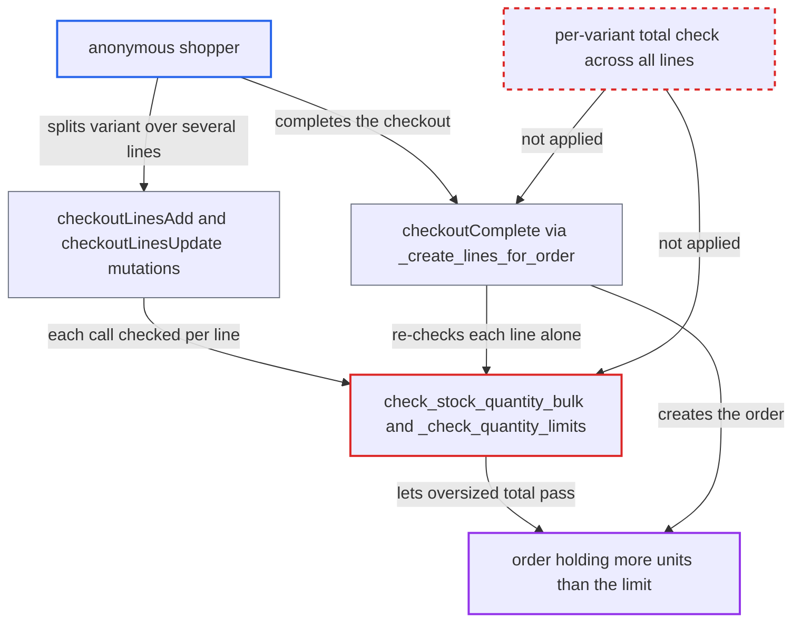

# Per-checkout variant quantity limit bypassed by splitting a variant across checkout lines

| Field | Value |
|---|---|
| ID | `find_01CE4oF68MGYLSrZMtn4f1vW` |
| Severity | **Medium** |
| Status | open |
| CWE | CWE-1284 — Improper quantity validation |
| Created | 2026-10-27T21:25:07.867063Z |
| Claude Security | https://claude.ai/security/findings/find_01CE4oF68MGYLSrZMtn4f1vW |

## Description

An anonymous shopper can buy any multiple of a variant's per-checkout quantity limit in one order. This works only when the merchant has set `quantity_limit_per_customer` to 2 or more (it is null by default). The limit checks on line add, line update and checkout completion look at one line at a time and never at the variant's total across lines.

1. **attacker** creates a checkout and adds 1 unit of the limited variant with `checkoutLinesAdd`. The attacker needs no account and no permission, only a variant whose `quantityLimitPerCustomer` L is at least 2. ([`saleor/graphql/checkout/mutations/checkout_lines_add.py:86-112`](https://github.com/cx-benchmark/saleor/blob/c982006cc04c77a97def93218dedac8d715eb041/saleor/graphql/checkout/mutations/checkout_lines_add.py#L86-L112))
2. **attacker** adds 1 more unit with `checkoutLinesAdd` and `forceNewLine: true`, and repeats. `forceNewLine` is a public input field with no permission check, and it makes a separate line for the same variant instead of merging into the existing one. ([`saleor/graphql/checkout/mutations/checkout_create.py:118-125`](https://github.com/cx-benchmark/saleor/blob/c982006cc04c77a97def93218dedac8d715eb041/saleor/graphql/checkout/mutations/checkout_create.py#L118-L125))
3. **the check `check_stock_quantity_bulk`** counts only the last line's quantity for the variant. The existing quantities are built as a dict keyed by variant, so with several lines for one variant only one survives, and each add is seen as 1+1 which is within the limit. ([`saleor/warehouse/availability.py:310-324`](https://github.com/cx-benchmark/saleor/blob/c982006cc04c77a97def93218dedac8d715eb041/saleor/warehouse/availability.py#L310-L324))
4. **attacker** sends `checkoutLinesUpdate` for each `lineId`, raising each line up to L, one at a time. This call passes `replace=True`, so the check ignores the sibling lines and compares only the new quantity of that one line with the limit. ([`saleor/graphql/checkout/mutations/checkout_lines_update.py:118-143`](https://github.com/cx-benchmark/saleor/blob/c982006cc04c77a97def93218dedac8d715eb041/saleor/graphql/checkout/mutations/checkout_lines_update.py#L118-L143))
5. **the function `_create_lines_for_order`** re-checks each line on its own during `checkoutComplete` and creates the order. It calls the check once per line with `replace=True` and `global_quantity_limit=None`, so every line passes even though the variant's total is a multiple of the limit. ([`saleor/checkout/complete_checkout.py:622-634`](https://github.com/cx-benchmark/saleor/blob/c982006cc04c77a97def93218dedac8d715eb041/saleor/checkout/complete_checkout.py#L622-L634))

## Assessment

Anyone who can create a checkout can attack, with no login. It needs a variant whose per-checkout limit L is at least 2, set by the merchant (null by default). The attacker adds the variant on several lines using `forceNewLine`, raises each line with `checkoutLinesUpdate`, then completes the checkout. The report also notes that a line-level voucher (`SPECIFIC_PRODUCT`) discounts every matching line, so a single-use voucher can then apply to more units than the limit allows in one order.

Impact: The merchant's per-checkout purchase cap can be exceeded by any multiple in one order, which defeats limited-release caps. A line-level or single-use voucher can discount more units than the cap allows. Stock is still enforced at allocation, nothing is disclosed, and availability is not affected.

## Recommendation

(1) Limit validation on line add and update takes the existing quantity from a dict that keeps one line per variant. In replace mode it ignores sibling lines. The variant's total across all checkout lines is never compared with `quantity_limit_per_customer`.

Fix criteria: After any add or update, the total quantity of each variant across all checkout lines (untouched lines plus new or replaced quantities) does not exceed the applicable limit. With limit 2, adding a third unit via `forceNewLine` returns `QUANTITY_GREATER_THAN_LIMIT`. Raising one split line via `checkoutLinesUpdate` so the total exceeds 2 also returns `QUANTITY_GREATER_THAN_LIMIT`.

(2) At completion, the limit is re-checked once per line instead of against the per-variant total. A checkout that holds too many units through split lines therefore becomes an order.

Fix criteria: `checkoutComplete` and `orderCreateFromCheckout` reject a checkout whose total quantity of any variant across its lines exceeds the variant's limit. A test that builds a checkout with two lines of the same variant whose sum exceeds the limit confirms that completion fails.

## Evidence

**https://github.com/cx-benchmark/saleor**

- [`saleor/warehouse/availability.py:310-324`](https://github.com/cx-benchmark/saleor/blob/c982006cc04c77a97def93218dedac8d715eb041/saleor/warehouse/availability.py#L310-L324)
- [`saleor/warehouse/availability.py:495-500`](https://github.com/cx-benchmark/saleor/blob/c982006cc04c77a97def93218dedac8d715eb041/saleor/warehouse/availability.py#L495-L500)
- [`saleor/warehouse/availability.py:222-239`](https://github.com/cx-benchmark/saleor/blob/c982006cc04c77a97def93218dedac8d715eb041/saleor/warehouse/availability.py#L222-L239)
- [`saleor/graphql/checkout/mutations/checkout_lines_update.py:118-143`](https://github.com/cx-benchmark/saleor/blob/c982006cc04c77a97def93218dedac8d715eb041/saleor/graphql/checkout/mutations/checkout_lines_update.py#L118-L143)
- [`saleor/graphql/checkout/mutations/checkout_lines_add.py:86-112`](https://github.com/cx-benchmark/saleor/blob/c982006cc04c77a97def93218dedac8d715eb041/saleor/graphql/checkout/mutations/checkout_lines_add.py#L86-L112)
- [`saleor/graphql/checkout/mutations/checkout_create.py:118-125`](https://github.com/cx-benchmark/saleor/blob/c982006cc04c77a97def93218dedac8d715eb041/saleor/graphql/checkout/mutations/checkout_create.py#L118-L125)
- [`saleor/graphql/checkout/mutations/utils.py:324-331`](https://github.com/cx-benchmark/saleor/blob/c982006cc04c77a97def93218dedac8d715eb041/saleor/graphql/checkout/mutations/utils.py#L324-L331)
- [`saleor/checkout/utils.py:309-330`](https://github.com/cx-benchmark/saleor/blob/c982006cc04c77a97def93218dedac8d715eb041/saleor/checkout/utils.py#L309-L330)
- [`saleor/checkout/complete_checkout.py:622-634`](https://github.com/cx-benchmark/saleor/blob/c982006cc04c77a97def93218dedac8d715eb041/saleor/checkout/complete_checkout.py#L622-L634)

