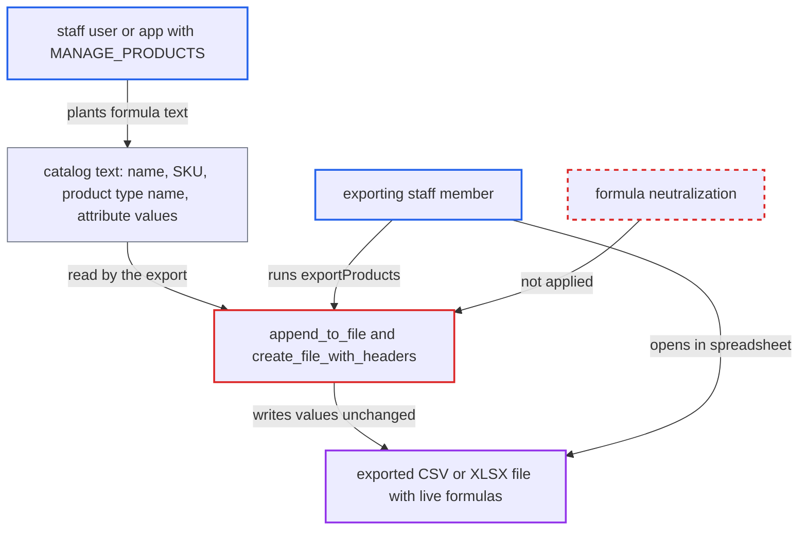

# Product export writes catalog text into CSV/XLSX cells as live spreadsheet formulas

| Field | Value |
|---|---|
| ID | `find_01Lz3f1fFZaVmZJLxjs1GzZe` |
| Severity | **Medium** |
| Status | open |
| CWE | CWE-1236 — CSV injection |
| Created | 2026-10-27T21:21:29.034585Z |
| Claude Security | https://claude.ai/security/findings/find_01Lz3f1fFZaVmZJLxjs1GzZe |

## Description

A staff user or app with `MANAGE_PRODUCTS` (or only `MANAGE_PRODUCT_TYPES_AND_ATTRIBUTES`) can plant spreadsheet formulas in product data. They run on another staff member's computer when that person opens a product export. The export code in `append_to_file` and `create_file_with_headers` writes catalog text into CSV and XLSX cells unchanged. It never neutralizes a leading `=`, `+`, `-`, `@`, tab or carriage return.

1. **attacker (staff user or app)** saves a formula as catalog text through `/graphql/`. A product name, SKU, product type name or attribute value is set to something like `=HYPERLINK(...)` or `=WEBSERVICE(...)`, and `clean_variant_sku` only strips whitespace, so a SKU can start with `=`. ([`saleor/graphql/product/utils.py:240-243`](https://github.com/cx-benchmark/saleor/blob/c982006cc04c77a97def93218dedac8d715eb041/saleor/graphql/product/utils.py#L240-L243))
2. **exporting staff member** runs the `exportProducts` mutation. The mutation requires `MANAGE_PRODUCTS`, lets the caller choose CSV or XLSX through `file_type`, and queues `export_products_task`. ([`saleor/graphql/csv/mutations/export_products.py:85-132`](https://github.com/cx-benchmark/saleor/blob/c982006cc04c77a97def93218dedac8d715eb041/saleor/graphql/csv/mutations/export_products.py#L85-L132))
3. **the task `export_products_task`** calls `export_products` with the requested file type. The attacker needs no further action at this point, because the text was planted earlier. ([`saleor/csv/tasks.py:58-72`](https://github.com/cx-benchmark/saleor/blob/c982006cc04c77a97def93218dedac8d715eb041/saleor/csv/tasks.py#L58-L72))
4. **`get_products_data`** reads the free-text fields and attribute values for the export rows. `name`, `variants__sku`, `product_type__name` and attribute values from `prepare_attribute_value` are taken as stored. ([`saleor/csv/utils/products_data.py:58-78`](https://github.com/cx-benchmark/saleor/blob/c982006cc04c77a97def93218dedac8d715eb041/saleor/csv/utils/products_data.py#L58-L78))
5. **`append_to_file` and `create_file_with_headers`** write the rows into the CSV or XLSX file without escaping. They pass values straight to `petl` (`appendcsv` or `appendxlsx`) with no check for formula-trigger characters. ([`saleor/csv/utils/export.py:158-170`](https://github.com/cx-benchmark/saleor/blob/c982006cc04c77a97def93218dedac8d715eb041/saleor/csv/utils/export.py#L158-L170))
6. **`openpyxl` through `petl`** stores a string starting with `=` as a formula cell in XLSX. The report assumes `openpyxl` 3.1.5 behaves this way and sets recalculation on load, and it ships in the Docker image because `uv sync` runs without `--no-dev`. ([`Dockerfile:14-18`](https://github.com/cx-benchmark/saleor/blob/c982006cc04c77a97def93218dedac8d715eb041/Dockerfile#L14-L18))
7. **`send_export_download_link_notification`** sends the download link to the exporting staff member. That person then opens the finished file in a spreadsheet application. ([`saleor/csv/notifications.py:29-46`](https://github.com/cx-benchmark/saleor/blob/c982006cc04c77a97def93218dedac8d715eb041/saleor/csv/notifications.py#L29-L46))
8. **victim's spreadsheet** evaluates the formula. In XLSX the formula is recalculated on open. In CSV the spreadsheet parses the leading `=`. The victim must open the file and enable editing or click the link.

## Assessment

The attacker is a staff user or third-party app with `MANAGE_PRODUCTS`, or with only `MANAGE_PRODUCT_TYPES_AND_ATTRIBUTES`, which covers product type names and attribute value names. They set a formula such as `=HYPERLINK(...)` or `=WEBSERVICE(...)` that concatenates other cells. Later a different staff member runs `exportProducts` and opens the file. The victim must run the export, open the file, and enable editing or click the link. Either file format works: CSV relies on the spreadsheet parsing the leading `=`, and XLSX stores it as a formula already.

Impact: A formula in the export can send other cells of the file to the attacker's host. One example is stock quantities, which need `MANAGE_PRODUCTS` or `MANAGE_ORDERS` to read, so an attribute-only staff member gains access to them. The gain is limited to catalog and stock data, and Saleor's data and service are not otherwise changed.

Subsequent-system impact: The formula runs in the victim's spreadsheet on their workstation. It can show attacker-chosen phishing links and contact attacker hosts, which reveals the victim's network identity. It can also try DDE-style command payloads, which modern spreadsheet software blocks or warns about. Sandboxing and prompts limit this effect.

## Recommendation

`append_to_file` and `create_file_with_headers` write catalog text authored by other staff and apps into CSV and XLSX cells unchanged. Spreadsheets treat values starting with `=`, `+`, `-`, `@`, tab or carriage return as formulas, and `openpyxl` stores `=`-leading strings as formula cells in XLSX.

Fix criteria: Every string cell in both CSV and XLSX product exports opens as literal text. Values starting with formula trigger characters are neutralized, and XLSX string cells are never stored with the formula data type. Verify by exporting a product named `=1+1`, plus a SKU and an attribute value starting with `+`, `-` and `@`, in both formats. Each cell must show the literal text, with no formula in the XLSX sheet XML.

## Evidence

**https://github.com/cx-benchmark/saleor**

- [`saleor/csv/utils/export.py:158-170`](https://github.com/cx-benchmark/saleor/blob/c982006cc04c77a97def93218dedac8d715eb041/saleor/csv/utils/export.py#L158-L170)
- [`saleor/csv/utils/export.py:112-122`](https://github.com/cx-benchmark/saleor/blob/c982006cc04c77a97def93218dedac8d715eb041/saleor/csv/utils/export.py#L112-L122)
- [`saleor/csv/utils/products_data.py:58-78`](https://github.com/cx-benchmark/saleor/blob/c982006cc04c77a97def93218dedac8d715eb041/saleor/csv/utils/products_data.py#L58-L78)
- [`saleor/csv/utils/products_data.py:481-510`](https://github.com/cx-benchmark/saleor/blob/c982006cc04c77a97def93218dedac8d715eb041/saleor/csv/utils/products_data.py#L481-L510)
- [`saleor/graphql/product/utils.py:240-243`](https://github.com/cx-benchmark/saleor/blob/c982006cc04c77a97def93218dedac8d715eb041/saleor/graphql/product/utils.py#L240-L243)
- [`saleor/graphql/csv/mutations/export_products.py:85-132`](https://github.com/cx-benchmark/saleor/blob/c982006cc04c77a97def93218dedac8d715eb041/saleor/graphql/csv/mutations/export_products.py#L85-L132)
- [`saleor/csv/tasks.py:58-72`](https://github.com/cx-benchmark/saleor/blob/c982006cc04c77a97def93218dedac8d715eb041/saleor/csv/tasks.py#L58-L72)
- [`saleor/csv/notifications.py:29-46`](https://github.com/cx-benchmark/saleor/blob/c982006cc04c77a97def93218dedac8d715eb041/saleor/csv/notifications.py#L29-L46)
- [`Dockerfile:14-18`](https://github.com/cx-benchmark/saleor/blob/c982006cc04c77a97def93218dedac8d715eb041/Dockerfile#L14-L18)

