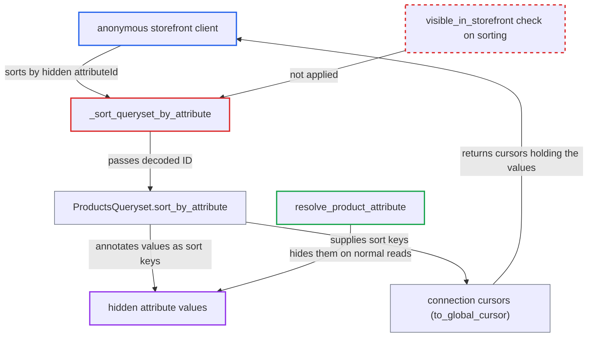

# Product sort by attributeId discloses hidden attribute values to anonymous users via cursors

| Field | Value |
|---|---|
| ID | `find_01S6uYqVCkqdQauJeA8i2VLo` |
| Severity | **Medium** |
| Status | open |
| CWE | CWE-200 — Information exposure |
| Created | 2026-10-27T21:21:28.687363Z |
| Claude Security | https://claude.ai/security/findings/find_01S6uYqVCkqdQauJeA8i2VLo |

## Description

An anonymous storefront visitor can read the values of product attributes the merchant hid with `visible_in_storefront=False`, for every product they can list in a channel. They only need to sort the public `products` query by the hidden attribute's ID and decode the returned cursors. The sort path `_sort_queryset_by_attribute` never applies the visibility rule, and the cursors carry the sort values in plain base64 JSON.

1. **anonymous client** sends a products query sorted by a hidden attribute's ID. The query sets `sortBy:{attributeId:...}` and selects `edges{cursor}`. The `attributeId` argument is a free ID, and the `products` connection (like `category.products` and `collection.products`) needs no permission. ([`saleor/graphql/product/sorters.py:293-308`](https://github.com/cx-benchmark/saleor/blob/c982006cc04c77a97def93218dedac8d715eb041/saleor/graphql/product/sorters.py#L293-L308))
2. **the function `_sort_queryset_by_attribute`** decodes the ID and calls `sort_by_attribute` without any visibility check. It uses no requestor and does no attribute lookup, so the `visible_in_storefront` flag is never read. ([`saleor/graphql/utils/sorting.py:15-22`](https://github.com/cx-benchmark/saleor/blob/c982006cc04c77a97def93218dedac8d715eb041/saleor/graphql/utils/sorting.py#L15-L22))
3. **the method `ProductsQueryset.sort_by_attribute`** annotates each product with the hidden attribute's values and sorts by them. It accepts any numeric attribute pk and adds `numeric_value`, `concatenated_values` and `concatenated_values_order`, filtered only by `attribute_id`. ([`saleor/product/managers.py:157-248`](https://github.com/cx-benchmark/saleor/blob/c982006cc04c77a97def93218dedac8d715eb041/saleor/product/managers.py#L157-L248))
4. **the connection code in `connection.py`** takes these annotations as sorting fields and writes them into every edge cursor. `_get_sorting_fields` returns `Product.sort_by_attribute_fields()`, and `_get_edges_for_connection` puts those values into each cursor and into `pageInfo.startCursor` and `endCursor`. ([`saleor/graphql/core/connection.py:232-237`](https://github.com/cx-benchmark/saleor/blob/c982006cc04c77a97def93218dedac8d715eb041/saleor/graphql/core/connection.py#L232-L237))
5. **`to_global_cursor`** encodes the values as plain base64 JSON. The cursor has the form `[order, numeric_value, concatenated_values, name]`, so anyone can decode it. ([`saleor/product/models.py:272-278`](https://github.com/cx-benchmark/saleor/blob/c982006cc04c77a97def93218dedac8d715eb041/saleor/product/models.py#L272-L278))
6. **anonymous client** decodes the cursors and repeats for other attribute IDs and pages. Attribute IDs are base64 of sequential integers, so the client can try each one. Paging with `after` covers the whole catalogue.

## Assessment

The attacker is an anonymous client of `/graphql/`. No login, special role or victim action is needed. The merchant must have assigned values to an attribute with `visible_in_storefront=False`. The attacker sends `products(channel:"default-channel", first:100, sortBy:{attributeId:"<base64 Attribute:N>", direction:ASC}){edges{cursor node{id name}}}` for sequential N and base64-decodes each cursor. The same `sortBy` input is also offered on `category.products` and `collection.products`. Comparing the decoded values with the public `Product.attributes` output shows which attributes are hidden.

Impact: The attacker reads the value names and numeric values of hidden attributes for every published product they can list, plus each product's position in that sort. This can include internal data such as costs, supplier codes or internal flags. The loss is limited: products the caller cannot list stay out of reach, only product-attribute data leaks (no PII or secrets), and nothing can be changed.

## Recommendation

`_sort_queryset_by_attribute` and `ProductsQueryset.sort_by_attribute` sort by any attribute ID without applying the `visible_in_storefront` rule. The connection then writes the attribute-derived sort keys (`numeric_value`, `concatenated_values`) into client-visible cursors.

Fix criteria: For requestors without `MANAGE_PRODUCTS`, sorting by an attribute with `visible_in_storefront=False` is refused or behaves as for a nonexistent attribute. No cursor contains values of such an attribute. An anonymous `products(sortBy:{attributeId:<hidden>}){edges{cursor}}` response no longer contains or varies with the hidden values. A `MANAGE_PRODUCTS` staff client can still sort by that attribute.

## Evidence

**https://github.com/cx-benchmark/saleor**

- [`saleor/graphql/utils/sorting.py:15-22`](https://github.com/cx-benchmark/saleor/blob/c982006cc04c77a97def93218dedac8d715eb041/saleor/graphql/utils/sorting.py#L15-L22)
- [`saleor/product/managers.py:157-248`](https://github.com/cx-benchmark/saleor/blob/c982006cc04c77a97def93218dedac8d715eb041/saleor/product/managers.py#L157-L248)
- [`saleor/graphql/core/connection.py:232-237`](https://github.com/cx-benchmark/saleor/blob/c982006cc04c77a97def93218dedac8d715eb041/saleor/graphql/core/connection.py#L232-L237)
- [`saleor/graphql/core/connection.py:165-172`](https://github.com/cx-benchmark/saleor/blob/c982006cc04c77a97def93218dedac8d715eb041/saleor/graphql/core/connection.py#L165-L172)
- [`saleor/product/models.py:272-278`](https://github.com/cx-benchmark/saleor/blob/c982006cc04c77a97def93218dedac8d715eb041/saleor/product/models.py#L272-L278)
- [`saleor/graphql/product/schema.py:243-263`](https://github.com/cx-benchmark/saleor/blob/c982006cc04c77a97def93218dedac8d715eb041/saleor/graphql/product/schema.py#L243-L263)
- [`saleor/graphql/product/sorters.py:293-308`](https://github.com/cx-benchmark/saleor/blob/c982006cc04c77a97def93218dedac8d715eb041/saleor/graphql/product/sorters.py#L293-L308)
- [`saleor/graphql/product/resolvers.py:265-293`](https://github.com/cx-benchmark/saleor/blob/c982006cc04c77a97def93218dedac8d715eb041/saleor/graphql/product/resolvers.py#L265-L293)

