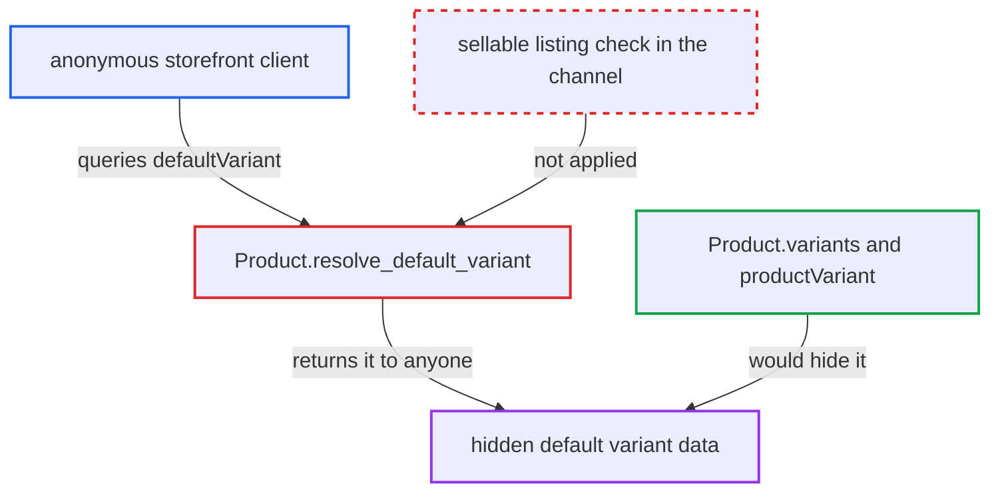

# Product.defaultVariant exposes channel-hidden variants to anonymous customers

| Field | Value |
|---|---|
| ID | `find_01H7xSWt7Q6CnK5n1C4Kwaoj` |
| Severity | **Medium** |
| Status | open |
| CWE | CWE-285 — Missing authorization |
| Created | 2026-10-27T21:25:45.823190Z |
| Claude Security | https://claude.ai/security/findings/find_01H7xSWt7Q6CnK5n1C4Kwaoj |

## Description

An anonymous storefront client can read catalogue data of a product variant the merchant has hidden from a channel. This covers the variant's name, SKU, external reference, attributes, weight, public metadata and stock-derived available quantity. It leaks one variant per product, and only when another variant keeps the product visible. The cause is `Product.resolve_default_variant`, which skips the per-channel sellable-listing check that other variant resolvers apply.

1. **merchant** withdraws the default variant from a channel. The variant's listing is deleted, its price is left unset, or `isAvailableForPurchase` is set to false. The variant was usually made the default automatically as the first one created, and the default changes only when set explicitly. ([`saleor/graphql/product/mutations/product_variant/product_variant_create.py:216-218`](https://github.com/cx-benchmark/saleor/blob/c982006cc04c77a97def93218dedac8d715eb041/saleor/graphql/product/mutations/product_variant/product_variant_create.py#L216-L218))
2. **merchant** keeps another variant sellable in the channel. The product stays visible to customers because of the other variant, so the product can still be queried.
3. **anonymous client** queries `product(slug, channel)` and asks for `defaultVariant` fields. No account is needed. The query asks for fields such as `name`, `sku`, `externalReference`, `attributes`, `weight`, `metadata` and `quantityAvailable`.
4. **the resolver `Product.resolve_default_variant`** loads the default variant with `ProductVariantByIdLoader` and returns it in the caller's channel context. It checks neither the requestor's permissions nor whether the variant has a sellable listing in the channel. ([`saleor/graphql/product/types/products.py:1082-1095`](https://github.com/cx-benchmark/saleor/blob/c982006cc04c77a97def93218dedac8d715eb041/saleor/graphql/product/types/products.py#L1082-L1095))
5. **the GraphQL API** returns the hidden variant's data to the anonymous client. `Product.variants` and the root `productVariant` query would hide this same variant from that caller. ([`saleor/graphql/product/types/products.py:1425-1447`](https://github.com/cx-benchmark/saleor/blob/c982006cc04c77a97def93218dedac8d715eb041/saleor/graphql/product/types/products.py#L1425-L1447))

## Assessment

The attacker is an anonymous storefront client of `/graphql/`. No account is needed and no victim takes part. The merchant's data must be in one state: a published product whose default variant has no sellable listing in the channel, while another variant does. A sellable listing means `price_amount` is set and `is_available_for_purchase=True`. The attacker sends a `product` query with a slug and channel and selects fields on `defaultVariant`.

Impact: The attacker reads the hidden variant's `name`, `sku`, `externalReference`, storefront-visible attributes, `weight`, public metadata, `quantityLimitPerCustomer` and `quantityAvailable`. The leak is limited to one variant per product. Prices are not exposed, because `ProductVariant.pricing` is null for a non-sellable listing. `channelListings` still requires staff or app authentication. The variant cannot be bought, since checkout and order validation reject it.

## Recommendation

`Product.resolve_default_variant` returns the default variant without the per-channel sellable-listing rule that every other variant resolver applies to requestors without product permissions. This breaks the documented hiding of variants that are unlisted or set `isAvailableForPurchase: false`.

Fix criteria: For requestors without `ALL_PRODUCTS_PERMISSIONS`, `defaultVariant` returns null unless the variant is in the set `Product.variants` returns for that channel. That means it has a sellable listing, with price set and `is_available_for_purchase=True`. Verify by querying as an anonymous caller a product whose default variant is unlisted, or has `isAvailableForPurchase=false`, in the channel. The result must be `defaultVariant: null`. Staff with `MANAGE_PRODUCTS` must still see the variant.

## Evidence

**https://github.com/cx-benchmark/saleor**

- [`saleor/graphql/product/types/products.py:1082-1095`](https://github.com/cx-benchmark/saleor/blob/c982006cc04c77a97def93218dedac8d715eb041/saleor/graphql/product/types/products.py#L1082-L1095)
- [`saleor/graphql/product/types/products.py:1425-1447`](https://github.com/cx-benchmark/saleor/blob/c982006cc04c77a97def93218dedac8d715eb041/saleor/graphql/product/types/products.py#L1425-L1447)
- [`saleor/product/managers.py:322-371`](https://github.com/cx-benchmark/saleor/blob/c982006cc04c77a97def93218dedac8d715eb041/saleor/product/managers.py#L322-L371)
- [`saleor/graphql/product/resolvers.py:176-203`](https://github.com/cx-benchmark/saleor/blob/c982006cc04c77a97def93218dedac8d715eb041/saleor/graphql/product/resolvers.py#L176-L203)
- [`saleor/graphql/product/types/channels.py:312-318`](https://github.com/cx-benchmark/saleor/blob/c982006cc04c77a97def93218dedac8d715eb041/saleor/graphql/product/types/channels.py#L312-L318)
- [`saleor/graphql/product/mutations/product_variant/product_variant_create.py:216-218`](https://github.com/cx-benchmark/saleor/blob/c982006cc04c77a97def93218dedac8d715eb041/saleor/graphql/product/mutations/product_variant/product_variant_create.py#L216-L218)

