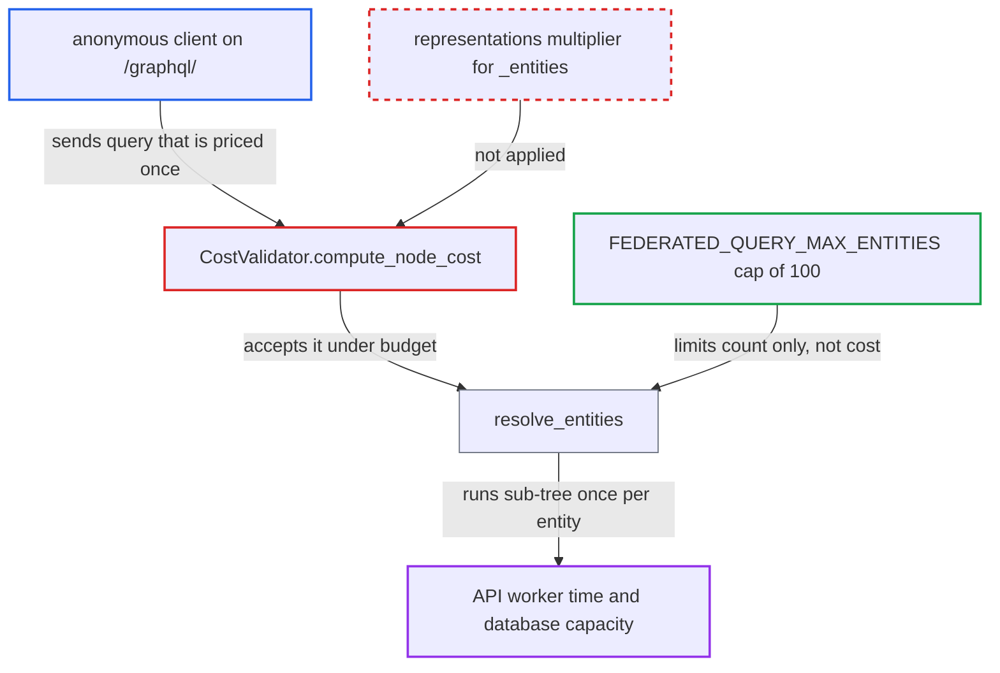

# Query cost validator does not multiply federation _entities sub-selection by representation count

| Field | Value |
|---|---|
| ID | `find_01Upyfyvu7ao554GKo4hqb31` |
| Severity | **Medium** |
| Status | open |
| CWE | CWE-770 — Allocation of Resources Without Limits |
| Created | 2026-10-27T21:23:00.963093Z |
| Claude Security | https://claude.ai/security/findings/find_01Upyfyvu7ao554GKo4hqb31 |

## Description

An anonymous visitor to `/graphql/` can make one request do up to 100 times the work the server's query cost limit is meant to allow. That slows the API and database for all storefronts and the dashboard. The report says availability is degraded, not lost, and no data is exposed or changed. The cause is that the cost validator prices the `_entities` sub-selection once, although it runs once per representation.

1. **anonymous client** posts a query using `_entities` with 100 duplicate representations of one public product. The `_entities` field is on the public `Query` type, and duplicate representations are allowed, so no special data is needed. ([`saleor/graphql/core/federation/schema.py:68-80`](https://github.com/cx-benchmark/saleor/blob/c982006cc04c77a97def93218dedac8d715eb041/saleor/graphql/core/federation/schema.py#L68-L80))
2. **cost validator `CostValidator.compute_node_cost`** prices the `_entities` field at the default cost of 0 and adds no multiplier. The `Query` section of `COST_MAP` has no `_entities` entry, so the field falls back to `default_cost`. ([`saleor/graphql/query_cost_map.py:57-135`](https://github.com/cx-benchmark/saleor/blob/c982006cc04c77a97def93218dedac8d715eb041/saleor/graphql/query_cost_map.py#L57-L135))
3. **cost validator** prices the `_Entity` inline fragments once. Their child selection is costed with the parent's unchanged `operation_multipliers`, so the nested sub-tree comes to about 10,200, under the 50,000 limit of `GRAPHQL_QUERY_MAX_COMPLEXITY`, and the query is accepted. ([`saleor/graphql/core/validators/query_cost.py:97-110`](https://github.com/cx-benchmark/saleor/blob/c982006cc04c77a97def93218dedac8d715eb041/saleor/graphql/core/validators/query_cost.py#L97-L110))
4. **`get_multipliers_from_string`** could not turn the `representations` list into a multiplier even if a cost-map entry existed. It calls `int()` on the argument value, which raises `TypeError` for a list, and the error is silently skipped. ([`saleor/graphql/core/validators/query_cost.py:221-236`](https://github.com/cx-benchmark/saleor/blob/c982006cc04c77a97def93218dedac8d715eb041/saleor/graphql/core/validators/query_cost.py#L221-L236))
5. **resolver `resolve_entities`** returns one entity per representation. It only checks that the count is at most `FEDERATED_QUERY_MAX_ENTITIES` (default 100), so 100 copies give 100 entities. ([`saleor/graphql/core/federation/schema.py:111-164`](https://github.com/cx-benchmark/saleor/blob/c982006cc04c77a97def93218dedac8d715eb041/saleor/graphql/core/federation/schema.py#L111-L164))
6. **`Product.__resolve_references`** maps each duplicate representation back to the same product. It returns `[products.get(root_id) for root_id in roots_ids]`, so every duplicate becomes an entity. ([`saleor/graphql/product/types/products.py:1639-1666`](https://github.com/cx-benchmark/saleor/blob/c982006cc04c77a97def93218dedac8d715eb041/saleor/graphql/product/types/products.py#L1639-L1666))
7. **the executor and `Product.resolve_product_variants`** resolve the nested connections once for each of the 100 entities. Each execution builds and slices its own queryset with no dataloader de-duplication, so the database work is repeated 100 times. ([`saleor/graphql/product/types/products.py:1450-1476`](https://github.com/cx-benchmark/saleor/blob/c982006cc04c77a97def93218dedac8d715eb041/saleor/graphql/product/types/products.py#L1450-L1476))

## Assessment

The attacker is any anonymous internet user who can reach `/graphql/`. No login, special role or setting is needed. The attacker needs the public ID of one visible product and sends the same representation up to `FEDERATED_QUERY_MAX_ENTITIES` times (default 100). A sub-tree priced just under `GRAPHQL_QUERY_MAX_COMPLEXITY` (50,000) then does up to 100 times that work. The report notes this is separate from an operation-variable-default bypass filed separately, and that the two stack.

Impact: One request can cost up to 100 times the configured `GRAPHQL_QUERY_MAX_COMPLEXITY` budget. This uses API worker time and database capacity that all storefronts and the dashboard share. The amplification is capped at 100 times, so availability is degraded rather than lost outright. No data is disclosed or modified.

## Recommendation

The cost validator prices the `_entities` sub-selection once, although it runs once per supplied representation. Neither `COST_MAP` nor the validator turns the length of `representations` into a multiplier. `get_multipliers_from_string` also cannot use a list-valued argument as a multiplier.

Fix criteria: The validated cost of an `_entities` selection scales with the number of representations, whether they are given literally or through a variable. Where the count cannot be determined, it is priced at the `FEDERATED_QUERY_MAX_ENTITIES` worst case. A test shows that `_entities` with 100 representations over a nested sub-selection of cost C is priced at 100·C or more. The same test shows it is rejected when that exceeds `GRAPHQL_QUERY_MAX_COMPLEXITY`.

## Evidence

**https://github.com/cx-benchmark/saleor**

- [`saleor/graphql/query_cost_map.py:57-135`](https://github.com/cx-benchmark/saleor/blob/c982006cc04c77a97def93218dedac8d715eb041/saleor/graphql/query_cost_map.py#L57-L135)
- [`saleor/graphql/core/validators/query_cost.py:97-110`](https://github.com/cx-benchmark/saleor/blob/c982006cc04c77a97def93218dedac8d715eb041/saleor/graphql/core/validators/query_cost.py#L97-L110)
- [`saleor/graphql/core/validators/query_cost.py:221-236`](https://github.com/cx-benchmark/saleor/blob/c982006cc04c77a97def93218dedac8d715eb041/saleor/graphql/core/validators/query_cost.py#L221-L236)
- [`saleor/graphql/core/federation/schema.py:68-80`](https://github.com/cx-benchmark/saleor/blob/c982006cc04c77a97def93218dedac8d715eb041/saleor/graphql/core/federation/schema.py#L68-L80)
- [`saleor/graphql/core/federation/schema.py:111-164`](https://github.com/cx-benchmark/saleor/blob/c982006cc04c77a97def93218dedac8d715eb041/saleor/graphql/core/federation/schema.py#L111-L164)
- [`saleor/graphql/product/types/products.py:1639-1666`](https://github.com/cx-benchmark/saleor/blob/c982006cc04c77a97def93218dedac8d715eb041/saleor/graphql/product/types/products.py#L1639-L1666)
- [`saleor/graphql/product/types/products.py:1450-1476`](https://github.com/cx-benchmark/saleor/blob/c982006cc04c77a97def93218dedac8d715eb041/saleor/graphql/product/types/products.py#L1450-L1476)
- [`saleor/settings.py:912-916`](https://github.com/cx-benchmark/saleor/blob/c982006cc04c77a97def93218dedac8d715eb041/saleor/settings.py#L912-L916)

