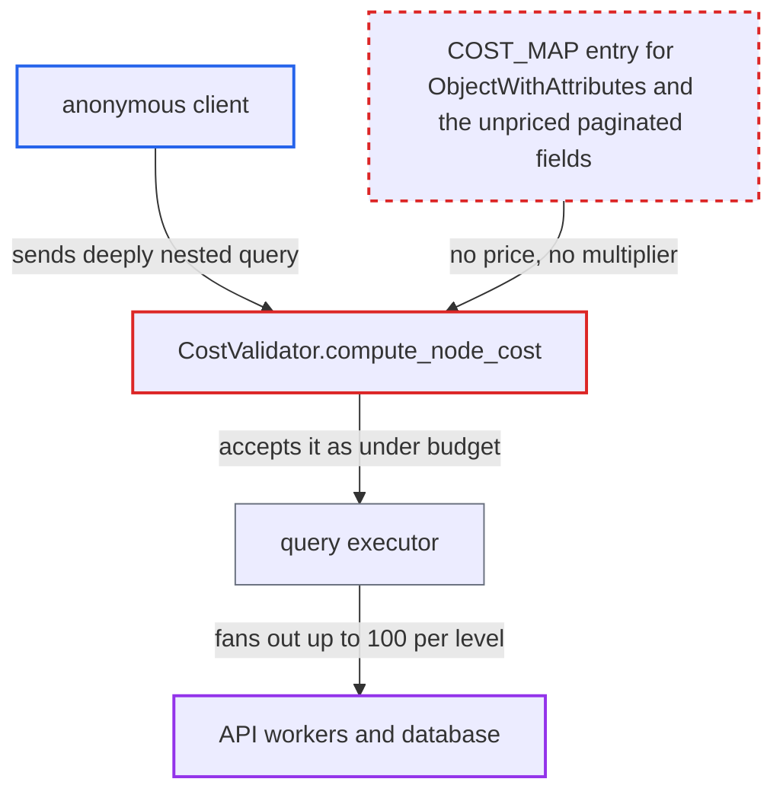

# Query cost validator drops limit/first multipliers for interface-typed and unpriced paginated fields

| Field | Value |
|---|---|
| ID | `find_01ER9xaAbSKb27goQib1tXo6` |
| Severity | **Medium** |
| Status | open |
| CWE | CWE-770 — Allocation of Resources Without Limits |
| Created | 2026-10-27T21:24:43.360276Z |
| Claude Security | https://claude.ai/security/findings/find_01ER9xaAbSKb27goQib1tXo6 |

## Description

An anonymous client can send GraphQL queries that the server prices far below their real cost. This ties up API worker CPU, memory and database load. The effect is limited by the store's data and the 100-item cap per connection, and no data is disclosed or changed. The cause is `compute_node_cost`, which finds no `COST_MAP` entry for the interface `ObjectWithAttributes` and for ten paginated fields. It then drops their `limit`/`first` multipliers.

1. **attacker** sends a query that selects `assignedAttributes(limit:100)` through `... on ObjectWithAttributes`. The query sits under `products(first:100, channel:...)` and needs no login.
2. **the validator `CostValidator.compute_node_cost`** looks up each field's price by the static parent type name. When no entry exists, the field costs `default_cost` (0) and pushes no multiplier, so its children are costed with the ancestors' multipliers unchanged. ([`saleor/graphql/core/validators/query_cost.py:97-110`](https://github.com/cx-benchmark/saleor/blob/c982006cc04c77a97def93218dedac8d715eb041/saleor/graphql/core/validators/query_cost.py#L97-L110))
3. **the validator `CostValidator.compute_node_cost`** costs an inline fragment's body against the type in its condition. Here that type is the interface `ObjectWithAttributes`, not the concrete `Product` the selection runs on. ([`saleor/graphql/core/validators/query_cost.py:131-142`](https://github.com/cx-benchmark/saleor/blob/c982006cc04c77a97def93218dedac8d715eb041/saleor/graphql/core/validators/query_cost.py#L131-L142))
4. **`COST_MAP`** returns no price for `ObjectWithAttributes.assignedAttributes`. Only `Product`, `ProductVariant`, `Page` and `User` are priced with `multipliers: ["limit"]`, so the ×100 factor is lost for the whole subtree. ([`saleor/graphql/query_cost_map.py:338-355`](https://github.com/cx-benchmark/saleor/blob/c982006cc04c77a97def93218dedac8d715eb041/saleor/graphql/query_cost_map.py#L338-L355))
5. **the field `ObjectWithAttributes.assignedAttributes`** accepts any positive `limit`. The default is 100 and there is no upper bound, so the executor can return up to N attributes per object. ([`saleor/graphql/attribute/types.py:1606-1628`](https://github.com/cx-benchmark/saleor/blob/c982006cc04c77a97def93218dedac8d715eb041/saleor/graphql/attribute/types.py#L1606-L1628))
6. **attacker** nests the same trick through multi-reference attribute values. `AssignedMultiProductReferenceAttribute.value(limit)` returns `Product` objects again, so the unpriced interface selection can repeat at each level, and the report says no query-depth rule exists. ([`saleor/graphql/attribute/types.py:1119-1170`](https://github.com/cx-benchmark/saleor/blob/c982006cc04c77a97def93218dedac8d715eb041/saleor/graphql/attribute/types.py#L1119-L1170))
7. **the validator** accepts the query as under budget. The example query is priced at 20,100, below the 50,000 limit, while the same selection on `Product` directly is priced above 1,000,000 and refused.
8. **the executor** runs the query and returns up to N items at every level. The real work depends on how many attributes and multi-reference attributes the catalogue has.

## Assessment

Any anonymous client who can reach the GraphQL API can do this. It uses a query such as `products(first:100, channel:...)` with `... on ObjectWithAttributes { assignedAttributes(limit:100) ... }`, nested through `AssignedMultiProductReferenceAttribute` values. A second way in is the eleven `first`/`last` fields with no `COST_MAP` entry, namely `Query.promotions`, `Query.transactions`, `Query.reportProductSales`, `Warehouse.stocks`, `Warehouse.shippingZones`, `Webhook.eventDeliveries`, `EventDelivery.attempts`, `ShippingMethodType.excludedProducts`, `Voucher.codes`, `User.checkouts` and the interface field. Staff, apps, or customers (through `me.checkouts`) can use the unpriced connections the same way. The attacker does not control the catalogue, which sets how much work the executor really does.

Impact: The attacker can run queries far above the configured `GRAPHQL_QUERY_MAX_COMPLEXITY` budget. Each unpriced level removes a factor of up to 100 from the cost of everything nested under it. This loads API worker CPU and memory and the database across the shared deployment. No data is disclosed or modified, and the real fan-out is bounded by the store's data and the 100-item cap per connection.

## Recommendation

(1) `COST_MAP` lookups are keyed by the static parent type of the selection. A field declared on an interface and selected through an interface-typed fragment, such as `ObjectWithAttributes.assignedAttributes`, is therefore not matched by the concrete-type entries.

Fix criteria: A field costs the same whichever type condition it is selected under. This holds either because every interface that declares priced fields has an entry (`ObjectWithAttributes.assignedAttributes` with the `limit` multiplier) or because the entry is resolved through the implementing types. A check confirms that `... on ObjectWithAttributes { assignedAttributes(limit:100) }` under `products(first:100)` is costed at 100·100, like the direct `Product.assignedAttributes` form.

(2) Several paginated fields have no cost entry, so their page size is never a multiplier. They are `Query.promotions`, `Query.transactions`, `Query.reportProductSales`, `ShippingMethodType.excludedProducts`, `Voucher.codes`, `Warehouse.stocks`, `Warehouse.shippingZones`, `Webhook.eventDeliveries`, `EventDelivery.attempts` and `User.checkouts`.

Fix criteria: Every field that accepts `first`, `last` or `limit` has a cost entry with the matching multiplier. A test asserts that the set of connection and limited fields in the schema is a subset of the priced fields in `COST_MAP`, so new fields cannot ship unpriced. A check confirms that `promotions(first:100){edges{node{rules{id}}}}` is costed at 100 or more.

## Evidence

**https://github.com/cx-benchmark/saleor**

- [`saleor/graphql/core/validators/query_cost.py:97-110`](https://github.com/cx-benchmark/saleor/blob/c982006cc04c77a97def93218dedac8d715eb041/saleor/graphql/core/validators/query_cost.py#L97-L110)
- [`saleor/graphql/core/validators/query_cost.py:131-142`](https://github.com/cx-benchmark/saleor/blob/c982006cc04c77a97def93218dedac8d715eb041/saleor/graphql/core/validators/query_cost.py#L131-L142)
- [`saleor/graphql/query_cost_map.py:338-355`](https://github.com/cx-benchmark/saleor/blob/c982006cc04c77a97def93218dedac8d715eb041/saleor/graphql/query_cost_map.py#L338-L355)
- [`saleor/graphql/attribute/types.py:1606-1628`](https://github.com/cx-benchmark/saleor/blob/c982006cc04c77a97def93218dedac8d715eb041/saleor/graphql/attribute/types.py#L1606-L1628)
- [`saleor/graphql/attribute/types.py:1119-1170`](https://github.com/cx-benchmark/saleor/blob/c982006cc04c77a97def93218dedac8d715eb041/saleor/graphql/attribute/types.py#L1119-L1170)
- [`saleor/graphql/warehouse/types.py:107-114`](https://github.com/cx-benchmark/saleor/blob/c982006cc04c77a97def93218dedac8d715eb041/saleor/graphql/warehouse/types.py#L107-L114)
- [`saleor/graphql/discount/schema.py:164-172`](https://github.com/cx-benchmark/saleor/blob/c982006cc04c77a97def93218dedac8d715eb041/saleor/graphql/discount/schema.py#L164-L172)

