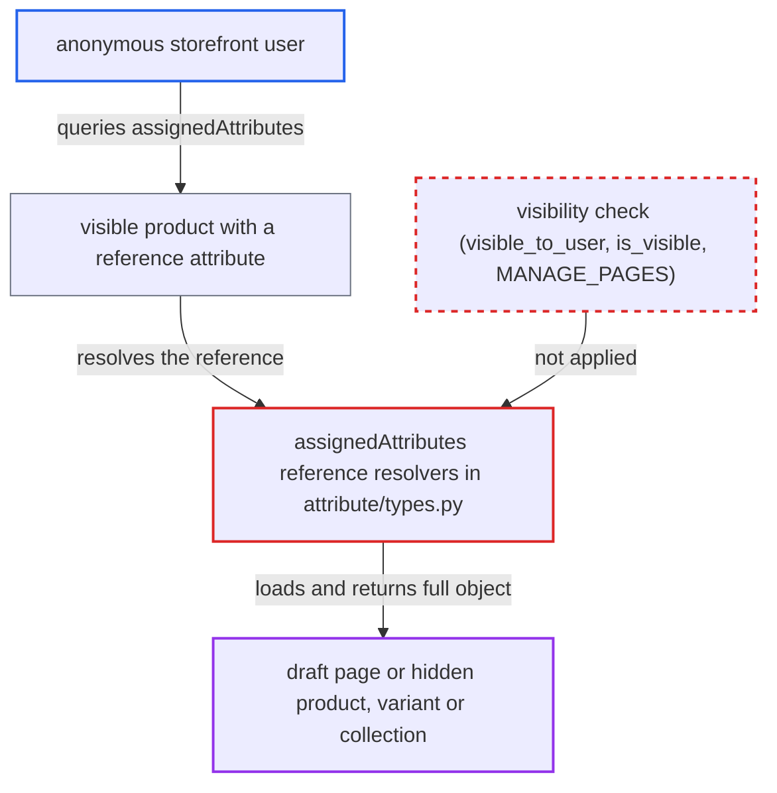

# Reference attributes return unpublished pages, products, variants and collections to anonymous users

| Field | Value |
|---|---|
| ID | `find_01FEULengU53ZxJZX6wtxir2` |
| Severity | **Medium** |
| Status | open |
| CWE | CWE-862 — Missing authorization |
| Created | 2026-10-27T21:11:05.430217Z |
| Claude Security | https://claude.ai/security/findings/find_01FEULengU53ZxJZX6wtxir2 |

## Description

An anonymous storefront user can read content of draft or scheduled pages, and of products, variants and collections hidden in their channel. This works when a visible object references the hidden item through a reference attribute that is visible in the storefront (the default). The resolvers in `saleor/graphql/attribute/types.py` load the target with unfiltered dataloaders and never check visibility or `MANAGE_PAGES`. Only referenced items are reachable, and the data is catalogue content.

1. **Staff member** links a visible product, variant or page to an unpublished item through a reference attribute. The target is a draft or scheduled page, or a product, variant or collection hidden in the channel, and the attribute's `visible_in_storefront` is `True`, which is its default.
2. **Anonymous attacker** queries the visible object's `assignedAttributes` on `/graphql/`. The query asks for fields such as `title`, `content`, `seoDescription` and `metadata` on the referenced item, for example through `AssignedSinglePageReferenceAttribute`. ([`saleor/graphql/product/resolvers.py:300-323`](https://github.com/cx-benchmark/saleor/blob/c982006cc04c77a97def93218dedac8d715eb041/saleor/graphql/product/resolvers.py#L300-L323))
3. **the resolver `resolve_product_attributes`** returns the product's attributes to the anonymous caller. It filters attributes only by `visible_in_storefront` and never by the visibility of the entity they reference. ([`saleor/graphql/product/resolvers.py:300-323`](https://github.com/cx-benchmark/saleor/blob/c982006cc04c77a97def93218dedac8d715eb041/saleor/graphql/product/resolvers.py#L300-L323))
4. **the resolver `AssignedSinglePageReferenceAttribute.resolve_value`** loads the referenced page with `PageByIdLoader`. It does not call `visible_to_user`, does not test `is_visible` and does not look at the requestor's `MANAGE_PAGES`. The product, variant, collection and multi-reference resolvers behave the same way. ([`saleor/graphql/attribute/types.py:883-914`](https://github.com/cx-benchmark/saleor/blob/c982006cc04c77a97def93218dedac8d715eb041/saleor/graphql/attribute/types.py#L883-L914))
5. **the dataloader `PageByIdLoader`** fetches the row with a plain `in_bulk` lookup. There is no published filter, so unpublished or scheduled rows come back like any other. `ProductByIdLoader`, `ProductVariantByIdLoader` and `CollectionByIdLoader` are equally unfiltered. ([`saleor/graphql/page/dataloaders.py:13-18`](https://github.com/cx-benchmark/saleor/blob/c982006cc04c77a97def93218dedac8d715eb041/saleor/graphql/page/dataloaders.py#L13-L18))
6. **the resolver** returns the raw row wrapped as a full GraphQL object. The `Page` and `Product` types re-check nothing on fields such as `title`, `content`, `name`, `description` or `media`, so the hidden content reaches the anonymous caller. ([`saleor/graphql/attribute/types.py:917-1063`](https://github.com/cx-benchmark/saleor/blob/c982006cc04c77a97def93218dedac8d715eb041/saleor/graphql/attribute/types.py#L917-L1063))

## Assessment

The attacker is an anonymous storefront user who needs only access to `/graphql/`. It depends on staff having linked a visible product, variant or page to a draft or scheduled page, or to a product, variant or collection hidden in the channel. The link must use a reference attribute (`REFERENCE` or `SINGLE_REFERENCE`) whose `visible_in_storefront` is `True`, the default. The report calls this a normal editorial state. The older `SelectedAttribute.values` path is a second way in, but it exposes only the target's current title or name and its global ID.

Impact: Anonymous users can read content that publication rules should hide. This covers draft or embargoed page title, content, SEO fields, public metadata and attributes. It also covers hidden products' name, description, media and category, variant names and SKUs, and hidden collections. Private metadata stays protected, and anonymous `Product.variants` remain channel-filtered. Category references leak nothing, because categories have no publication state. Only referenced entities are reachable and the data is not personal, so the loss is limited.

## Recommendation

The reference resolvers in `saleor/graphql/attribute/types.py` (`AssignedSingle*ReferenceAttribute`, `AssignedMulti*ReferenceAttribute` and the legacy `AttributeValue.name` and `reference`) return rows from unfiltered `*ByIdLoader` dataloaders. The visibility rules applied elsewhere do not cover entities reached by reference.

Fix criteria: A caller without `MANAGE_PAGES` gets `null`, or no list entry, for a referenced page that is not published or whose `published_at` is in the future. A caller without product permissions gets the same for a referenced product, variant or collection not visible in the request's channel. Staff with the permission still see them. An anonymous query of a published product that references a draft page and an unlisted product returns nothing for them. This holds through both `assignedAttributes` and `attributes{values}`.

## Evidence

**https://github.com/cx-benchmark/saleor**

- [`saleor/graphql/attribute/types.py:883-914`](https://github.com/cx-benchmark/saleor/blob/c982006cc04c77a97def93218dedac8d715eb041/saleor/graphql/attribute/types.py#L883-L914)
- [`saleor/graphql/attribute/types.py:917-1063`](https://github.com/cx-benchmark/saleor/blob/c982006cc04c77a97def93218dedac8d715eb041/saleor/graphql/attribute/types.py#L917-L1063)
- [`saleor/graphql/attribute/types.py:1065-1324`](https://github.com/cx-benchmark/saleor/blob/c982006cc04c77a97def93218dedac8d715eb041/saleor/graphql/attribute/types.py#L1065-L1324)
- [`saleor/graphql/page/dataloaders.py:13-18`](https://github.com/cx-benchmark/saleor/blob/c982006cc04c77a97def93218dedac8d715eb041/saleor/graphql/page/dataloaders.py#L13-L18)
- [`saleor/graphql/product/dataloaders/products.py:48-53`](https://github.com/cx-benchmark/saleor/blob/c982006cc04c77a97def93218dedac8d715eb041/saleor/graphql/product/dataloaders/products.py#L48-L53)
- [`saleor/graphql/product/resolvers.py:300-323`](https://github.com/cx-benchmark/saleor/blob/c982006cc04c77a97def93218dedac8d715eb041/saleor/graphql/product/resolvers.py#L300-L323)
- [`saleor/graphql/menu/types.py:219-238`](https://github.com/cx-benchmark/saleor/blob/c982006cc04c77a97def93218dedac8d715eb041/saleor/graphql/menu/types.py#L219-L238)
- [`saleor/graphql/page/resolvers.py:10-40`](https://github.com/cx-benchmark/saleor/blob/c982006cc04c77a97def93218dedac8d715eb041/saleor/graphql/page/resolvers.py#L10-L40)
- [`saleor/graphql/product/resolvers.py:107-131`](https://github.com/cx-benchmark/saleor/blob/c982006cc04c77a97def93218dedac8d715eb041/saleor/graphql/product/resolvers.py#L107-L131)
- [`saleor/graphql/attribute/types.py:185-236`](https://github.com/cx-benchmark/saleor/blob/c982006cc04c77a97def93218dedac8d715eb041/saleor/graphql/attribute/types.py#L185-L236)

