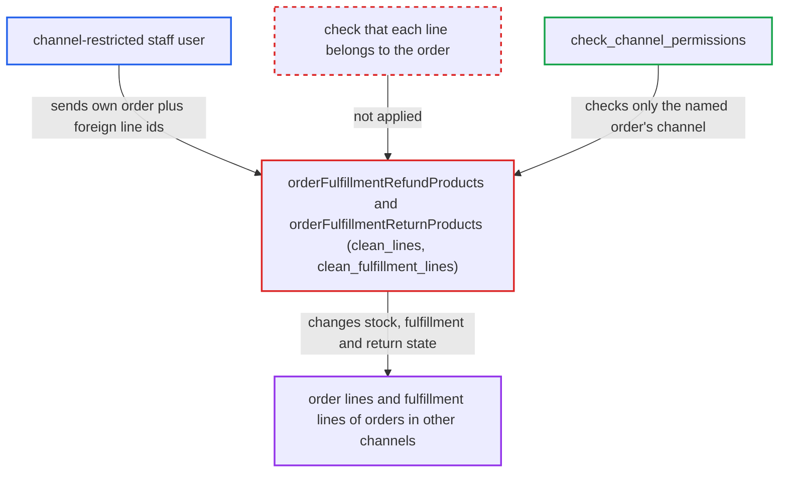

# Refund/return products mutations accept lines belonging to other orders

| Field | Value |
|---|---|
| ID | `find_011oJ2fd7zJpohhKuACX8zT5` |
| Severity | **Medium** |
| Status | open |
| CWE | CWE-639 — Missing authorization |
| Created | 2026-10-27T21:19:11.772539Z |
| Claude Security | https://claude.ai/security/findings/find_011oJ2fd7zJpohhKuACX8zT5 |

## Description

A staff user restricted to one sales channel can corrupt order data in channels they have no access to. Examples are marking foreign lines as fulfilled, releasing their stock, and moving them into returns or refunds. The attacker needs `MANAGE_ORDERS` and a channel-restricted permission group. The cause is that `orderFulfillmentRefundProducts` and `orderFulfillmentReturnProducts` check the channel only for the `order` argument and never check that the supplied lines belong to that order.

1. **channel-restricted staff user** calls `orderFulfillmentReturnProducts` or `orderFulfillmentRefundProducts` with their own order A and line ids from another order. `FulfillmentLine` ids are sequential integers, so `FulfillmentLine:<n>` ids can be enumerated, and `orderLines` can use known order-line UUIDs. ([`saleor/order/models.py:856-865`](https://github.com/cx-benchmark/saleor/blob/c982006cc04c77a97def93218dedac8d715eb041/saleor/order/models.py#L856-L865))
2. **the mutation** checks `MANAGE_ORDERS` and the channel permission for order A only. `check_channel_permissions(info, [order.channel_id])` is given only order A's channel, so the check passes. ([`saleor/graphql/order/mutations/fulfillment_return_products.py:219-245`](https://github.com/cx-benchmark/saleor/blob/c982006cc04c77a97def93218dedac8d715eb041/saleor/graphql/order/mutations/fulfillment_return_products.py#L219-L245))
3. **the base class `clean_lines` and `clean_fulfillment_lines`** load the supplied lines by primary key from unscoped querysets. They use `OrderLine.objects` and `FulfillmentLine.objects` and check only the gift-card flag, quantities and fulfillment status. They never compare `order_id` with order A. ([`saleor/graphql/order/mutations/fulfillment_refund_and_return_product_base.py:193-261`](https://github.com/cx-benchmark/saleor/blob/c982006cc04c77a97def93218dedac8d715eb041/saleor/graphql/order/mutations/fulfillment_refund_and_return_product_base.py#L193-L261))
4. **the action helpers in `saleor/order/actions.py`** change the foreign order's rows as if they belonged to order A. Order lines get a higher `quantity_fulfilled` and lose their stock allocations. Fulfillment lines are reduced or deleted, and new lines are recorded under order A's REFUNDED, RETURNED or REPLACED fulfillment. ([`saleor/order/actions.py:1385-1510`](https://github.com/cx-benchmark/saleor/blob/c982006cc04c77a97def93218dedac8d715eb041/saleor/order/actions.py#L1385-L1510))
5. **`create_replace_order`** copies the foreign lines into a draft order for order A's customer when `replace: true`. The copy includes variant and prices, which exposes them to the attacker. ([`saleor/order/actions.py:1625-1692`](https://github.com/cx-benchmark/saleor/blob/c982006cc04c77a97def93218dedac8d715eb041/saleor/order/actions.py#L1625-L1692))

## Assessment

The attacker is a staff user with `MANAGE_ORDERS` whose permission group is restricted to channel A. They need the deployment to have several channels and channel-restricted groups. Apps and unrestricted staff can already act on other channels' orders directly. The attacker calls `orderFulfillmentReturnProducts` with `fulfillmentLines` holding enumerated `FulfillmentLine:<n>` ids, or with `orderLines` holding known order-line UUIDs. They can add `replace: true`. The refund variant also needs order A to have a refundable payment. No victim interaction is needed.

Impact: The attacker chooses which orders in channels they are excluded from get corrupted. Unfulfilled lines are marked fulfilled and their stock allocations are released, so they can no longer be fulfilled. Fulfillment lines are shrunk or deleted and re-recorded under order A, and draft replacement orders are built from the foreign lines. Products, quantities and prices of the foreign lines are exposed to a limited degree. No money leaves the foreign order's payment, and the refund is capped by order A's `payment.captured_amount`.

## Recommendation

(1) The refund and return mutations resolve `orderLineId` and `fulfillmentLineId` values without scoping them to the order whose permissions were checked.

Fix criteria: Each `orderLineId` resolves only within `order.lines` and each `fulfillmentLineId` only within `FulfillmentLine.objects.filter(fulfillment__order=order)`. A foreign id produces a validation error before any state change. Tests show both mutations reject foreign lines and leave the foreign order's `quantity_fulfilled`, allocations and fulfillment line quantities unchanged.

(2) The action layer (`create_refund_fulfillment`, `create_fulfillments_for_returned_products` and their helpers) trusts caller-supplied lines. It does not check `line.order_id` or `line.fulfillment.order_id` against the target order.

Fix criteria: The actions assert that every supplied order line and fulfillment line belongs to `order`, and raise an error otherwise. No caller can then create cross-order refund, return or replace fulfillments. A test that calls the actions directly with a foreign line confirms this.

## Evidence

**https://github.com/cx-benchmark/saleor**

- [`saleor/graphql/order/mutations/fulfillment_refund_and_return_product_base.py:193-261`](https://github.com/cx-benchmark/saleor/blob/c982006cc04c77a97def93218dedac8d715eb041/saleor/graphql/order/mutations/fulfillment_refund_and_return_product_base.py#L193-L261)
- [`saleor/graphql/order/mutations/fulfillment_refund_and_return_product_base.py:121-191`](https://github.com/cx-benchmark/saleor/blob/c982006cc04c77a97def93218dedac8d715eb041/saleor/graphql/order/mutations/fulfillment_refund_and_return_product_base.py#L121-L191)
- [`saleor/graphql/order/mutations/fulfillment_return_products.py:219-245`](https://github.com/cx-benchmark/saleor/blob/c982006cc04c77a97def93218dedac8d715eb041/saleor/graphql/order/mutations/fulfillment_return_products.py#L219-L245)
- [`saleor/graphql/order/mutations/fulfillment_refund_products.py:141-167`](https://github.com/cx-benchmark/saleor/blob/c982006cc04c77a97def93218dedac8d715eb041/saleor/graphql/order/mutations/fulfillment_refund_products.py#L141-L167)
- [`saleor/order/actions.py:1385-1510`](https://github.com/cx-benchmark/saleor/blob/c982006cc04c77a97def93218dedac8d715eb041/saleor/order/actions.py#L1385-L1510)
- [`saleor/order/actions.py:1625-1692`](https://github.com/cx-benchmark/saleor/blob/c982006cc04c77a97def93218dedac8d715eb041/saleor/order/actions.py#L1625-L1692)
- [`saleor/graphql/core/mutations.py:585-598`](https://github.com/cx-benchmark/saleor/blob/c982006cc04c77a97def93218dedac8d715eb041/saleor/graphql/core/mutations.py#L585-L598)
- [`saleor/order/models.py:856-865`](https://github.com/cx-benchmark/saleor/blob/c982006cc04c77a97def93218dedac8d715eb041/saleor/order/models.py#L856-L865)

