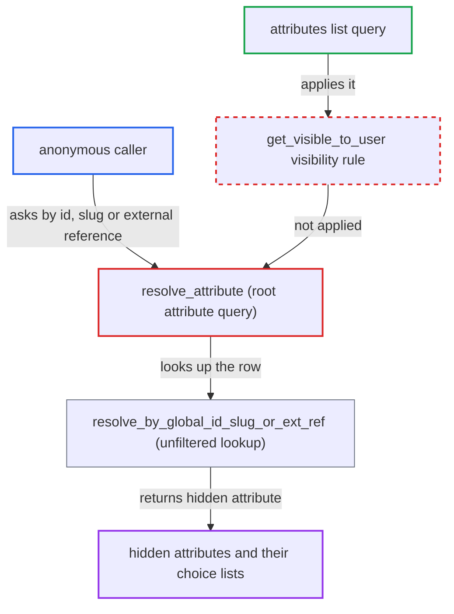

# Single attribute query ignores visible_in_storefront, exposing hidden attributes to anonymous callers

| Field | Value |
|---|---|
| ID | `find_01LxTXJfL97XE62R6ZiLWQhc` |
| Severity | **Medium** |
| Status | open |
| CWE | CWE-862 — Missing authorization |
| Created | 2026-10-27T21:12:45.616149Z |
| Claude Security | https://claude.ai/security/findings/find_01LxTXJfL97XE62R6ZiLWQhc |

## Description

Anyone, including an anonymous caller of `/graphql/`, can read attributes that the merchant hid from the storefront. That includes each hidden attribute's definition and its full list of predefined choices. No login or permission is needed. The root `attribute` query resolver `AttributeQueries.resolve_attribute` skips the `visible_in_storefront` rule that the `attributes` list applies.

1. **anonymous caller** sends an `attribute` query to `/graphql/`. The caller passes a base64 global ID built from a sequential integer, or a guessable `slug`, or an `externalReference`. ([`saleor/graphql/attribute/schema.py:55-84`](https://github.com/cx-benchmark/saleor/blob/c982006cc04c77a97def93218dedac8d715eb041/saleor/graphql/attribute/schema.py#L55-L84))
2. **the resolver `AttributeQueries.resolve_attribute`** looks the attribute up without checking the requestor. The `attribute` field is a plain `BaseField` with no permissions, and the resolver never looks at `visible_in_storefront`. ([`saleor/graphql/attribute/schema.py:55-84`](https://github.com/cx-benchmark/saleor/blob/c982006cc04c77a97def93218dedac8d715eb041/saleor/graphql/attribute/schema.py#L55-L84))
3. **the helper `resolve_by_global_id_slug_or_ext_ref`** fetches the row from the unfiltered manager. It runs a bare `model.objects.filter(...).first()`, so hidden attributes are returned like any other. ([`saleor/graphql/core/utils/resolvers.py:22-43`](https://github.com/cx-benchmark/saleor/blob/c982006cc04c77a97def93218dedac8d715eb041/saleor/graphql/core/utils/resolvers.py#L22-L43))
4. **the field `Attribute.choices`** returns the predefined values of the hidden attribute. For dropdown, multiselect and swatch attributes it has no permission check, so names, slugs, swatch values and file URLs are exposed. ([`saleor/graphql/attribute/types.py:394-413`](https://github.com/cx-benchmark/saleor/blob/c982006cc04c77a97def93218dedac8d715eb041/saleor/graphql/attribute/types.py#L394-L413))
5. **anonymous caller** compares the result with the `attributes` list. The list withholds hidden attributes, so the difference shows which ones are hidden. ([`saleor/graphql/attribute/resolvers.py:6-12`](https://github.com/cx-benchmark/saleor/blob/c982006cc04c77a97def93218dedac8d715eb041/saleor/graphql/attribute/resolvers.py#L6-L12))

## Assessment

The attacker is an anonymous caller of `/graphql/` and needs no account or setting. They send `attribute(id: ...)` with base64 of `Attribute:N` for sequential N, or `attribute(slug: ...)` with a guessable slug. The `externalReference` argument is another way to look an attribute up. They can add `choices`, `productTypes` and similar fields to the query. Comparing the results with the `attributes` list shows which attributes are hidden.

Impact: The attacker reads the schema-level data of every hidden attribute: `name`, `slug`, `type`, `inputType`, `entityType`, `unit`, `externalReference`, public `metadata`, `productTypes`, `productVariantTypes` and `referenceTypes`. They also read the full predefined choice lists of hidden dropdown, multiselect and swatch attributes. Values assigned to individual products stay hidden, and `valueRequired` and `visibleInStorefront` stay permission-gated. Nothing can be changed.

## Recommendation

`AttributeQueries.resolve_attribute` in `saleor/graphql/attribute/schema.py` resolves an attribute by id, slug or external reference from the unfiltered manager. This bypasses the `visible_in_storefront` rule that `get_visible_to_user` enforces for the list query.

Fix criteria: The single `attribute` lookup applies the same visibility rule as `attributes`. A requestor without a manage-attributes permission gets `null` for an attribute with `visible_in_storefront=False`, whether the lookup is by id, slug or external reference. Test with an anonymous client and a permission-less staff client against a hidden attribute. Also confirm that a client holding `MANAGE_PRODUCT_TYPES_AND_ATTRIBUTES` still receives it.

## Evidence

**https://github.com/cx-benchmark/saleor**

- [`saleor/graphql/attribute/schema.py:55-84`](https://github.com/cx-benchmark/saleor/blob/c982006cc04c77a97def93218dedac8d715eb041/saleor/graphql/attribute/schema.py#L55-L84)
- [`saleor/graphql/core/utils/resolvers.py:22-43`](https://github.com/cx-benchmark/saleor/blob/c982006cc04c77a97def93218dedac8d715eb041/saleor/graphql/core/utils/resolvers.py#L22-L43)
- [`saleor/graphql/attribute/resolvers.py:6-12`](https://github.com/cx-benchmark/saleor/blob/c982006cc04c77a97def93218dedac8d715eb041/saleor/graphql/attribute/resolvers.py#L6-L12)
- [`saleor/attribute/models/base.py:46-56`](https://github.com/cx-benchmark/saleor/blob/c982006cc04c77a97def93218dedac8d715eb041/saleor/attribute/models/base.py#L46-L56)
- [`saleor/graphql/product/resolvers.py:276-290`](https://github.com/cx-benchmark/saleor/blob/c982006cc04c77a97def93218dedac8d715eb041/saleor/graphql/product/resolvers.py#L276-L290)
- [`saleor/graphql/attribute/types.py:394-413`](https://github.com/cx-benchmark/saleor/blob/c982006cc04c77a97def93218dedac8d715eb041/saleor/graphql/attribute/types.py#L394-L413)

