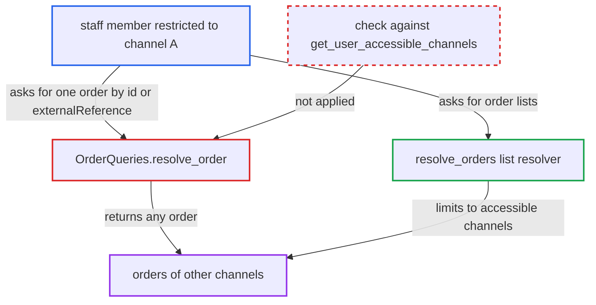

# Single order lookup ignores staff channel restrictions, exposing other channels' orders

| Field | Value |
|---|---|
| ID | `find_01NyPX1i4LrdCpHcKQBw6BXN` |
| Severity | **Medium** |
| Status | open |
| CWE | CWE-863 — Missing authorization |
| Created | 2026-10-27T21:23:46.438489Z |
| Claude Security | https://claude.ai/security/findings/find_01NyPX1i4LrdCpHcKQBw6BXN |

## Description

A staff member restricted to one channel can read full orders, drafts included, from channels they are excluded from. They need `MANAGE_ORDERS` in a group limited to specific channels, plus an identifier for the target order. `OrderQueries.resolve_order` and `resolve_order_by_token` never compare the order's channel with the requester's accessible channels. The read is limited to viewing; nothing can be changed.

1. **Restricted staff member** sends an `order` query for a channel-B order. The query uses `externalReference`, a legacy sequential number as `id`, or a UUID the staff member has learned, and selects fields such as `userEmail`, `billingAddress`, `events`, `transactions`, `user` and `privateMetadata`. ([`saleor/graphql/order/schema.py:216-236`](https://github.com/cx-benchmark/saleor/blob/c982006cc04c77a97def93218dedac8d715eb041/saleor/graphql/order/schema.py#L216-L236))
2. **the resolver `OrderQueries.resolve_order`** accepts the request without any channel check. For `externalReference` it checks only `MANAGE_ORDERS` and maps the reference to an id across all channels, and for `id` it checks nothing. ([`saleor/graphql/order/schema.py:216-236`](https://github.com/cx-benchmark/saleor/blob/c982006cc04c77a97def93218dedac8d715eb041/saleor/graphql/order/schema.py#L216-L236))
3. **the resolver `resolve_order`** loads the order from the whole `Order` table. It finds the order by UUID or by legacy `number` (`use_old_id=True`), drafts included, and applies no `channel_id` filter. ([`saleor/graphql/order/resolvers.py:90-101`](https://github.com/cx-benchmark/saleor/blob/c982006cc04c77a97def93218dedac8d715eb041/saleor/graphql/order/resolvers.py#L90-L101))
4. **the `Order` field resolvers** return internal data to the requester. `events`, `grantedRefunds`, `transactions`, `user` and private metadata are gated only by `MANAGE_ORDERS`, which the requester has. ([`saleor/graphql/order/types.py:1853-1858`](https://github.com/cx-benchmark/saleor/blob/c982006cc04c77a97def93218dedac8d715eb041/saleor/graphql/order/types.py#L1853-L1858))
5. **the `Order` address and email resolvers** return unmasked personal data for legacy orders. For legacy `use_old_id` orders, addresses and email are shown in clear to any requester with `MANAGE_ORDERS`. ([`saleor/graphql/order/types.py:2163-2183`](https://github.com/cx-benchmark/saleor/blob/c982006cc04c77a97def93218dedac8d715eb041/saleor/graphql/order/types.py#L2163-L2183))

## Assessment

The attacker is authenticated staff with `MANAGE_ORDERS` in a permission group restricted to channel A. They need an identifier for an order in channel B. That can be its `externalReference` (which depends on the deployment), a legacy sequential number (only on upgraded installs, and these can be enumerated), or a UUID they have learned. The deprecated `orderByToken` field, which is still served, has the same gap.

Impact: The attacker reads orders, drafts included, from channels they are excluded from. This exposes customer addresses, email and user account, purchased items, payment transactions and PSP references, granted refunds, internal events and notes, and private metadata. The path is read-only.

## Recommendation

`OrderQueries.resolve_order` and `resolve_order_by_token` return any order to a staff requester without checking the order's channel against the requester's accessible channels. The list resolvers, the federation resolver and the order mutations all enforce that check.

Fix criteria: For a non-app staff requester who is not the order's owner, a single-order lookup by `id`, legacy number, `externalReference` or token returns null or `PermissionDenied` when `order.channel_id` is not in `get_user_accessible_channels`. Owner access and app access still work. Test it with a `MANAGE_ORDERS` staff member restricted to channel A. Query `order(id:)`, `order(externalReference:)` and `orderByToken` for a channel-B order, and confirm that no order data is returned.

## Evidence

**https://github.com/cx-benchmark/saleor**

- [`saleor/graphql/order/schema.py:216-236`](https://github.com/cx-benchmark/saleor/blob/c982006cc04c77a97def93218dedac8d715eb041/saleor/graphql/order/schema.py#L216-L236)
- [`saleor/graphql/order/resolvers.py:90-101`](https://github.com/cx-benchmark/saleor/blob/c982006cc04c77a97def93218dedac8d715eb041/saleor/graphql/order/resolvers.py#L90-L101)
- [`saleor/graphql/order/resolvers.py:126-137`](https://github.com/cx-benchmark/saleor/blob/c982006cc04c77a97def93218dedac8d715eb041/saleor/graphql/order/resolvers.py#L126-L137)
- [`saleor/graphql/order/resolvers.py:20-42`](https://github.com/cx-benchmark/saleor/blob/c982006cc04c77a97def93218dedac8d715eb041/saleor/graphql/order/resolvers.py#L20-L42)
- [`saleor/graphql/order/types.py:3207-3229`](https://github.com/cx-benchmark/saleor/blob/c982006cc04c77a97def93218dedac8d715eb041/saleor/graphql/order/types.py#L3207-L3229)
- [`saleor/graphql/order/mutations/order_update.py:254-256`](https://github.com/cx-benchmark/saleor/blob/c982006cc04c77a97def93218dedac8d715eb041/saleor/graphql/order/mutations/order_update.py#L254-L256)
- [`saleor/graphql/order/types.py:1853-1858`](https://github.com/cx-benchmark/saleor/blob/c982006cc04c77a97def93218dedac8d715eb041/saleor/graphql/order/types.py#L1853-L1858)
- [`saleor/graphql/order/types.py:2163-2183`](https://github.com/cx-benchmark/saleor/blob/c982006cc04c77a97def93218dedac8d715eb041/saleor/graphql/order/types.py#L2163-L2183)

