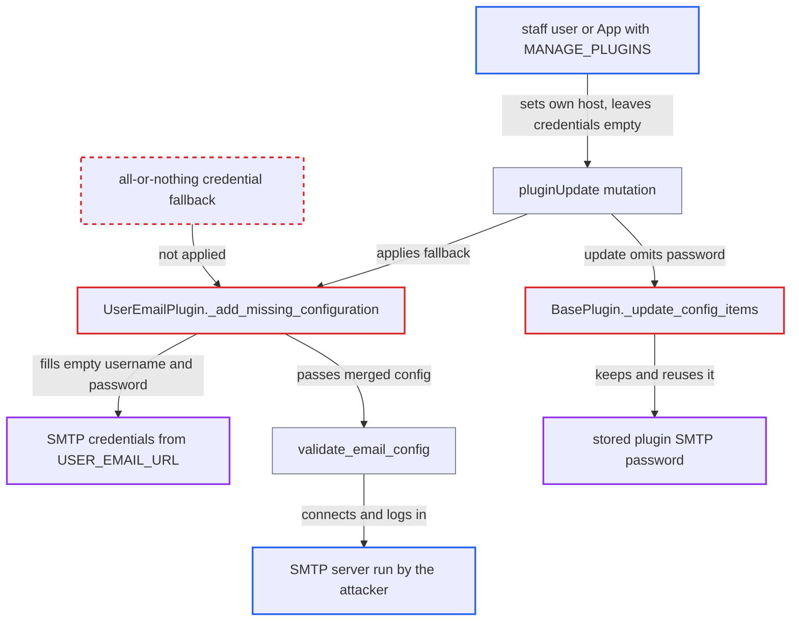

# SMTP credentials sent to staff-chosen host via UserEmailPlugin environment fallback

| Field | Value |
|---|---|
| ID | `find_01UcjL7XowWPN4w35zaeMDbn` |
| Severity | **Medium** |
| Status | open |
| CWE | CWE-522 — Credential exposure |
| Created | 2026-10-27T21:24:43.429767Z |
| Claude Security | https://claude.ai/security/findings/find_01UcjL7XowWPN4w35zaeMDbn |

## Description

A staff user or App with `MANAGE_PLUGINS` can steal the SMTP relay credentials from the server environment, plus any stored plugin SMTP password the API hides from that role. They set the plugin's `host` to a server they run and leave `username` and `password` empty. `UserEmailPlugin._add_missing_configuration` fills the empty fields from deployment secrets, and Saleor then logs in to the attacker's server with them.

1. **staff user or App with `MANAGE_PLUGINS`** runs an SMTP server and calls `pluginUpdate` for `mirumee.notifications.user_email`. The call sets `active=true`, `host`, `port` and `sender_address` to the attacker's values and leaves `username` and `password` empty; the mutation only requires `MANAGE_PLUGINS`. ([`saleor/graphql/plugins/mutations.py:48-107`](https://github.com/cx-benchmark/saleor/blob/c982006cc04c77a97def93218dedac8d715eb041/saleor/graphql/plugins/mutations.py#L48-L107))
2. **the plugin's `validate_plugin_configuration`** applies the environment fallback and then validates the merged configuration. Validation runs synchronously inside the mutation and goes through `validate_default_email_configuration`. ([`saleor/plugins/user_email/plugin.py:415-428`](https://github.com/cx-benchmark/saleor/blob/c982006cc04c77a97def93218dedac8d715eb041/saleor/plugins/user_email/plugin.py#L415-L428))
3. **`UserEmailPlugin._add_missing_configuration`** fills each empty setting on its own, so the attacker's `host` is kept and the empty credentials are replaced. Empty `username` and `password` fall back to `settings.USER_EMAIL_HOST_USER` and `USER_EMAIL_HOST_PASSWORD`, so real credentials end up paired with the attacker's host. ([`saleor/plugins/user_email/plugin.py:472-487`](https://github.com/cx-benchmark/saleor/blob/c982006cc04c77a97def93218dedac8d715eb041/saleor/plugins/user_email/plugin.py#L472-L487))
4. **deployment settings** supply the fallback credentials from the `USER_EMAIL_URL` environment variable. These are deployment secrets that no API exposes, and they are not plugin data. ([`saleor/settings.py:186-196`](https://github.com/cx-benchmark/saleor/blob/c982006cc04c77a97def93218dedac8d715eb041/saleor/settings.py#L186-L196))
5. **`validate_email_config`** opens Django's SMTP `EmailBackend` against the attacker's host with the merged credentials. Django's `open()` connects to `host:port`, optionally runs STARTTLS, and calls `login()` when both username and password are set. ([`saleor/plugins/email_common.py:249-261`](https://github.com/cx-benchmark/saleor/blob/c982006cc04c77a97def93218dedac8d715eb041/saleor/plugins/email_common.py#L249-L261))
6. **attacker's SMTP server** receives the login and records the username and password. The server can advertise only `AUTH PLAIN` or `LOGIN`, so the password arrives in clear. If the environment forces `use_tls`, the attacker presents a valid certificate for their own hostname.

## Assessment

The attacker is a staff user or App holding `MANAGE_PLUGINS`. They need an SMTP server they control. The deployment must have a `USER_EMAIL_URL` with credentials, or a stored plugin password, which is the normal production setup. No victim action is needed. A second route affects both e-mail plugins. `BasePlugin._update_config_items` keeps the stored `password` when an update leaves it out. So a `MANAGE_PLUGINS` user can change only `host` and recover the stored SMTP password, although the API masks `Password`-type fields from that role.

Impact: The attacker obtains the SMTP relay credentials from the server environment and any stored plugin SMTP password, which the role is not allowed to read. The report says nothing else on the Saleor host is read or modified by this path.

Subsequent-system impact: The stolen credentials give full use of the operator's SMTP relay or provider account. The attacker can send mail as the shop and, depending on the provider, read data held on the provider side.

## Recommendation

(1) Environment SMTP credentials are merged field by field with a host chosen by the staff user. Secrets the role cannot read are therefore sent to a server the role controls.

Fix criteria: Environment credentials are used only together with the environment host and port, as an all-or-nothing fallback like `AdminEmailPlugin._parse_email_config_or_get_default`. A configuration that overrides `host` without its own credentials does not authenticate. Setting only `host` on the user-email plugin results in an unauthenticated connection attempt.

(2) A stored password is kept and reused when the host is changed. A plugin manager can therefore redirect an existing masked secret to their own server.

Fix criteria: Changing `host` or `port` of an e-mail plugin requires the password to be supplied again, or clears it. Updating `host` alone no longer results in a `login()` with the previously stored password.

## Evidence

**https://github.com/cx-benchmark/saleor**

- [`saleor/plugins/user_email/plugin.py:472-487`](https://github.com/cx-benchmark/saleor/blob/c982006cc04c77a97def93218dedac8d715eb041/saleor/plugins/user_email/plugin.py#L472-L487)
- [`saleor/plugins/user_email/plugin.py:415-428`](https://github.com/cx-benchmark/saleor/blob/c982006cc04c77a97def93218dedac8d715eb041/saleor/plugins/user_email/plugin.py#L415-L428)
- [`saleor/plugins/email_common.py:249-261`](https://github.com/cx-benchmark/saleor/blob/c982006cc04c77a97def93218dedac8d715eb041/saleor/plugins/email_common.py#L249-L261)
- [`saleor/settings.py:186-196`](https://github.com/cx-benchmark/saleor/blob/c982006cc04c77a97def93218dedac8d715eb041/saleor/settings.py#L186-L196)
- [`saleor/plugins/base_plugin.py:1740-1776`](https://github.com/cx-benchmark/saleor/blob/c982006cc04c77a97def93218dedac8d715eb041/saleor/plugins/base_plugin.py#L1740-L1776)
- [`saleor/graphql/plugins/mutations.py:48-107`](https://github.com/cx-benchmark/saleor/blob/c982006cc04c77a97def93218dedac8d715eb041/saleor/graphql/plugins/mutations.py#L48-L107)

