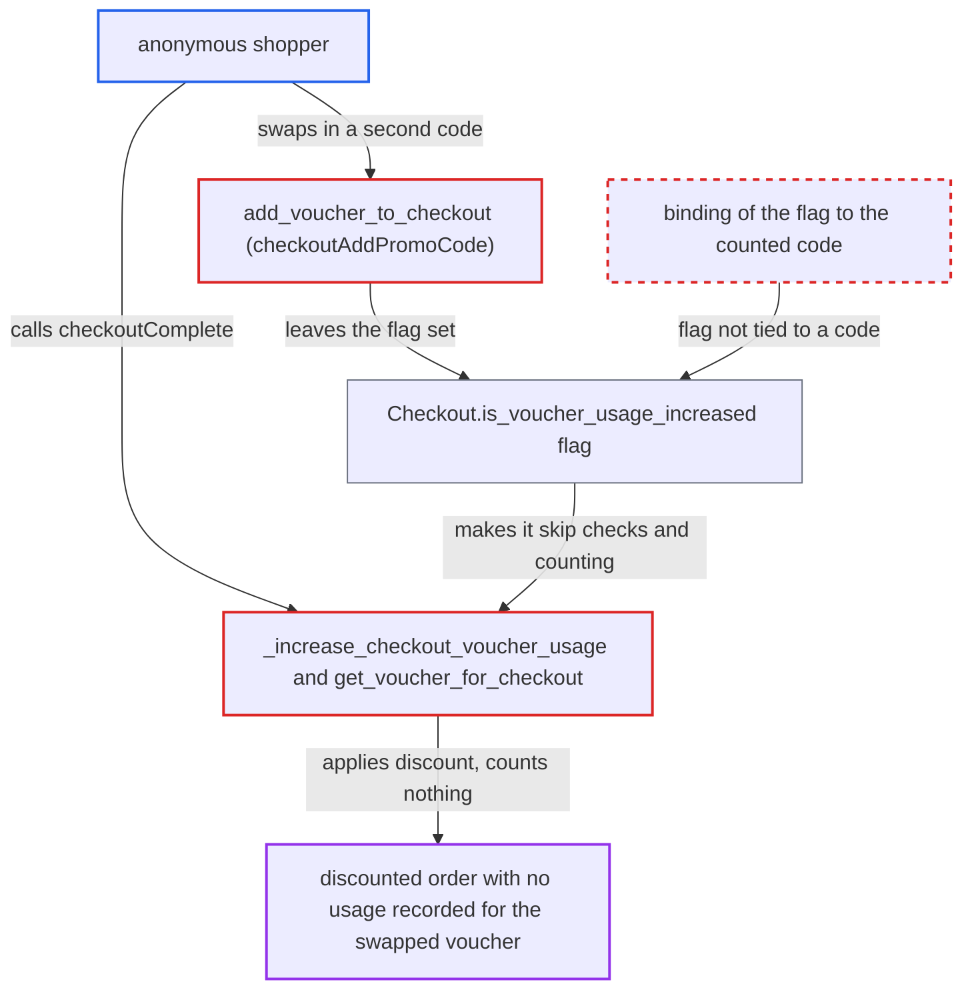

# Stale is_voucher_usage_increased flag lets swapped vouchers bypass usage and single-use limits

| Field | Value |
|---|---|
| ID | `find_01RFZtRD2cRR3ine693rzXmR` |
| Severity | **Medium** |
| Status | open |
| CWE | CWE-837 — Business logic error |
| Created | 2026-10-27T21:26:58.317127Z |
| Claude Security | https://claude.ai/security/findings/find_01RFZtRD2cRR3ine693rzXmR |

## Description

An anonymous shopper can get a limited or single-use voucher's discount on repeated orders without the voucher's usage being counted. The shopper needs two voucher codes and a checkout whose completion fails after usage was counted. The flag `Checkout.is_voucher_usage_increased` is not tied to a code, and several failure paths leave it set. Swapping the code then skips validation and usage accounting at completion.

1. **anonymous shopper** attaches a first code V1 and starts completion. In the transaction flow, `create_order_from_checkout` increments the usage and sets `is_voucher_usage_increased` in its own `transaction.atomic()` block, which commits before order creation starts. ([`saleor/checkout/complete_checkout.py:1610-1618`](https://github.com/cx-benchmark/saleor/blob/c982006cc04c77a97def93218dedac8d715eb041/saleor/checkout/complete_checkout.py#L1610-L1618))
2. **order creation** fails after the increment was committed. On `InsufficientStock` or `GiftCardNotApplicable` the fail handler's release is rolled back by the re-raise, and `NO_LINES` and `TaxDataError` release nothing, so the flag stays set. ([`saleor/checkout/complete_checkout.py:1620-1701`](https://github.com/cx-benchmark/saleor/blob/c982006cc04c77a97def93218dedac8d715eb041/saleor/checkout/complete_checkout.py#L1620-L1701))
3. **legacy payment flow** leaves the flag set after a declined payment. On a `PaymentError` the fail handler is called without a voucher, so nothing is released and the flag committed earlier stays set. ([`saleor/checkout/complete_checkout.py:1096-1098`](https://github.com/cx-benchmark/saleor/blob/c982006cc04c77a97def93218dedac8d715eb041/saleor/checkout/complete_checkout.py#L1096-L1098))
4. **fail handler** does not clear the flag in these cases. Only `_release_checkout_voucher_usage` ever resets the flag, and it runs only when a voucher is passed in. ([`saleor/checkout/complete_checkout.py:2025-2062`](https://github.com/cx-benchmark/saleor/blob/c982006cc04c77a97def93218dedac8d715eb041/saleor/checkout/complete_checkout.py#L2025-L2062))
5. **anonymous shopper** replaces V1 with a limited or single-use code V2 through `checkoutAddPromoCode`. `add_voucher_to_checkout` overwrites `checkout.voucher_code` and leaves the flag alone, and V2 is validated only at this point. ([`saleor/checkout/utils.py:788-837`](https://github.com/cx-benchmark/saleor/blob/c982006cc04c77a97def93218dedac8d715eb041/saleor/checkout/utils.py#L788-L837))
6. **anonymous shopper** calls `checkoutComplete` on the flagged checkout. While the flag is set, `get_voucher_for_checkout` skips `active_in_channel()` (dates, channel listing, usage limit), so V2 is returned without re-validation. ([`saleor/checkout/utils.py:593-605`](https://github.com/cx-benchmark/saleor/blob/c982006cc04c77a97def93218dedac8d715eb041/saleor/checkout/utils.py#L593-L605))
7. **`_increase_checkout_voucher_usage`** returns early because the flag is set. V2's `used` is not incremented, no `VoucherCustomer` row is written and a `single_use` code is not deactivated, but its discount is applied to the order. ([`saleor/checkout/complete_checkout.py:142-157`](https://github.com/cx-benchmark/saleor/blob/c982006cc04c77a97def93218dedac8d715eb041/saleor/checkout/complete_checkout.py#L142-L157))

## Assessment

The attacker is an anonymous shopper who holds two codes: any applicable code V1 and a limited or single-use code V2. They need completion of a checkout to fail after the usage increment. In the transaction flow, a line's stock can be taken first by their own or another checkout, for example several checkouts holding the last unit. In the legacy payment flow, a declined card does the same. The other failing exits are `NO_LINES` and `TaxDataError`. The attacker then swaps V1 for V2, fixes the lines and completes. This needs no race and works sequentially, and it can be repeated for every new flagged checkout.

Impact: Usage limits, single-use deactivation and once-per-customer rules are not enforced for the swapped voucher, so one code yields discounted orders repeatedly. Each failed completion also permanently burns one usage of the first voucher without an order. The harm is limited to the voucher's value per order, and the report names no data disclosure and no loss of service.

## Recommendation

(1) The usage-increased marker is a checkout-level boolean that is not bound to the voucher code it was counted for. It is not cleared when the code is replaced or removed, so later codes inherit a state that disables their validation and usage accounting.

Fix criteria: Skipping validation and the increment at completion happens only for the exact code whose usage was already counted for this checkout. Removing or replacing the code releases that usage and clears the marker. Verify: after a failed completion, swap in a different limited, single-use or once-per-customer code and complete. It must increment its `used`, write `VoucherCustomer`, deactivate a single-use code, and reject an expired or exhausted code.

(2) Compensation for a failed order creation runs inside the transaction that is then rolled back. Some exits (`NO_LINES`, `TaxDataError`, the legacy `PaymentError` path) have no compensation at all, so consumed usage and the marker leak.

Fix criteria: Every exit from a failed completion, in both the transaction and payment flows, leaves `VoucherCode.used`, `is_active`, `VoucherCustomer` and `is_voucher_usage_increased` as they were before the attempt. Alternatively, the increment commits only together with the order. Verify by forcing `InsufficientStock`, `TaxDataError`, `NO_LINES` and a declined payment, then checking those values afterwards.

## Evidence

**https://github.com/cx-benchmark/saleor**

- [`saleor/checkout/complete_checkout.py:142-157`](https://github.com/cx-benchmark/saleor/blob/c982006cc04c77a97def93218dedac8d715eb041/saleor/checkout/complete_checkout.py#L142-L157)
- [`saleor/checkout/complete_checkout.py:1610-1618`](https://github.com/cx-benchmark/saleor/blob/c982006cc04c77a97def93218dedac8d715eb041/saleor/checkout/complete_checkout.py#L1610-L1618)
- [`saleor/checkout/complete_checkout.py:1620-1701`](https://github.com/cx-benchmark/saleor/blob/c982006cc04c77a97def93218dedac8d715eb041/saleor/checkout/complete_checkout.py#L1620-L1701)
- [`saleor/checkout/complete_checkout.py:1096-1098`](https://github.com/cx-benchmark/saleor/blob/c982006cc04c77a97def93218dedac8d715eb041/saleor/checkout/complete_checkout.py#L1096-L1098)
- [`saleor/checkout/complete_checkout.py:2025-2062`](https://github.com/cx-benchmark/saleor/blob/c982006cc04c77a97def93218dedac8d715eb041/saleor/checkout/complete_checkout.py#L2025-L2062)
- [`saleor/checkout/utils.py:788-837`](https://github.com/cx-benchmark/saleor/blob/c982006cc04c77a97def93218dedac8d715eb041/saleor/checkout/utils.py#L788-L837)
- [`saleor/checkout/utils.py:880-895`](https://github.com/cx-benchmark/saleor/blob/c982006cc04c77a97def93218dedac8d715eb041/saleor/checkout/utils.py#L880-L895)
- [`saleor/checkout/utils.py:593-605`](https://github.com/cx-benchmark/saleor/blob/c982006cc04c77a97def93218dedac8d715eb041/saleor/checkout/utils.py#L593-L605)

