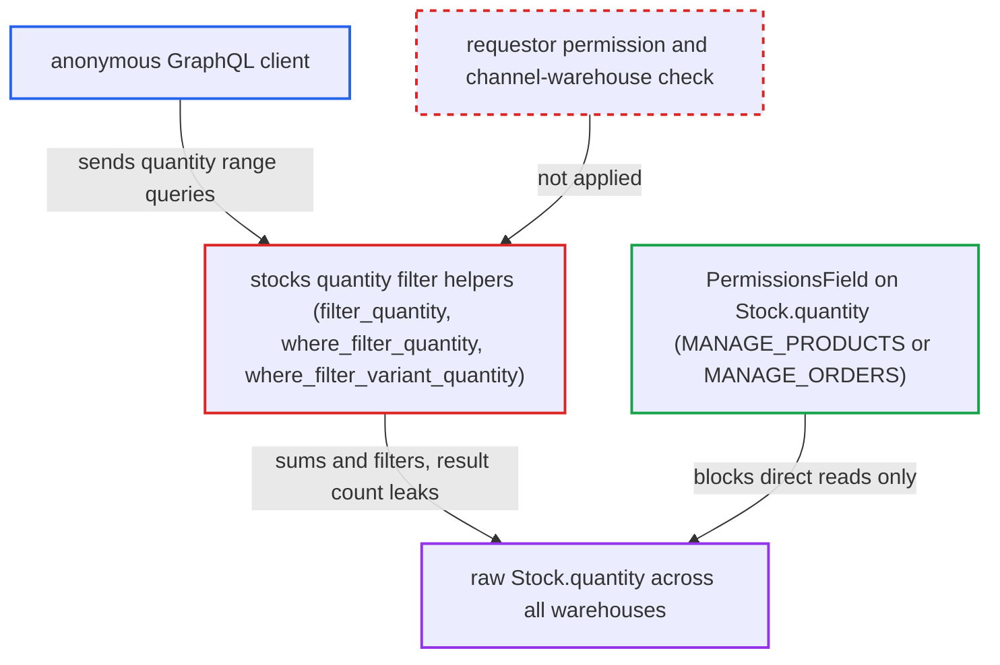

# Stock quantity filters let anonymous users infer exact staff-only inventory levels

| Field | Value |
|---|---|
| ID | `find_016mjXXkmmpxgdcfLWVVCPoW` |
| Severity | **Medium** |
| Status | open |
| CWE | CWE-862 — Missing authorization |
| Created | 2026-10-27T21:20:10.111317Z |
| Claude Security | https://claude.ai/security/findings/find_016mjXXkmmpxgdcfLWVVCPoW |

## Description

Anonymous users can learn the exact raw stock level of any product or variant they can see, including stock in warehouses outside the channel. They only need to send repeated list queries with a `stocks` quantity range and read the result count. The helpers `filter_quantity`, `where_filter_quantity` and `where_filter_variant_quantity` sum raw stock for any caller and never check who is asking.

1. **anonymous client** sends a list query with a `stocks` quantity range for a known product or variant. For example `productVariants(where:{ids:[V], stocks:{quantity:{gte:X, lte:Y}}}){ totalCount }`, or `products(where:{ids:[P], stocks:...})`, with no login. ([`saleor/graphql/product/filters/product_variant.py:129-159`](https://github.com/cx-benchmark/saleor/blob/c982006cc04c77a97def93218dedac8d715eb041/saleor/graphql/product/filters/product_variant.py#L129-L159))
2. **the resolver `resolve_product_variants`** accepts the anonymous request and passes the `where` input on to the filtering code. The field declares no `permissions`, and `filter_connection_queryset` applies the filter fields without any permission check. ([`saleor/graphql/product/schema.py:622-669`](https://github.com/cx-benchmark/saleor/blob/c982006cc04c77a97def93218dedac8d715eb041/saleor/graphql/product/schema.py#L622-L669))
3. **the helper `where_filter_variant_quantity`** sums raw `Stock.quantity` and keeps rows whose total is inside the range. The sum covers every warehouse, or only the caller-chosen `warehouseIds`. It ignores allocations, reservations, the 50 cap and the channel's warehouses, and it never looks at the requestor. ([`saleor/graphql/product/filters/product_helpers.py:554-587`](https://github.com/cx-benchmark/saleor/blob/c982006cc04c77a97def93218dedac8d715eb041/saleor/graphql/product/filters/product_helpers.py#L554-L587))
4. **anonymous client** reads `totalCount` or whether the known id is returned. Each reply says whether the real total is inside the range that was sent.
5. **anonymous client** halves the range on each reply until one value is left. About log2(N) requests give the exact total stock. Adding known `warehouseIds` gives the stock of a single warehouse.

## Assessment

The attacker is any anonymous client of the public `/graphql/` endpoint. No login, victim action or special setting is needed, and the default channel and settings are enough. The filter is reachable through `products` (`filter` or `where`), `productVariants` (`where`), and the nested `Category.products`, `Collection.products` and `Product.productVariants` connections. The attacker needs the id of a visible product or variant. Per-warehouse stock also needs warehouse IDs, which may come from click-and-collect collection points. Note: the project's tests and CHANGELOG suggest the filter is meant to be public. The flaw is that it evaluates staff-only, non-channel-scoped raw quantities for any requestor.

Impact: The attacker learns the exact summed raw inventory of any visible variant or product. Warehouses not assigned to the channel are included, and so is per-warehouse stock when warehouse IDs are known. The API otherwise limits this data to holders of `MANAGE_PRODUCTS` or `MANAGE_ORDERS` and caps it at 50 for customers. The leak is business-sensitive but not credentials or personal data. It is limited to items the caller can already list, and nothing can be changed or taken down.

## Recommendation

The `stocks` quantity and warehouse filters (`filter_quantity`, `where_filter_quantity`, `where_filter_variant_quantity` and their `*_stocks` dispatchers) evaluate raw, all-warehouse `Stock.quantity` for any requestor. This turns the public list filters into a way to read staff-only inventory data.

Fix criteria: Requestors without `MANAGE_PRODUCTS` or `MANAGE_ORDERS` can learn no more about stock than `quantityAvailable` shows. For them the `stocks.quantity` and `warehouseIds` filter is refused or has no effect, or it is computed only on channel-scoped, capped available quantity. An anonymous `productVariants(where:{stocks:{quantity:{gte:51}}})` or `products(filter:{stocks:{quantity:{gte:51}}})` cannot tell a variant with 60 units from one with 500. It also reveals no stock in warehouses outside the channel. A staff client with `MANAGE_PRODUCTS` still gets the full filter.

## Evidence

**https://github.com/cx-benchmark/saleor**

- [`saleor/graphql/product/filters/product_helpers.py:554-587`](https://github.com/cx-benchmark/saleor/blob/c982006cc04c77a97def93218dedac8d715eb041/saleor/graphql/product/filters/product_helpers.py#L554-L587)
- [`saleor/graphql/product/filters/product_helpers.py:341-398`](https://github.com/cx-benchmark/saleor/blob/c982006cc04c77a97def93218dedac8d715eb041/saleor/graphql/product/filters/product_helpers.py#L341-L398)
- [`saleor/graphql/product/filters/product_helpers.py:455-515`](https://github.com/cx-benchmark/saleor/blob/c982006cc04c77a97def93218dedac8d715eb041/saleor/graphql/product/filters/product_helpers.py#L455-L515)
- [`saleor/graphql/product/filters/product_variant.py:129-159`](https://github.com/cx-benchmark/saleor/blob/c982006cc04c77a97def93218dedac8d715eb041/saleor/graphql/product/filters/product_variant.py#L129-L159)
- [`saleor/graphql/product/filters/product.py:129`](https://github.com/cx-benchmark/saleor/blob/c982006cc04c77a97def93218dedac8d715eb041/saleor/graphql/product/filters/product.py#L129)
- [`saleor/graphql/product/schema.py:622-669`](https://github.com/cx-benchmark/saleor/blob/c982006cc04c77a97def93218dedac8d715eb041/saleor/graphql/product/schema.py#L622-L669)
- [`saleor/graphql/core/connection.py:488-551`](https://github.com/cx-benchmark/saleor/blob/c982006cc04c77a97def93218dedac8d715eb041/saleor/graphql/core/connection.py#L488-L551)
- [`saleor/graphql/warehouse/types.py:190-219`](https://github.com/cx-benchmark/saleor/blob/c982006cc04c77a97def93218dedac8d715eb041/saleor/graphql/warehouse/types.py#L190-L219)
- [`saleor/graphql/product/types/products.py:396-432`](https://github.com/cx-benchmark/saleor/blob/c982006cc04c77a97def93218dedac8d715eb041/saleor/graphql/product/types/products.py#L396-L432)
- [`saleor/site/models.py:89-93`](https://github.com/cx-benchmark/saleor/blob/c982006cc04c77a97def93218dedac8d715eb041/saleor/site/models.py#L89-L93)
- [`saleor/warehouse/availability.py:318-336`](https://github.com/cx-benchmark/saleor/blob/c982006cc04c77a97def93218dedac8d715eb041/saleor/warehouse/availability.py#L318-L336)

