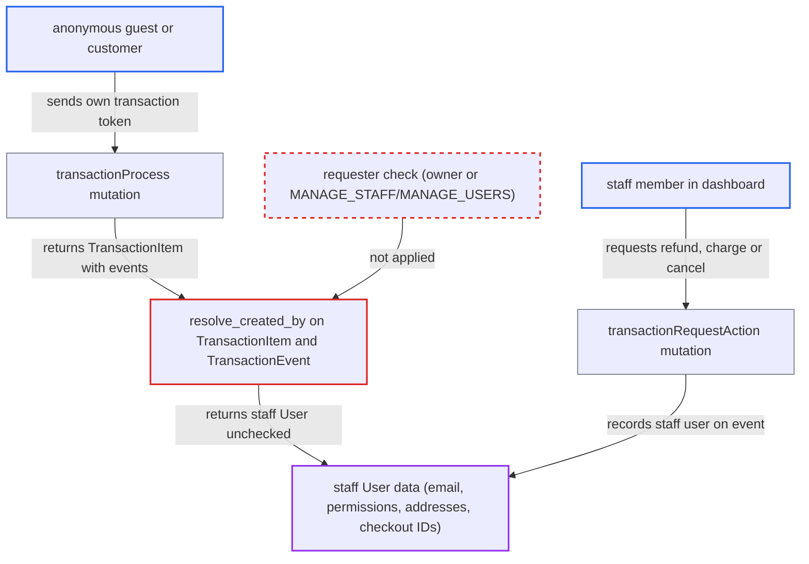

# TransactionItem/TransactionEvent createdBy return staff User node to storefront transactionProcess callers

| Field | Value |
|---|---|
| ID | `find_012mJdvtyZ7ZReZ9LSu9RAZv` |
| Severity | **Medium** |
| Status | open |
| CWE | CWE-862 — Missing authorization |
| Created | 2026-10-27T21:28:26.626363Z |
| Claude Security | https://claude.ai/security/findings/find_012mJdvtyZ7ZReZ9LSu9RAZv |

## Description

An anonymous guest or customer can read the account details of a staff member who handled their own payment. That includes email, name, permission groups, addresses and open checkout IDs. The attacker needs the transaction token from their own payment, and a staff member must have acted on that transaction from the dashboard. The resolvers `TransactionItem.resolve_created_by` and `TransactionEvent.resolve_created_by` return the staff `User` without checking who is asking.

1. **the attacker (guest or customer)** pays for their own checkout with `transactionInitialize` and keeps the returned transaction token. The mutation needs no permission, and the token is also the transaction's `id`.
2. **a staff member** refunds, charges or cancels that transaction from the dashboard through `transactionRequestAction`. The mutation passes `info.context.user` on, and no app is set when staff act from the dashboard. ([`saleor/graphql/payment/mutations/transaction/transaction_request_action.py:98-150`](https://github.com/cx-benchmark/saleor/blob/c982006cc04c77a97def93218dedac8d715eb041/saleor/graphql/payment/mutations/transaction/transaction_request_action.py#L98-L150))
3. **`create_transaction_event_requested`** stores the staff user on the new `*_REQUEST` event. This attaches the staff account to the customer's transaction. ([`saleor/graphql/payment/mutations/transaction/utils.py:86-128`](https://github.com/cx-benchmark/saleor/blob/c982006cc04c77a97def93218dedac8d715eb041/saleor/graphql/payment/mutations/transaction/utils.py#L86-L128))
4. **the attacker** calls `transactionProcess` with the token and asks for `events { createdBy { ... on User { ... } } }`. `TransactionProcess` has no `permissions` in its `Meta`, so anonymous callers pass, and it returns the full `TransactionItem`. ([`saleor/graphql/payment/mutations/transaction/transaction_process.py:177-228`](https://github.com/cx-benchmark/saleor/blob/c982006cc04c77a97def93218dedac8d715eb041/saleor/graphql/payment/mutations/transaction/transaction_process.py#L177-L228))
5. **the resolver `resolve_created_by`** returns the staff `User` node as is. The event has no app, so the resolver falls through to `UserByUserIdLoader(info.context).load(root.user_id)` and never checks the requester. ([`saleor/graphql/payment/types.py:409-447`](https://github.com/cx-benchmark/saleor/blob/c982006cc04c77a97def93218dedac8d715eb041/saleor/graphql/payment/types.py#L409-L447))
6. **the `User` type** resolves the requested fields without further checks. `email`, names, `isStaff`, `addresses`, `checkoutIds`/`checkouts`, `permissionGroups`, `userPermissions` and `accessibleChannels` have no guard. ([`saleor/graphql/account/types.py:654-790`](https://github.com/cx-benchmark/saleor/blob/c982006cc04c77a97def93218dedac8d715eb041/saleor/graphql/account/types.py#L654-L790))

## Assessment

The attacker is an anonymous guest or customer who paid through `transactionInitialize` and holds the transaction token. A staff member must later act on that transaction from the dashboard. For example, the attacker could ask support for a refund. The refund, charge and cancel requests via `transactionRequestAction` attach the staff user, and so do `transactionRequestRefundForGrantedRefund`, the auto-refund in `orderGrantRefundCreate`, and manual adjustments in `transactionUpdate`. `transactionCreate` also sets `TransactionItem.user`. `transactionInitialize` returns the same `TransactionItem`, so it is a second way to read the data. A separate flaw in how `transactionProcess` looks up transactions by sequential pk would widen the leak to every dashboard-made `transactionCreate` transaction. This finding does not depend on that flaw.

Impact: The attacker learns the identity of the staff member who touched the transaction. That covers email, name, staff status, permission groups with permission codes, channel access and saved addresses. If that staff member has open checkouts, the leaked checkout IDs are bearer credentials that let the attacker change those checkouts. Each transaction exposes only the staff who acted on it. Gift card codes and orders stay gated, and there is no availability impact.

## Recommendation

`TransactionItem.resolve_created_by` and `TransactionEvent.resolve_created_by` return a `User` node without checking that the requester may view that user. The project enforces this check on `PromotionEvent.createdBy` and `OrderEvent.user`, and ADR 0010 requires it.

Fix criteria: A `User` under `TransactionItem.createdBy` or `TransactionEvent.createdBy` is returned only to that same user or to requesters holding the staff or user-management permission the project picks (for example `MANAGE_STAFF` or `MANAGE_USERS`). Anyone else gets `null`. An anonymous or customer `transactionProcess` or `transactionInitialize` call on a transaction with a staff-created refund event returns no `User` data under `createdBy`. `App` creators and permitted staff still see the field.

## Evidence

**https://github.com/cx-benchmark/saleor**

- [`saleor/graphql/payment/types.py:409-447`](https://github.com/cx-benchmark/saleor/blob/c982006cc04c77a97def93218dedac8d715eb041/saleor/graphql/payment/types.py#L409-L447)
- [`saleor/graphql/payment/types.py:863-905`](https://github.com/cx-benchmark/saleor/blob/c982006cc04c77a97def93218dedac8d715eb041/saleor/graphql/payment/types.py#L863-L905)
- [`saleor/graphql/payment/mutations/transaction/transaction_process.py:177-228`](https://github.com/cx-benchmark/saleor/blob/c982006cc04c77a97def93218dedac8d715eb041/saleor/graphql/payment/mutations/transaction/transaction_process.py#L177-L228)
- [`saleor/graphql/payment/mutations/transaction/transaction_request_action.py:98-150`](https://github.com/cx-benchmark/saleor/blob/c982006cc04c77a97def93218dedac8d715eb041/saleor/graphql/payment/mutations/transaction/transaction_request_action.py#L98-L150)
- [`saleor/graphql/payment/mutations/transaction/utils.py:86-128`](https://github.com/cx-benchmark/saleor/blob/c982006cc04c77a97def93218dedac8d715eb041/saleor/graphql/payment/mutations/transaction/utils.py#L86-L128)
- [`saleor/graphql/account/types.py:654-790`](https://github.com/cx-benchmark/saleor/blob/c982006cc04c77a97def93218dedac8d715eb041/saleor/graphql/account/types.py#L654-L790)
- [`saleor/graphql/discount/types/promotion_events.py:48-73`](https://github.com/cx-benchmark/saleor/blob/c982006cc04c77a97def93218dedac8d715eb041/saleor/graphql/discount/types/promotion_events.py#L48-L73)
- [`docs/adr/0010-order-payment-history-is-a-projection-not-an-opened-transaction.md:9-12`](https://github.com/cx-benchmark/saleor/blob/c982006cc04c77a97def93218dedac8d715eb041/docs/adr/0010-order-payment-history-is-a-projection-not-an-opened-transaction.md#L9-L12)

