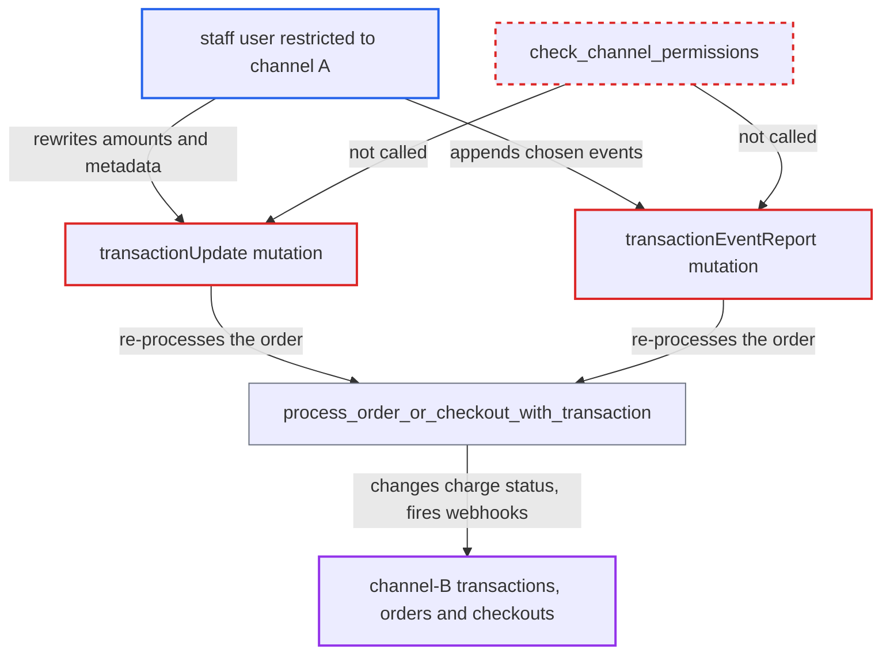

# transactionUpdate and transactionEventReport ignore staff channel restrictions

| Field | Value |
|---|---|
| ID | `find_01BeheAV74rGtguYp52TKhPH` |
| Severity | **Medium** |
| Status | open |
| CWE | CWE-863 — Missing authorization |
| Created | 2026-10-27T21:25:07.719656Z |
| Claude Security | https://claude.ai/security/findings/find_01BeheAV74rGtguYp52TKhPH |

## Description

A staff member whose permission groups are limited to channel A can change payment records on channel-B orders and checkouts. They need `HANDLE_PAYMENTS`, and the target transaction must be staff-created or have no owner. `transactionUpdate` and `transactionEventReport` check only ownership through `check_if_requestor_has_access` and never call `check_channel_permissions`.

1. **restricted staff user** picks a channel-B transaction to target. Transactions made by `transactionCreate` are stored with `use_old_id=True`, so a global ID of the form `TransactionItem:<n>` can be found by counting through integer ids. A known token also works. ([`saleor/graphql/payment/mutations/transaction/transaction_create.py:287-295`](https://github.com/cx-benchmark/saleor/blob/c982006cc04c77a97def93218dedac8d715eb041/saleor/graphql/payment/mutations/transaction/transaction_create.py#L287-L295))
2. **staff user** calls `transactionUpdate` or `transactionEventReport` on that transaction. `transactionUpdate` can set the amounts, `pspReference`, `availableActions` and metadata. `transactionEventReport` can add an event such as `CHARGE_SUCCESS` with any amount and timestamp. ([`saleor/graphql/payment/mutations/transaction/transaction_update.py:206-268`](https://github.com/cx-benchmark/saleor/blob/c982006cc04c77a97def93218dedac8d715eb041/saleor/graphql/payment/mutations/transaction/transaction_update.py#L206-L268))
3. **the mutation** loads the transaction without looking at its channel. `transactionEventReport` uses the same ownership-only gate as `transactionUpdate`. ([`saleor/graphql/payment/mutations/transaction/transaction_event_report.py:318-332`](https://github.com/cx-benchmark/saleor/blob/c982006cc04c77a97def93218dedac8d715eb041/saleor/graphql/payment/mutations/transaction/transaction_event_report.py#L318-L332))
4. **`check_if_requestor_has_access`** lets the staff user through. It returns `True` for any authenticated user when `transaction.user_id` is set, and for anyone when the transaction has no owner. It never reads the requestor's accessible channels. ([`saleor/graphql/payment/utils.py:22-47`](https://github.com/cx-benchmark/saleor/blob/c982006cc04c77a97def93218dedac8d715eb041/saleor/graphql/payment/utils.py#L22-L47))
5. **the mutation** skips `check_channel_permissions`. This shared guard would refuse staff whose groups do not cover the object's channel, but these two mutations never call it. ([`saleor/graphql/core/mutations.py:585-598`](https://github.com/cx-benchmark/saleor/blob/c982006cc04c77a97def93218dedac8d715eb041/saleor/graphql/core/mutations.py#L585-L598))
6. **the mutation** saves the changes and calls `process_order_or_checkout_with_transaction`. This recomputes the charge and authorize status of the channel-B order or checkout. It also fires `order_charged` or `order_refunded` and their webhooks. ([`saleor/graphql/payment/mutations/transaction/transaction_update.py:206-268`](https://github.com/cx-benchmark/saleor/blob/c982006cc04c77a97def93218dedac8d715eb041/saleor/graphql/payment/mutations/transaction/transaction_update.py#L206-L268))

## Assessment

The attacker is a staff user with `HANDLE_PAYMENTS` in a permission group restricted to channel A. They reach the public `/graphql/` API and need a staff-created or ownerless transaction to exist in channel B. They either count through integer ids of `transactionCreate` transactions or use a known token. They can use either `transactionUpdate` or `transactionEventReport`. App-owned transactions are refused by the ownership check.

Impact: The attacker can rewrite payment records of orders and checkouts in channels they are excluded from. They can change charged, authorized, refunded and canceled amounts, PSP references, available actions and private metadata. This can flip an order's `charge_status` between unpaid and fully paid. The response also returns the foreign transaction and its linked order or checkout, which is a limited disclosure.

## Recommendation

`transactionUpdate` and `transactionEventReport` authorize staff only by transaction ownership (`check_if_requestor_has_access`) and the global `HANDLE_PAYMENTS` permission. They ignore the staff user's channel restriction for the channel of the transaction's order or checkout.

Fix criteria: Before any write, a staff requestor is refused when the channel of the transaction's order or checkout is not among their accessible channels. This matches `check_channel_permissions`, and apps are unaffected. To verify, a staff user restricted to channel A calls either mutation on a channel-B transaction. They get a permission error, no event or amount change is stored, and the order's charge status is unchanged.

## Evidence

**https://github.com/cx-benchmark/saleor**

- [`saleor/graphql/payment/mutations/transaction/transaction_update.py:206-268`](https://github.com/cx-benchmark/saleor/blob/c982006cc04c77a97def93218dedac8d715eb041/saleor/graphql/payment/mutations/transaction/transaction_update.py#L206-L268)
- [`saleor/graphql/payment/mutations/transaction/transaction_event_report.py:318-332`](https://github.com/cx-benchmark/saleor/blob/c982006cc04c77a97def93218dedac8d715eb041/saleor/graphql/payment/mutations/transaction/transaction_event_report.py#L318-L332)
- [`saleor/graphql/payment/utils.py:22-47`](https://github.com/cx-benchmark/saleor/blob/c982006cc04c77a97def93218dedac8d715eb041/saleor/graphql/payment/utils.py#L22-L47)
- [`saleor/graphql/core/mutations.py:585-598`](https://github.com/cx-benchmark/saleor/blob/c982006cc04c77a97def93218dedac8d715eb041/saleor/graphql/core/mutations.py#L585-L598)
- [`saleor/graphql/payment/mutations/transaction/transaction_request_action.py:268-276`](https://github.com/cx-benchmark/saleor/blob/c982006cc04c77a97def93218dedac8d715eb041/saleor/graphql/payment/mutations/transaction/transaction_request_action.py#L268-L276)
- [`saleor/graphql/payment/resolvers.py:47-73`](https://github.com/cx-benchmark/saleor/blob/c982006cc04c77a97def93218dedac8d715eb041/saleor/graphql/payment/resolvers.py#L47-L73)
- [`saleor/graphql/payment/mutations/transaction/transaction_create.py:287-295`](https://github.com/cx-benchmark/saleor/blob/c982006cc04c77a97def93218dedac8d715eb041/saleor/graphql/payment/mutations/transaction/transaction_create.py#L287-L295)

