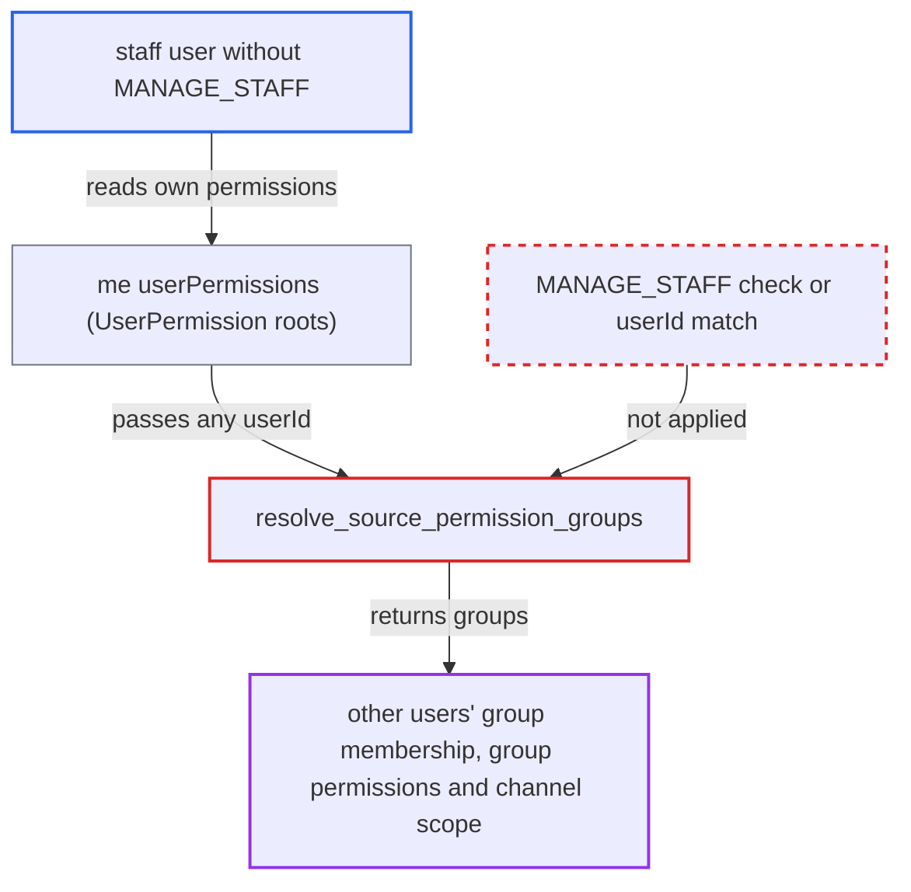

# UserPermission.sourcePermissionGroups reveals other users' permission-group membership by arbitrary userId

| Field | Value |
|---|---|
| ID | `find_01KbZ1shx2RTRz7EMAsSGh7L` |
| Severity | **Medium** |
| Status | open |
| CWE | CWE-639 — Insecure Direct Object Reference |
| Created | 2026-10-27T21:16:22.064541Z |
| Claude Security | https://claude.ai/security/findings/find_01KbZ1shx2RTRz7EMAsSGh7L |

## Description

Any logged-in staff user, even one without `MANAGE_STAFF`, can read which permission groups any other user belongs to. They can also read the full permission list and channel scope of broader groups that share at least one permission with them. The cause is `resolve_source_permission_groups`, which uses the client-supplied `userId` without checking it against the requestor or checking `MANAGE_STAFF`. The leak is read-only.

1. **staff attacker** logs in as a staff user who holds at least one permission but not `MANAGE_STAFF`. This is the only access needed, and no victim action or special configuration is required.
2. **staff attacker** queries `me { userPermissions }` on `/graphql/`. The `me` field has no permission gate, and `User.userPermissions` returns `UserPermission` nodes for the requestor's own effective permissions. ([`saleor/graphql/account/schema.py:235-239`](https://github.com/cx-benchmark/saleor/blob/c982006cc04c77a97def93218dedac8d715eb041/saleor/graphql/account/schema.py#L235-L239))
3. **staff attacker** asks for `sourcePermissionGroups` on each `UserPermission` and passes a `userId` of their choice. `userId` is a required, freely chosen argument, and the field is not a `PermissionsField`. Global ids are sequential integers, so the attacker can iterate `User:<n>`. ([`saleor/graphql/account/types.py:319-329`](https://github.com/cx-benchmark/saleor/blob/c982006cc04c77a97def93218dedac8d715eb041/saleor/graphql/account/types.py#L319-L329))
4. **the resolver `resolve_source_permission_groups`** returns the groups of the chosen user that contain the root permission. It filters `Group.objects.filter(user__pk=user_id, permissions__name=root.name)`. It compares the id with neither the requestor nor the parent user, and it checks no permission. ([`saleor/graphql/account/types.py:337-342`](https://github.com/cx-benchmark/saleor/blob/c982006cc04c77a97def93218dedac8d715eb041/saleor/graphql/account/types.py#L337-L342))
5. **staff attacker** reads the returned group fields and repeats the query for other ids. The query can ask for the group `name`, its `permissions`, its `accessibleChannels` and `restrictedAccessToChannels`. This shows which accounts sit in privileged groups.

## Assessment

The attacker is an authenticated staff user who holds at least one permission but not `MANAGE_STAFF`. They send a GraphQL query to `/graphql/` through `me { userPermissions { sourcePermissionGroups(userId: ...) } }` and iterate over `User:<n>` ids. No victim action and no special configuration are needed. The same data is gated elsewhere: `permissionGroups` and `permissionGroup` require `MANAGE_STAFF`, and so does `Group.users`. `me.editableGroups` shows only groups whose permissions are a subset of the requestor's, and never other users' membership.

Impact: The attacker learns which groups any user id belongs to, for each permission they hold themselves. They also learn the names, full permission lists and channel scopes (including `restrictedAccessToChannels`) of broader groups, such as full-access admin groups, that contain any one of their permissions. This helps them pick out privileged accounts. The leak covers only groups that share a permission with the requestor. It exposes no PII and allows no modification.

## Recommendation

`resolve_source_permission_groups` trusts the client-supplied `userId` and does no authorization relative to the requestor. The returned membership is therefore not tied to the user whose permissions are being resolved.

Fix criteria: Groups of a user other than the requestor are returned only to a requestor holding `MANAGE_STAFF`, or the field ignores `userId` and uses the parent `User`. A staff user without `MANAGE_STAFF` who queries `me { userPermissions { sourcePermissionGroups(userId: <other user>) } }` gets an empty list or a permission error. The Dashboard flow `user(id:$id){userPermissions{sourcePermissionGroups(userId:$id)}}` still works for a requestor with `MANAGE_STAFF`.

## Evidence

**https://github.com/cx-benchmark/saleor**

- [`saleor/graphql/account/types.py:337-342`](https://github.com/cx-benchmark/saleor/blob/c982006cc04c77a97def93218dedac8d715eb041/saleor/graphql/account/types.py#L337-L342)
- [`saleor/graphql/account/types.py:319-329`](https://github.com/cx-benchmark/saleor/blob/c982006cc04c77a97def93218dedac8d715eb041/saleor/graphql/account/types.py#L319-L329)
- [`saleor/graphql/account/types.py:525-527`](https://github.com/cx-benchmark/saleor/blob/c982006cc04c77a97def93218dedac8d715eb041/saleor/graphql/account/types.py#L525-L527)
- [`saleor/graphql/account/schema.py:235-239`](https://github.com/cx-benchmark/saleor/blob/c982006cc04c77a97def93218dedac8d715eb041/saleor/graphql/account/schema.py#L235-L239)
- [`saleor/graphql/account/schema.py:216-234`](https://github.com/cx-benchmark/saleor/blob/c982006cc04c77a97def93218dedac8d715eb041/saleor/graphql/account/schema.py#L216-L234)
- [`saleor/graphql/account/types.py:1289-1295`](https://github.com/cx-benchmark/saleor/blob/c982006cc04c77a97def93218dedac8d715eb041/saleor/graphql/account/types.py#L1289-L1295)
- [`saleor/graphql/account/utils.py:116-140`](https://github.com/cx-benchmark/saleor/blob/c982006cc04c77a97def93218dedac8d715eb041/saleor/graphql/account/utils.py#L116-L140)

