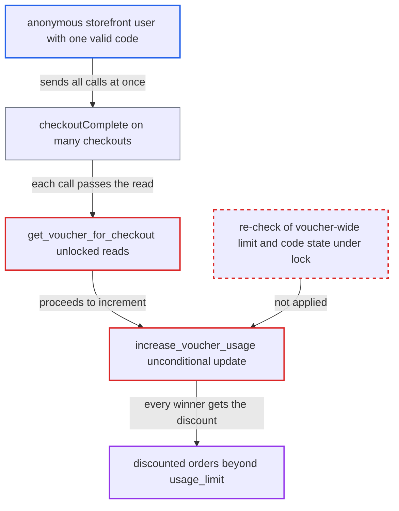

# Voucher usage limit and single-use enforced before lock, allowing concurrent over-redemption

| Field | Value |
|---|---|
| ID | `find_01UwoG9AC5WjdsZSAkV5f1Tr` |
| Severity | **Medium** |
| Status | open |
| CWE | CWE-367 — Race condition |
| Created | 2026-10-27T21:08:00.244193Z |
| Claude Security | https://claude.ai/security/findings/find_01UwoG9AC5WjdsZSAkV5f1Tr |

## Description

An anonymous storefront user holding one valid voucher code can use it on more orders than the merchant allowed. The voucher can be a 100% voucher, which makes the orders free. The attacker sends many `checkoutComplete` calls at the same moment and has to win a race. The usage limit and the single-use rule are checked by unlocked reads in `get_voucher_for_checkout`, and `increase_voucher_usage` then increments unconditionally.

1. **attacker** creates more checkouts than the voucher allows. With `usage_limit=N` or a `single_use` code, the attacker creates M>N checkouts with `checkoutCreate` and attaches the code to each with `checkoutAddPromoCode`, which is accepted while `used<N`.
2. **attacker** makes every checkout completable. A 100% voucher gives a zero total, which counts as fully authorized; otherwise the attacker pays the discounted total.
3. **attacker** sends all `checkoutComplete` calls at once. Each call completes a different checkout, and each completion locks only its own `Checkout` row, so the completions are not serialised against each other. ([`saleor/checkout/complete_checkout.py:1609-1618`](https://github.com/cx-benchmark/saleor/blob/c982006cc04c77a97def93218dedac8d715eb041/saleor/checkout/complete_checkout.py#L1609-L1618))
4. **the function `get_voucher_for_checkout`** checks the code and the usage limit with plain reads. The `is_active=True` lookup and the `active_in_channel` limit filter run without a lock, so every call that reads before the first commit sees the voucher as still valid. ([`saleor/checkout/utils.py:583-627`](https://github.com/cx-benchmark/saleor/blob/c982006cc04c77a97def93218dedac8d715eb041/saleor/checkout/utils.py#L583-L627))
5. **the function `get_voucher_for_checkout`** locks one `VoucherCode` row without checking again. The lock is taken only when `usage_limit` is set and covers a single code, while the limit is a sum over all codes of the voucher. Nothing re-reads `used` or `is_active` after the lock, and `single_use` vouchers with no limit are never locked. ([`saleor/checkout/utils.py:583-627`](https://github.com/cx-benchmark/saleor/blob/c982006cc04c77a97def93218dedac8d715eb041/saleor/checkout/utils.py#L583-L627))
6. **the function `increase_voucher_usage`** increments `used` and deactivates the code with no condition. It runs `used = F('used') + 1` and `is_active = False` without testing `used < usage_limit` or `is_active`, so every call that passed the earlier read gets its discounted order and `used` ends above `usage_limit`. ([`saleor/discount/utils/voucher.py:85-119`](https://github.com/cx-benchmark/saleor/blob/c982006cc04c77a97def93218dedac8d715eb041/saleor/discount/utils/voucher.py#L85-L119))

## Assessment

The attacker is an anonymous storefront user who holds one valid code for a voucher with `usage_limit=N` or `single_use`. No other access is needed. They create more checkouts than the limit, attach the code to each and complete them all at once. Both completion paths are affected: the transaction flow (`_increase_voucher_code_usage_value`) and the legacy payment flow (`_process_voucher_data_for_order`). The attack is a race. It also works with different codes of the same voucher, because the lock covers only one code row while the limit is a per-voucher sum. It relies on PostgreSQL's default READ COMMITTED isolation, which `saleor/settings.py` does not override.

Impact: The attacker gets the voucher discount on more orders than the merchant allowed, possibly free orders with a 100% voucher, and `VoucherCode.used` ends above `usage_limit`. The extra redemptions are limited to the completions that fall inside one race window per code. The once-per-customer rule is not affected, because the `VoucherCustomer` `unique_together` constraint backs `get_or_create`. The report names no confidentiality or availability impact.

## Recommendation

Usage-limit and single-use enforcement is split into an unlocked read (`active_in_channel`, the `is_active=True` lookup) and an unconditional write (`F('used')+1`, `is_active=False`). The existing lock covers one code row, not the voucher-wide limit, and does not apply to single-use vouchers that have no limit.

Fix criteria: Redemption is atomic with respect to the voucher-wide limit and the code's active state. Either the check is repeated under a lock that serialises every redemption of the voucher, including single-use codes, or conditional updates decide success by their affected-row count. N+1 concurrent `checkoutComplete` calls on distinct checkouts sharing a `usage_limit=N` voucher (same or different codes) or a `single_use` code produce at most N (or one) discounted orders. The rest fail with `VOUCHER_NOT_APPLICABLE`.

## Evidence

**https://github.com/cx-benchmark/saleor**

- [`saleor/checkout/utils.py:583-627`](https://github.com/cx-benchmark/saleor/blob/c982006cc04c77a97def93218dedac8d715eb041/saleor/checkout/utils.py#L583-L627)
- [`saleor/discount/utils/voucher.py:85-119`](https://github.com/cx-benchmark/saleor/blob/c982006cc04c77a97def93218dedac8d715eb041/saleor/discount/utils/voucher.py#L85-L119)
- [`saleor/discount/models.py:76-91`](https://github.com/cx-benchmark/saleor/blob/c982006cc04c77a97def93218dedac8d715eb041/saleor/discount/models.py#L76-L91)
- [`saleor/checkout/complete_checkout.py:1609-1618`](https://github.com/cx-benchmark/saleor/blob/c982006cc04c77a97def93218dedac8d715eb041/saleor/checkout/complete_checkout.py#L1609-L1618)
- [`saleor/checkout/complete_checkout.py:115-157`](https://github.com/cx-benchmark/saleor/blob/c982006cc04c77a97def93218dedac8d715eb041/saleor/checkout/complete_checkout.py#L115-L157)

