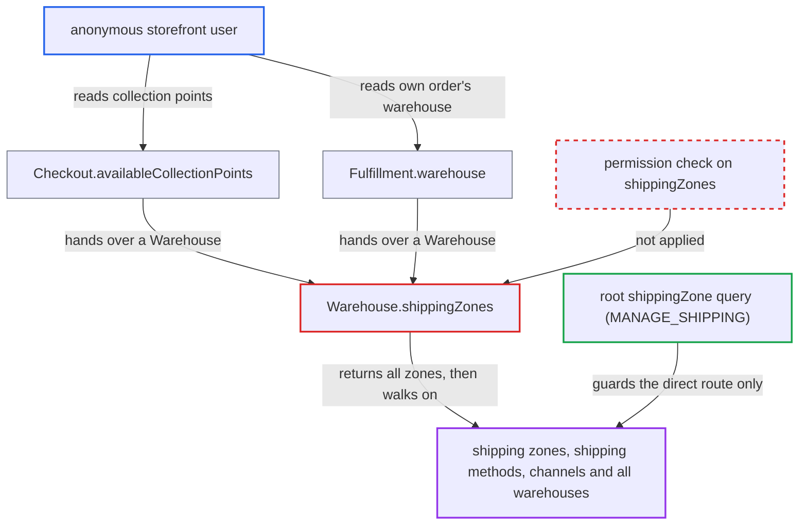

# Warehouse.shippingZones lets storefront users reach staff-only zones and all warehouses

| Field | Value |
|---|---|
| ID | `find_01LUnsYoPktNZdA4icZcAVLv` |
| Severity | **Medium** |
| Status | open |
| CWE | CWE-862 — Missing authorization |
| Created | 2026-10-27T21:21:28.628693Z |
| Claude Security | https://claude.ai/security/findings/find_01LUnsYoPktNZdA4icZcAVLv |

## Description

An anonymous storefront user can read staff-only shipping configuration: zone names and descriptions, shipping methods with their rules, channel slugs including inactive ones, and the name, email, address and phone of every linked warehouse. It needs a visible collection point, which requires click-and-collect to be enabled on a warehouse, or a fulfilled order. The cause is that `Warehouse.shippingZones` has no `permissions`, so no check runs.

1. **anonymous attacker** creates a checkout with `checkoutCreate`. The checkout uses a shippable variant in an active channel, and the checkout token holder can read it back without logging in. ([`saleor/graphql/checkout/types.py:1125-1144`](https://github.com/cx-benchmark/saleor/blob/c982006cc04c77a97def93218dedac8d715eb041/saleor/graphql/checkout/types.py#L1125-L1144))
2. **attacker** queries `availableCollectionPoints` on the checkout. This returns the channel's click-and-collect warehouses as `Warehouse` objects, which gives the attacker a starting warehouse. ([`saleor/graphql/checkout/types.py:1125-1144`](https://github.com/cx-benchmark/saleor/blob/c982006cc04c77a97def93218dedac8d715eb041/saleor/graphql/checkout/types.py#L1125-L1144))
3. **attacker** asks for `shippingZones` on that `Warehouse`. The field is a plain `ConnectionField` declared without `permissions`, and `PermissionsField` adds a check only when `permissions` is non-empty. ([`saleor/graphql/warehouse/types.py:102-106`](https://github.com/cx-benchmark/saleor/blob/c982006cc04c77a97def93218dedac8d715eb041/saleor/graphql/warehouse/types.py#L102-L106))
4. **the resolver `resolve_shipping_zones`** returns every zone of the warehouse. It returns `root.shipping_zones.all()` with `channel_slug=None` and never looks at who is asking. ([`saleor/graphql/warehouse/types.py:124-142`](https://github.com/cx-benchmark/saleor/blob/c982006cc04c77a97def93218dedac8d715eb041/saleor/graphql/warehouse/types.py#L124-L142))
5. **attacker** reads the staff-only fields of each `ShippingZone`. `name`, `description`, `countries`, `shippingMethods` and `channels` have no permission check, and `resolve_shipping_methods` returns all methods when `channel_slug` is None. ([`saleor/graphql/shipping/types.py:316-346`](https://github.com/cx-benchmark/saleor/blob/c982006cc04c77a97def93218dedac8d715eb041/saleor/graphql/shipping/types.py#L316-L346))
6. **attacker** follows `warehouses` and then `shippingZones` again to walk the whole graph. `WarehousesByShippingZoneIdLoader` returns every warehouse linked to the zone, whatever its `click_and_collect_option`, so the walk reaches warehouses that are not collection points. ([`saleor/graphql/warehouse/dataloaders.py:860-884`](https://github.com/cx-benchmark/saleor/blob/c982006cc04c77a97def93218dedac8d715eb041/saleor/graphql/warehouse/dataloaders.py#L860-L884))

## Assessment

The attacker is an anonymous user of `/graphql/` and needs no login. The first way in is a checkout made with `checkoutCreate`, then `availableCollectionPoints`. For that, the merchant must have enabled click-and-collect on a warehouse in the channel, and the default is `DISABLED`, so the attacker does not control this. The second way in is `Fulfillment.warehouse`, which is ungated and returns the warehouse that fulfilled a customer's order. It needs no click-and-collect setup. From either warehouse the attacker queries `shippingZones` and then follows `warehouses` and `shippingZones` recursively.

Impact: The attacker gets read-only access to merchant configuration that is otherwise staff-only. This covers the names, slugs, emails, full addresses and phone numbers of the fulfilment warehouses, zone names and descriptions, shipping-method postal-code and weight rules, and channel slugs including inactive ones. No customer personal data or secrets are reachable, and `channelListings`, `excludedProducts`, `taxClass`, `stocks` and private metadata stay gated. Nothing can be modified.

## Recommendation

`Warehouse.shippingZones` has no permission check, although `Warehouse` objects are deliberately shown to storefront callers. Through it callers reach the staff-only `ShippingZone` graph and, via `ShippingZone.warehouses`, `channels` and `shippingMethods`, the rest of the warehouse network. This bypasses the `MANAGE_SHIPPING` and `MANAGE_PRODUCTS` gates on the root queries.

Fix criteria: Unauthenticated and customer requests cannot go from any `Warehouse` they can see to shipping zones, other warehouses or zone channels. Traversal needs the same staff or app permission as the root `shippingZone(s)` and `warehouses` queries. Anonymous and customer queries for `checkout.availableCollectionPoints.shippingZones` and `order.fulfillments.warehouse.shippingZones` return a permission error or no data. A `MANAGE_SHIPPING` staff request still returns the zones and their warehouses.

## Evidence

**https://github.com/cx-benchmark/saleor**

- [`saleor/graphql/warehouse/types.py:102-106`](https://github.com/cx-benchmark/saleor/blob/c982006cc04c77a97def93218dedac8d715eb041/saleor/graphql/warehouse/types.py#L102-L106)
- [`saleor/graphql/warehouse/types.py:124-142`](https://github.com/cx-benchmark/saleor/blob/c982006cc04c77a97def93218dedac8d715eb041/saleor/graphql/warehouse/types.py#L124-L142)
- [`saleor/graphql/core/fields.py:43-66`](https://github.com/cx-benchmark/saleor/blob/c982006cc04c77a97def93218dedac8d715eb041/saleor/graphql/core/fields.py#L43-L66)
- [`saleor/graphql/shipping/types.py:261-300`](https://github.com/cx-benchmark/saleor/blob/c982006cc04c77a97def93218dedac8d715eb041/saleor/graphql/shipping/types.py#L261-L300)
- [`saleor/graphql/shipping/types.py:316-346`](https://github.com/cx-benchmark/saleor/blob/c982006cc04c77a97def93218dedac8d715eb041/saleor/graphql/shipping/types.py#L316-L346)
- [`saleor/graphql/warehouse/dataloaders.py:860-884`](https://github.com/cx-benchmark/saleor/blob/c982006cc04c77a97def93218dedac8d715eb041/saleor/graphql/warehouse/dataloaders.py#L860-L884)
- [`saleor/graphql/checkout/types.py:1125-1144`](https://github.com/cx-benchmark/saleor/blob/c982006cc04c77a97def93218dedac8d715eb041/saleor/graphql/checkout/types.py#L1125-L1144)
- [`saleor/graphql/order/types.py:948-952`](https://github.com/cx-benchmark/saleor/blob/c982006cc04c77a97def93218dedac8d715eb041/saleor/graphql/order/types.py#L948-L952)
- [`saleor/graphql/warehouse/schema.py:35-60`](https://github.com/cx-benchmark/saleor/blob/c982006cc04c77a97def93218dedac8d715eb041/saleor/graphql/warehouse/schema.py#L35-L60)

