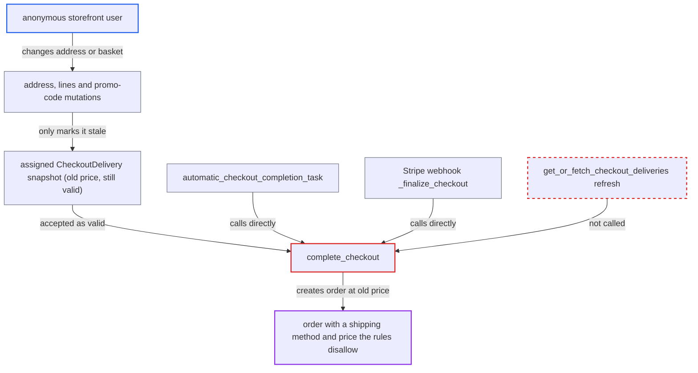

# Webhook and automatic checkout completion accept expired delivery snapshot, bypassing shipping method rules

| Field | Value |
|---|---|
| ID | `find_01YG3G6MqcY84Miwmqa5fDsa` |
| Severity | **Medium** |
| Status | open |
| CWE | CWE-672 — Use of expired resource |
| Created | 2026-10-27T21:31:45.802351Z |
| Claude Security | https://claude.ai/security/findings/find_01YG3G6MqcY84Miwmqa5fDsa |

## Description

An anonymous storefront user can get an order created with a shipping method and price that the merchant's rules no longer allow for the order's address or basket. The loss is limited to the shipping price difference per order, and the merchant can cancel the order. It works on channels with `automatically_complete_fully_paid_checkouts` turned on (default False), or through the legacy Stripe plugin's webhook. The cause is that `complete_checkout` checks the assigned delivery against an expired stored snapshot and never refreshes it.

1. **Anonymous storefront user** picks a cheap shipping method with `checkoutDeliveryMethodUpdate`. The user first sets an address A and queries `shippingMethods`, so the method is valid and assigned to the checkout at that moment.
2. **Anonymous storefront user** changes the address or cuts the basket so the method no longer applies. These mutations only set `delivery_methods_stale_at = now()`. The assigned delivery keeps its old `price_amount`, `active=True` and `is_valid=True`, and the user avoids fields that would refresh deliveries. ([`saleor/graphql/checkout/mutations/utils.py:64-70`](https://github.com/cx-benchmark/saleor/blob/c982006cc04c77a97def93218dedac8d715eb041/saleor/graphql/checkout/mutations/utils.py#L64-L70))
3. **the task `automatic_checkout_completion_task` or the Stripe webhook** calls `complete_checkout` without refreshing deliveries. The task only checks that some delivery id is set. The Stripe path `_finalize_checkout` only checks that the payment covers the recalculated total. ([`saleor/checkout/tasks.py:265-296`](https://github.com/cx-benchmark/saleor/blob/c982006cc04c77a97def93218dedac8d715eb041/saleor/checkout/tasks.py#L265-L296))
4. **the function `complete_checkout`** validates the shipping method against the expired snapshot. `clean_checkout_shipping` accepts the method because `is_method_in_valid_methods` returns the stored `active` and `is_valid` flags. It does not re-check the current address, subtotal or weight. ([`saleor/checkout/delivery_context.py:97-98`](https://github.com/cx-benchmark/saleor/blob/c982006cc04c77a97def93218dedac8d715eb041/saleor/checkout/delivery_context.py#L97-L98))
5. **the function `complete_checkout`** creates the order with the snapshot's shipping price. The shipping charge comes from the same snapshot, so the old lower price is what the payment covers. ([`saleor/checkout/base_calculations.py:133-156`](https://github.com/cx-benchmark/saleor/blob/c982006cc04c77a97def93218dedac8d715eb041/saleor/checkout/base_calculations.py#L133-L156))

## Assessment

The attacker is an anonymous storefront user and needs no login. One route needs a channel with `automatically_complete_fully_paid_checkouts` enabled (default False). The user pays the stale total via `transactionInitialize`, and the beat task completes the checkout. The other route needs the legacy Stripe plugin, which needs no channel option. The user calls `checkoutComplete` before the change and gets the intent client secret. The user then changes the address and confirms the intent, and the Stripe webhook completes the order. Either merchant configuration is required.

Impact: The attacker gets an order with a shipping method and price the merchant's rules do not allow. Examples are a domestic rate for an unserved or pricier zone, or free shipping below the threshold. The merchant under-collects shipping or has to ship where it did not intend. The loss is bounded by the shipping price difference per order, and the merchant can cancel. The report finds no disclosure or availability impact.

## Recommendation

`complete_checkout` validates the assigned delivery against the cached `CheckoutDelivery` snapshot and leaves refreshing an expired snapshot to its callers. The Celery auto-completion task and the Stripe webhook finalisation call it without refreshing, so a method the customer's own later changes made invalid is accepted at its old price.

Fix criteria: Whenever `delivery_methods_stale_at` has passed, every completion path re-evaluates the assigned delivery against the current address, basket and exclusions before creating the order. Doing this inside `complete_checkout` itself covers the auto-completion task, the Stripe webhook and future callers. To verify, assign a method, then change the address or basket so it no longer applies, and pay. Then run the automatic task or deliver the Stripe success webhook. Completion must fail with `INVALID_SHIPPING_METHOD` and create no order.

## Evidence

**https://github.com/cx-benchmark/saleor**

- [`saleor/checkout/complete_checkout.py:1717-1790`](https://github.com/cx-benchmark/saleor/blob/c982006cc04c77a97def93218dedac8d715eb041/saleor/checkout/complete_checkout.py#L1717-L1790)
- [`saleor/checkout/checkout_cleaner.py:26-63`](https://github.com/cx-benchmark/saleor/blob/c982006cc04c77a97def93218dedac8d715eb041/saleor/checkout/checkout_cleaner.py#L26-L63)
- [`saleor/checkout/delivery_context.py:97-98`](https://github.com/cx-benchmark/saleor/blob/c982006cc04c77a97def93218dedac8d715eb041/saleor/checkout/delivery_context.py#L97-L98)
- [`saleor/payment/gateways/stripe/webhooks.py:188-219`](https://github.com/cx-benchmark/saleor/blob/c982006cc04c77a97def93218dedac8d715eb041/saleor/payment/gateways/stripe/webhooks.py#L188-L219)
- [`saleor/checkout/tasks.py:265-296`](https://github.com/cx-benchmark/saleor/blob/c982006cc04c77a97def93218dedac8d715eb041/saleor/checkout/tasks.py#L265-L296)
- [`saleor/graphql/checkout/mutations/checkout_complete.py:196-203`](https://github.com/cx-benchmark/saleor/blob/c982006cc04c77a97def93218dedac8d715eb041/saleor/graphql/checkout/mutations/checkout_complete.py#L196-L203)
- [`saleor/graphql/checkout/mutations/utils.py:64-70`](https://github.com/cx-benchmark/saleor/blob/c982006cc04c77a97def93218dedac8d715eb041/saleor/graphql/checkout/mutations/utils.py#L64-L70)
- [`saleor/checkout/base_calculations.py:133-156`](https://github.com/cx-benchmark/saleor/blob/c982006cc04c77a97def93218dedac8d715eb041/saleor/checkout/base_calculations.py#L133-L156)

