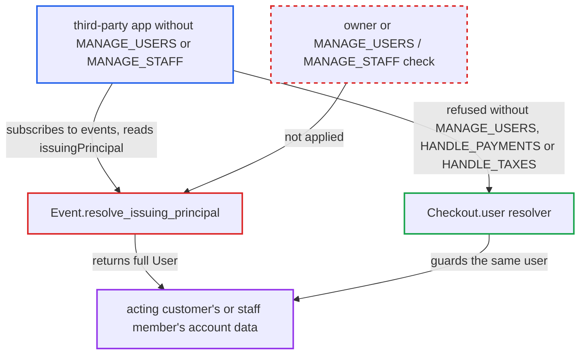

# Webhook issuingPrincipal exposes acting user's full account to apps lacking MANAGE_USERS/MANAGE_STAFF

| Field | Value |
|---|---|
| ID | `find_014eEC75jbeYjcNAYbsaoEJ2` |
| Severity | **Medium** |
| Status | open |
| CWE | CWE-862 — Missing authorization |
| Created | 2026-10-27T21:28:08.842998Z |
| Claude Security | https://claude.ai/security/findings/find_014eEC75jbeYjcNAYbsaoEJ2 |

## Description

An app without `MANAGE_USERS` or `MANAGE_STAFF` can read the account details of the customer or staff member who triggered a webhook event. That includes names, saved addresses with phone numbers, gift cards, permission groups and channel access. It needs only an installed app that can subscribe to the event, for example `MANAGE_CHECKOUTS` for `CHECKOUT_UPDATED`, or no permissions for `ATTRIBUTE_*` events. The cause is `Event.resolve_issuing_principal`, which returns `info.context.requestor` with no permission check.

1. **the attacker's app** registers a webhook with `webhookCreate`. It subscribes to `CHECKOUT_UPDATED` (needs only `MANAGE_CHECKOUTS`) or `ATTRIBUTE_UPDATED` (needs no permission), and its query selects `issuingPrincipal { ... on User { ... } }` with fields such as `addresses`, `giftCards` and `permissionGroups`.
2. **a customer or staff member** triggers the subscribed event by normal use of the shop. The event's requestor is `app or user`, so a logged-in customer's checkout edit or a staff member's attribute edit makes that person the requestor. ([`saleor/graphql/plugins/dataloaders.py:50-55`](https://github.com/cx-benchmark/saleor/blob/c982006cc04c77a97def93218dedac8d715eb041/saleor/graphql/plugins/dataloaders.py#L50-L55))
3. **the webhook worker** reloads the requestor `User` from the database and builds the payload context. The context is created with `request.app` set to the recipient app, but nothing later checks that app's permissions for the requestor. ([`saleor/webhook/transport/asynchronous/transport.py:668-716`](https://github.com/cx-benchmark/saleor/blob/c982006cc04c77a97def93218dedac8d715eb041/saleor/webhook/transport/asynchronous/transport.py#L668-L716))
4. **the context builder `initialize_request`** sets the recipient app and the requestor on the request. Field-level checks therefore run against the recipient app's permissions, but `issuingPrincipal` consults none. ([`saleor/graphql/webhook/subscription_payload.py:26-59`](https://github.com/cx-benchmark/saleor/blob/c982006cc04c77a97def93218dedac8d715eb041/saleor/graphql/webhook/subscription_payload.py#L26-L59))
5. **the resolver `Event.resolve_issuing_principal`** returns the requestor unchanged. The `IssuingPrincipal` union maps a `User` requestor to the full account `User` type, with no ownership or permission check. ([`saleor/graphql/webhook/subscription_types.py:154-158`](https://github.com/cx-benchmark/saleor/blob/c982006cc04c77a97def93218dedac8d715eb041/saleor/graphql/webhook/subscription_types.py#L154-L158))
6. **the `User` type** serves every ungated field to the app. Fields such as `firstName`, `addresses`, `giftCards`, `permissionGroups` and `accessibleChannels` have no field-level check, because the type relies on the resolver that returns the `User` to gate access. ([`saleor/graphql/account/types.py:448-520`](https://github.com/cx-benchmark/saleor/blob/c982006cc04c77a97def93218dedac8d715eb041/saleor/graphql/account/types.py#L448-L520))
7. **the webhook delivery** sends the account data to the app's URL. The victim only used the shop as usual and is not involved further.

## Assessment

The attacker runs a third-party app, malicious or compromised, installed with only `MANAGE_CHECKOUTS` or with no permissions at all. The app calls `webhookCreate` with `asyncEvents: [CHECKOUT_UPDATED]` or `ATTRIBUTE_UPDATED` and a subscription query that selects `issuingPrincipal { ... on User { ... } }`. Once registered, it needs nothing more. Each customer's checkout edit or staff member's attribute edit delivers that person's account to the app's URL. `ATTRIBUTE_*` and `ATTRIBUTE_VALUE_*` events need no permission, and `CHECKOUT_CREATED` and `CHECKOUT_UPDATED` need only `MANAGE_CHECKOUTS`.

Impact: The app reads account data it is not allowed to see elsewhere in the API. For customers that is names, the full address book with phone numbers, default addresses, the gift-card list, `dateJoined`, `lastLogin` and public metadata. For staff it is identity, permissions, permission groups and channel access. The disclosure is read-only and partial. The customer's e-mail is already visible on checkout events, and `orders`, stored payment methods and `privateMetadata` keep their own checks.

## Recommendation

`Event.resolve_issuing_principal` hands the requestor `User` object to the recipient app without the check other `User`-returning resolvers apply (owner, or `MANAGE_USERS` for customers and `MANAGE_STAFF` for staff). Every ungated `User` field becomes readable through any event the app can subscribe to.

Fix criteria: `issuingPrincipal` exposes a `User`'s account fields only to a recipient app that could read that user elsewhere in the API: `MANAGE_USERS` for customers, `MANAGE_STAFF` for staff. Otherwise it returns no more than a minimal identity, like the legacy `{id, type}`. A `MANAGE_CHECKOUTS`-only app subscribed to `checkoutUpdated` with `issuingPrincipal { ... on User { firstName addresses { id } } }` receives no names or addresses after a customer edits a checkout. A zero-permission app on `attributeUpdated` receives no staff permission groups. An app with `MANAGE_USERS` or `MANAGE_STAFF` still receives them.

## Evidence

**https://github.com/cx-benchmark/saleor**

- [`saleor/graphql/webhook/subscription_types.py:154-158`](https://github.com/cx-benchmark/saleor/blob/c982006cc04c77a97def93218dedac8d715eb041/saleor/graphql/webhook/subscription_types.py#L154-L158)
- [`saleor/graphql/webhook/subscription_types.py:110-128`](https://github.com/cx-benchmark/saleor/blob/c982006cc04c77a97def93218dedac8d715eb041/saleor/graphql/webhook/subscription_types.py#L110-L128)
- [`saleor/graphql/webhook/subscription_payload.py:26-59`](https://github.com/cx-benchmark/saleor/blob/c982006cc04c77a97def93218dedac8d715eb041/saleor/graphql/webhook/subscription_payload.py#L26-L59)
- [`saleor/graphql/plugins/dataloaders.py:50-55`](https://github.com/cx-benchmark/saleor/blob/c982006cc04c77a97def93218dedac8d715eb041/saleor/graphql/plugins/dataloaders.py#L50-L55)
- [`saleor/webhook/transport/asynchronous/transport.py:668-716`](https://github.com/cx-benchmark/saleor/blob/c982006cc04c77a97def93218dedac8d715eb041/saleor/webhook/transport/asynchronous/transport.py#L668-L716)
- [`saleor/graphql/checkout/types.py:935-951`](https://github.com/cx-benchmark/saleor/blob/c982006cc04c77a97def93218dedac8d715eb041/saleor/graphql/checkout/types.py#L935-L951)
- [`saleor/graphql/account/types.py:448-520`](https://github.com/cx-benchmark/saleor/blob/c982006cc04c77a97def93218dedac8d715eb041/saleor/graphql/account/types.py#L448-L520)
- [`saleor/webhook/event_types.py:282-305`](https://github.com/cx-benchmark/saleor/blob/c982006cc04c77a97def93218dedac8d715eb041/saleor/webhook/event_types.py#L282-L305)
- [`saleor/webhook/payload_helpers.py:14-19`](https://github.com/cx-benchmark/saleor/blob/c982006cc04c77a97def93218dedac8d715eb041/saleor/webhook/payload_helpers.py#L14-L19)

