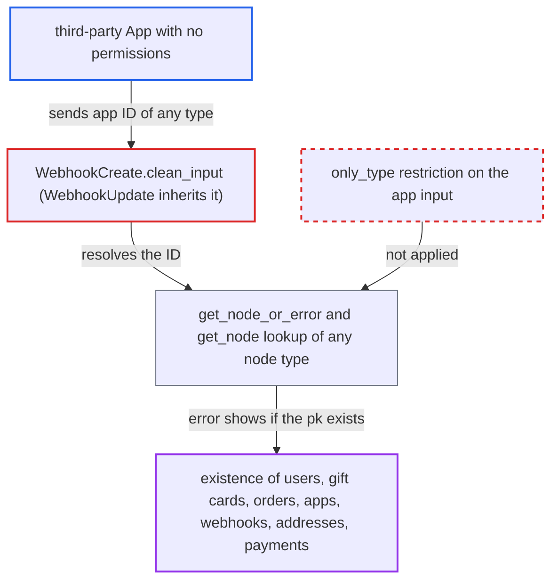

# webhookCreate app input resolves any node type, giving unprivileged apps an existence oracle

| Field | Value |
|---|---|
| ID | `find_016d8RHCLpni6hNmKdrskLLs` |
| Severity | **Medium** |
| Status | open |
| CWE | CWE-204 — Observable response discrepancy |
| Created | 2026-10-27T21:42:41.165168Z |
| Claude Security | https://claude.ai/security/findings/find_016d8RHCLpni6hNmKdrskLLs |

## Description

Any installed App, even one with no permissions, can learn whether a record with a given primary key exists. This covers users, gift cards, legacy-numbered orders, apps, webhooks, addresses and payments. No field values are exposed and nothing is changed. The cause is `WebhookCreate.clean_input`, and `WebhookUpdate` inherits it. It resolves the `app` input through the generic `DeprecatedModelMutation.clean_input` with no type restriction, and the response reveals whether the lookup found a row.

1. **the attacker's App** calls `webhookCreate` with its own app token and an `app` ID of another type. The ID can be, for example, `VXNlcjoxMjM=` (`User:123`), and the call needs no special permission. ([`saleor/graphql/webhook/mutations/webhook_create.py:99-106`](https://github.com/cx-benchmark/saleor/blob/c982006cc04c77a97def93218dedac8d715eb041/saleor/graphql/webhook/mutations/webhook_create.py#L99-L106))
2. **the permission check** lets the call through because the caller is an authenticated App. The check passes when any one of the listed permissions or authorization filters passes, so `AUTHENTICATED_APP` alone is enough. ([`saleor/permission/utils.py:32-46`](https://github.com/cx-benchmark/saleor/blob/c982006cc04c77a97def93218dedac8d715eb041/saleor/permission/utils.py#L32-L46))
3. **`WebhookCreate.clean_input`** calls the generic `DeprecatedModelMutation.clean_input` first. The `app` input is resolved before any check on whether an App caller may set it, and the result is only dropped afterwards. ([`saleor/graphql/webhook/mutations/webhook_create.py:110-139`](https://github.com/cx-benchmark/saleor/blob/c982006cc04c77a97def93218dedac8d715eb041/saleor/graphql/webhook/mutations/webhook_create.py#L110-L139))
4. **the generic `clean_input`** resolves the `app` ID with `get_node_or_error` and no `only_type`. The node type is whatever type name the caller put inside the global ID. ([`saleor/graphql/core/mutations.py:733-737`](https://github.com/cx-benchmark/saleor/blob/c982006cc04c77a97def93218dedac8d715eb041/saleor/graphql/core/mutations.py#L733-L737))
5. **`get_node_or_error`** calls `get_node` of the type named in the ID. `ModelObjectType.get_node` is a plain `model.objects.get(pk=id)` with no visibility or permission filter. ([`saleor/graphql/core/types/model.py:63-80`](https://github.com/cx-benchmark/saleor/blob/c982006cc04c77a97def93218dedac8d715eb041/saleor/graphql/core/types/model.py#L63-L80))
6. **the mutation response** gives a different error depending on whether the row exists. A missing row returns a `WebhookError` on field `app` with `Couldn't resolve to a node` and code `NOT_FOUND`. An existing row is simply discarded for app callers, because `get_instance` already set the calling app, and processing goes on to later validation errors. ([`saleor/graphql/webhook/mutations/webhook_create.py:199-204`](https://github.com/cx-benchmark/saleor/blob/c982006cc04c77a97def93218dedac8d715eb041/saleor/graphql/webhook/mutations/webhook_create.py#L199-L204))

## Assessment

The attacker is a third-party App installed with no or minimal permissions, holding only its own app token. It sends `webhookCreate(input: { app: "<Type:pk>", targetUrl: "" })` to `/graphql/` and reads `errors`. A missing row gives `errors[0].field == "app"` with `Couldn't resolve to a node`. An existing row gives a different, later validation error. No user interaction or special deployment state is needed. `webhookUpdate` offers the same probe to an App that owns at least one webhook. Sequential integer primary keys make enumeration easy.

Impact: The attacker can learn whether a primary key or legacy number exists for any model-backed type. That reveals counts of customers and gift cards, legacy order numbers, and the set of installed apps and webhooks. No field values are disclosed and nothing is modified. Any webhook created belongs to the attacker's own app.

## Recommendation

(1) `WebhookCreate.clean_input` lets the generic resolver look up the `app` input before deciding whether an App caller may set it. The resolver accepts any node type, and its outcome is shown to a caller who cannot read those models.

Fix criteria: An App caller cannot trigger any database lookup through the `app` input. `input.app` is either rejected or dropped for app callers before resolution, or resolved only with `only_type=App` and only for MANAGE_APPS staff. Submitting `app: User:<n>` or `GiftCard:<n>` from an app token returns the same error whether or not that pk exists. `webhookUpdate` behaves the same way.

(2) The generic `DeprecatedModelMutation.clean_input` resolves `ID` and `[ID]` input fields without an expected type, so every subclass inherits lookups of any type.

Fix criteria: Generic ID resolution enforces an expected type per field, declared on the input or supplied by the mutation. IDs of other types are rejected before the database is queried. Check: an ID of a foreign type given to any `DeprecatedModelMutation` ID input fails with an 'invalid ID type' error, with no database query for that type.

## Evidence

**https://github.com/cx-benchmark/saleor**

- [`saleor/graphql/webhook/mutations/webhook_create.py:110-139`](https://github.com/cx-benchmark/saleor/blob/c982006cc04c77a97def93218dedac8d715eb041/saleor/graphql/webhook/mutations/webhook_create.py#L110-L139)
- [`saleor/graphql/webhook/mutations/webhook_create.py:99-106`](https://github.com/cx-benchmark/saleor/blob/c982006cc04c77a97def93218dedac8d715eb041/saleor/graphql/webhook/mutations/webhook_create.py#L99-L106)
- [`saleor/graphql/core/mutations.py:733-737`](https://github.com/cx-benchmark/saleor/blob/c982006cc04c77a97def93218dedac8d715eb041/saleor/graphql/core/mutations.py#L733-L737)
- [`saleor/graphql/core/mutations.py:375-411`](https://github.com/cx-benchmark/saleor/blob/c982006cc04c77a97def93218dedac8d715eb041/saleor/graphql/core/mutations.py#L375-L411)
- [`saleor/graphql/core/types/model.py:63-80`](https://github.com/cx-benchmark/saleor/blob/c982006cc04c77a97def93218dedac8d715eb041/saleor/graphql/core/types/model.py#L63-L80)
- [`saleor/graphql/webhook/mutations/webhook_create.py:199-204`](https://github.com/cx-benchmark/saleor/blob/c982006cc04c77a97def93218dedac8d715eb041/saleor/graphql/webhook/mutations/webhook_create.py#L199-L204)
- [`saleor/graphql/webhook/mutations/webhook_update.py:95-131`](https://github.com/cx-benchmark/saleor/blob/c982006cc04c77a97def93218dedac8d715eb041/saleor/graphql/webhook/mutations/webhook_update.py#L95-L131)
- [`saleor/permission/utils.py:32-46`](https://github.com/cx-benchmark/saleor/blob/c982006cc04c77a97def93218dedac8d715eb041/saleor/permission/utils.py#L32-L46)

