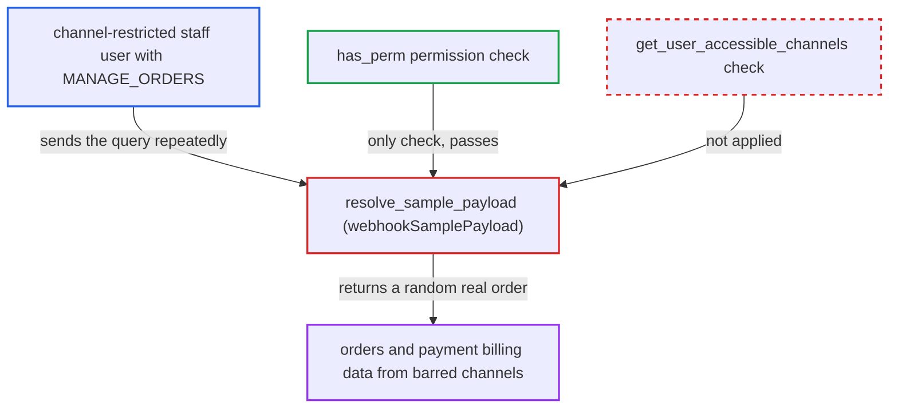

# webhookSamplePayload ignores staff channel restrictions and leaks real order payment billing data

| Field | Value |
|---|---|
| ID | `find_01PuGmLK87MyQVxoExWbb5G2` |
| Severity | **Medium** |
| Status | open |
| CWE | CWE-863 — Improper authorization |
| Created | 2026-10-27T21:21:29.119946Z |
| Claude Security | https://claude.ai/security/findings/find_01PuGmLK87MyQVxoExWbb5G2 |

## Description

A staff user restricted to certain sales channels can read real orders from channels they are barred from. Each response includes the customer's real payment billing name, e-mail, address and `psp_reference`. The user needs `MANAGE_ORDERS` and can call `webhookSamplePayload` repeatedly. The resolver `resolve_sample_payload` checks only the permission, never `get_user_accessible_channels`, and the anonymization of the sample is incomplete.

1. **channel-restricted staff user** sends the query `webhookSamplePayload` with an order or fulfillment event type. The user holds `MANAGE_ORDERS` but all their permission groups are `restricted_access_to_channels`. Event types named are `ORDER_CREATED`, `ORDER_FULLY_PAID`, `ORDER_FULFILLED`, `ORDER_CANCELLED` and `FULFILLMENT_CREATED`.
2. **the resolver `resolve_sample_payload`** lets the request through after checking only `user.has_perm(required_permission)`. It never consults `get_user_accessible_channels`, so the user's channel restriction is ignored. ([`saleor/graphql/webhook/resolvers.py:44-55`](https://github.com/cx-benchmark/saleor/blob/c982006cc04c77a97def93218dedac8d715eb041/saleor/graphql/webhook/resolvers.py#L44-L55))
3. **the function `_generate_sample_order_payload`** picks a random order from every channel. `_get_sample_object` uses `order_by("?").first()` on an unfiltered queryset, so each call can return a different order. The `FULFILLMENT_CREATED` branch draws a random fulfillment the same way. ([`saleor/webhook/payloads.py:1082-1085`](https://github.com/cx-benchmark/saleor/blob/c982006cc04c77a97def93218dedac8d715eb041/saleor/webhook/payloads.py#L1082-L1085))
4. **the function `anonymize_order`** replaces only some order fields. It swaps the user, `user_email`, the two addresses, the note and the metadata. The related payments, lines and fulfillments are copied unchanged. ([`saleor/core/utils/anonymization.py:105-121`](https://github.com/cx-benchmark/saleor/blob/c982006cc04c77a97def93218dedac8d715eb041/saleor/core/utils/anonymization.py#L105-L121))
5. **the function `_generate_order_payment_payload`** writes each real payment's billing data into the payload. This includes `billing_email`, the first and last name, company, street, city, postal code, country and `psp_reference`. The payload also carries the real order UUID, `number`, line items and tracking numbers. ([`saleor/webhook/payloads.py:333-364`](https://github.com/cx-benchmark/saleor/blob/c982006cc04c77a97def93218dedac8d715eb041/saleor/webhook/payloads.py#L333-L364))
6. **channel-restricted staff user** repeats the query to collect more orders. Each call returns one random record that the attacker cannot choose.

## Assessment

The attacker is an authenticated staff user who holds `MANAGE_ORDERS` and whose permission groups are all restricted to some channels, such as channel A. They send `webhookSamplePayload` to `/graphql/` with `ORDER_FULLY_PAID`, `ORDER_CREATED`, `ORDER_FULFILLED`, `ORDER_CANCELLED` or `FULFILLMENT_CREATED` as often as they like. No victim action is needed. Unrestricted `MANAGE_ORDERS` staff or apps gain nothing from the incomplete anonymization alone, because they can already list every order with its real addresses.

Impact: The attacker learns orders from channels they are barred from. For orders with legacy payments, this includes the customer's real payment billing name, e-mail, address and `psp_reference`. It also includes the order UUID, number, items, totals and tracking numbers. The loss is limited: each call returns one random record the attacker cannot choose, and the order-level addresses, e-mail and metadata are faked. Nothing is changed.

## Recommendation

(1) `resolve_sample_payload` authorizes by permission only, and the sample queries draw from every channel. This ignores the `restricted_access_to_channels` scoping that `resolve_orders`, `resolve_payments` and the other order read paths enforce.

Fix criteria: For a non-app caller, the sampled order or fulfillment comes only from channels returned by `get_user_accessible_channels`, or the query is refused to channel-restricted users. A test shows that a staff user restricted to channel A never receives a sample whose `channel.slug` is not A, across all order and fulfillment event types.

(2) `anonymize_order` leaves the related `Payment` rows (real `billing_*` fields and `psp_reference`) and the order identifiers in the serialized sample, so the supposedly anonymized payload carries real customer data.

Fix criteria: The sample payload contains no value taken from a real customer's payment billing data or from the real order's identifiers. Payment `billing_*` and `psp_reference`, order `id`, `token` and `number`, and fulfillment tracking numbers are faked or omitted, or the sample is built from synthetic objects. A test compares a sample against its source rows and asserts that none of these values match.

## Evidence

**https://github.com/cx-benchmark/saleor**

- [`saleor/graphql/webhook/resolvers.py:44-55`](https://github.com/cx-benchmark/saleor/blob/c982006cc04c77a97def93218dedac8d715eb041/saleor/graphql/webhook/resolvers.py#L44-L55)
- [`saleor/webhook/payloads.py:1094-1123`](https://github.com/cx-benchmark/saleor/blob/c982006cc04c77a97def93218dedac8d715eb041/saleor/webhook/payloads.py#L1094-L1123)
- [`saleor/webhook/payloads.py:1082-1085`](https://github.com/cx-benchmark/saleor/blob/c982006cc04c77a97def93218dedac8d715eb041/saleor/webhook/payloads.py#L1082-L1085)
- [`saleor/core/utils/anonymization.py:105-121`](https://github.com/cx-benchmark/saleor/blob/c982006cc04c77a97def93218dedac8d715eb041/saleor/core/utils/anonymization.py#L105-L121)
- [`saleor/webhook/payloads.py:333-364`](https://github.com/cx-benchmark/saleor/blob/c982006cc04c77a97def93218dedac8d715eb041/saleor/webhook/payloads.py#L333-L364)
- [`saleor/payment/utils.py:397-416`](https://github.com/cx-benchmark/saleor/blob/c982006cc04c77a97def93218dedac8d715eb041/saleor/payment/utils.py#L397-L416)
- [`saleor/webhook/payloads.py:292-310`](https://github.com/cx-benchmark/saleor/blob/c982006cc04c77a97def93218dedac8d715eb041/saleor/webhook/payloads.py#L292-L310)
- [`saleor/webhook/payloads.py:1163-1167`](https://github.com/cx-benchmark/saleor/blob/c982006cc04c77a97def93218dedac8d715eb041/saleor/webhook/payloads.py#L1163-L1167)
- [`saleor/graphql/order/resolvers.py:20-42`](https://github.com/cx-benchmark/saleor/blob/c982006cc04c77a97def93218dedac8d715eb041/saleor/graphql/order/resolvers.py#L20-L42)

