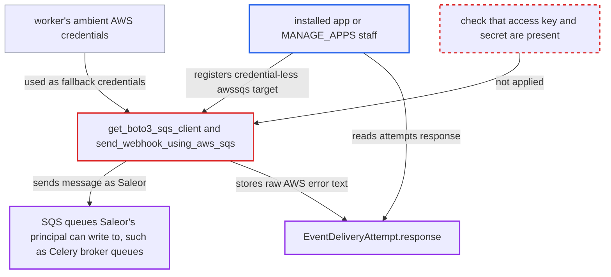

# awssqs webhook targets without credentials are sent under Saleor's own AWS identity

| Field | Value |
|---|---|
| ID | `find_01PuYwqxXv4SRyohWNbAGAeS` |
| Severity | **Low** |
| Status | open |
| CWE | CWE-441 — Confused deputy |
| Created | 2026-10-27T21:29:25.951157Z |
| Claude Security | https://claude.ai/security/findings/find_01PuYwqxXv4SRyohWNbAGAeS |

## Description

An installed app, or staff with `MANAGE_APPS`, can make Saleor send messages to AWS SQS queues using Saleor's own AWS identity. It can also read error text that may reveal Saleor's AWS account id and role name. This needs a worker that runs with ambient AWS credentials able to write to SQS. The cause is `get_boto3_sqs_client`, which passes missing URL credentials to `boto3.client` unchecked, so boto3 falls back to the worker's own credentials.

1. **the app** calls `webhookCreate` with a credential-less `awssqs://` target. The `targetUrl` is `awssqs://sqs.<region>.amazonaws.com/<account>/<queue>` with no userinfo, subscribed to `ATTRIBUTE_UPDATED`, and `AUTHENTICATED_APP` is allowed to call the mutation. ([`saleor/graphql/webhook/mutations/webhook_create.py:97-104`](https://github.com/cx-benchmark/saleor/blob/c982006cc04c77a97def93218dedac8d715eb041/saleor/graphql/webhook/mutations/webhook_create.py#L97-L104))
2. **`WebhookURLField`** accepts and stores the URL. The `awssqs` scheme is allowed with optional userinfo, so a target with no access key or secret is saved. The manifest schema accepts it too. ([`saleor/webhook/models.py:12-15`](https://github.com/cx-benchmark/saleor/blob/c982006cc04c77a97def93218dedac8d715eb041/saleor/webhook/models.py#L12-L15))
3. **the Celery worker** delivers the next event to the target. `send_webhook_request_async` passes `webhook.target_url` on, and `ATTRIBUTE_*` events need no permission, so deliveries happen. ([`saleor/webhook/transport/asynchronous/transport.py:844-872`](https://github.com/cx-benchmark/saleor/blob/c982006cc04c77a97def93218dedac8d715eb041/saleor/webhook/transport/asynchronous/transport.py#L844-L872))
4. **`get_boto3_sqs_client`** builds the SQS client from `parts.username` and `parts.password`. Both values are `None`, so boto3 uses the worker's default credential chain: env vars, shared config, or the ECS/EC2 role. No endpoint or account restriction is applied. ([`saleor/webhook/transport/utils.py:729-752`](https://github.com/cx-benchmark/saleor/blob/c982006cc04c77a97def93218dedac8d715eb041/saleor/webhook/transport/utils.py#L729-L752))
5. **`send_webhook_using_aws_sqs`** sends the webhook payload to the queue the app named. The `QueueUrl` comes from the app-controlled hostname and path, and the call is made as Saleor's principal. ([`saleor/webhook/transport/utils.py:290-309`](https://github.com/cx-benchmark/saleor/blob/c982006cc04c77a97def93218dedac8d715eb041/saleor/webhook/transport/utils.py#L290-L309))
6. **the app** reads the stored error text from `attempts{response}`. On an AWS error the function returns `str(e)`, which is saved in `EventDeliveryAttempt.response`. The owning app can query it, and an `AccessDenied` message may include the caller's principal ARN. ([`saleor/webhook/transport/asynchronous/transport.py:844-872`](https://github.com/cx-benchmark/saleor/blob/c982006cc04c77a97def93218dedac8d715eb041/saleor/webhook/transport/asynchronous/transport.py#L844-L872))

## Assessment

The attacker is any installed app, or staff with `MANAGE_APPS`. They call `webhookCreate` over `/graphql/` with an `awssqs://` target without userinfo, subscribed to `ATTRIBUTE_UPDATED`, which needs no permission. The attack only works if the Celery worker has ambient AWS credentials that can write to SQS, such as a task or instance role or env keys. That is a deployment condition the attacker does not control. One concrete target is the Celery broker queues, when `CELERY_BROKER_URL=sqs://` takes its credentials from the same chain. Google Pub/Sub targets follow the same pattern, but there the Application Default Credentials are the only credential path the code offers, so that part is the intended design and the operator must limit the service account's topic rights.

Impact: The app can make Saleor write messages to SQS queues in the operator's AWS account that the app has no rights to. The body is a Saleor-generated webhook payload that the app's subscription query only partly shapes. It is not an arbitrary command, and a Celery worker would most likely reject it as an unknown message. The app can also learn Saleor's AWS account id and role name from `AccessDenied` text, and can test which queues the role may write to. No Saleor data is changed and the service is not degraded.

Subsequent-system impact: Unauthorized, poison-style messages can land in queues in the operator's AWS account, such as Saleor's own Celery broker queues. The report shows no code that says what consumers do with them.

## Recommendation

(1) `get_boto3_sqs_client` lets boto3 fall back to the worker's own credential chain when an `awssqs://` URL has no userinfo. An app-chosen queue is then written with Saleor's AWS identity instead of the app's.

Fix criteria: An `awssqs://` target without both access key and secret is rejected at `webhookCreate`, `webhookUpdate` and manifest install. At send time, no SQS client is built from ambient credentials for an app webhook, and a credential-less target fails without any AWS call. To verify, register `awssqs://sqs.us-east-1.amazonaws.com/<acct>/<queue>`. The mutation must be refused, and an existing such row must give a FAILED attempt with no `SendMessage` issued.

(2) Raw botocore error text is stored in `EventDeliveryAttempt.response` and shown to the app. It exposes the caller's principal ARN and lets the app test which queues the role may write to.

Fix criteria: Cloud-provider errors stored for app-visible delivery attempts contain no principal ARNs or account ids, for example only a generic message or an error code. To verify, force an `AccessDenied` on an SQS delivery and read `attempts { response }` as the app. No ARN or account id may appear.

## Evidence

**https://github.com/cx-benchmark/saleor**

- [`saleor/webhook/transport/utils.py:729-752`](https://github.com/cx-benchmark/saleor/blob/c982006cc04c77a97def93218dedac8d715eb041/saleor/webhook/transport/utils.py#L729-L752)
- [`saleor/webhook/transport/utils.py:290-309`](https://github.com/cx-benchmark/saleor/blob/c982006cc04c77a97def93218dedac8d715eb041/saleor/webhook/transport/utils.py#L290-L309)
- [`saleor/webhook/models.py:12-15`](https://github.com/cx-benchmark/saleor/blob/c982006cc04c77a97def93218dedac8d715eb041/saleor/webhook/models.py#L12-L15)
- [`saleor/graphql/webhook/mutations/webhook_create.py:97-104`](https://github.com/cx-benchmark/saleor/blob/c982006cc04c77a97def93218dedac8d715eb041/saleor/graphql/webhook/mutations/webhook_create.py#L97-L104)
- [`saleor/webhook/transport/asynchronous/transport.py:844-872`](https://github.com/cx-benchmark/saleor/blob/c982006cc04c77a97def93218dedac8d715eb041/saleor/webhook/transport/asynchronous/transport.py#L844-L872)
- [`saleor/settings.py:632-639`](https://github.com/cx-benchmark/saleor/blob/c982006cc04c77a97def93218dedac8d715eb041/saleor/settings.py#L632-L639)
- [`saleor/webhook/transport/utils.py:312-343`](https://github.com/cx-benchmark/saleor/blob/c982006cc04c77a97def93218dedac8d715eb041/saleor/webhook/transport/utils.py#L312-L343)

