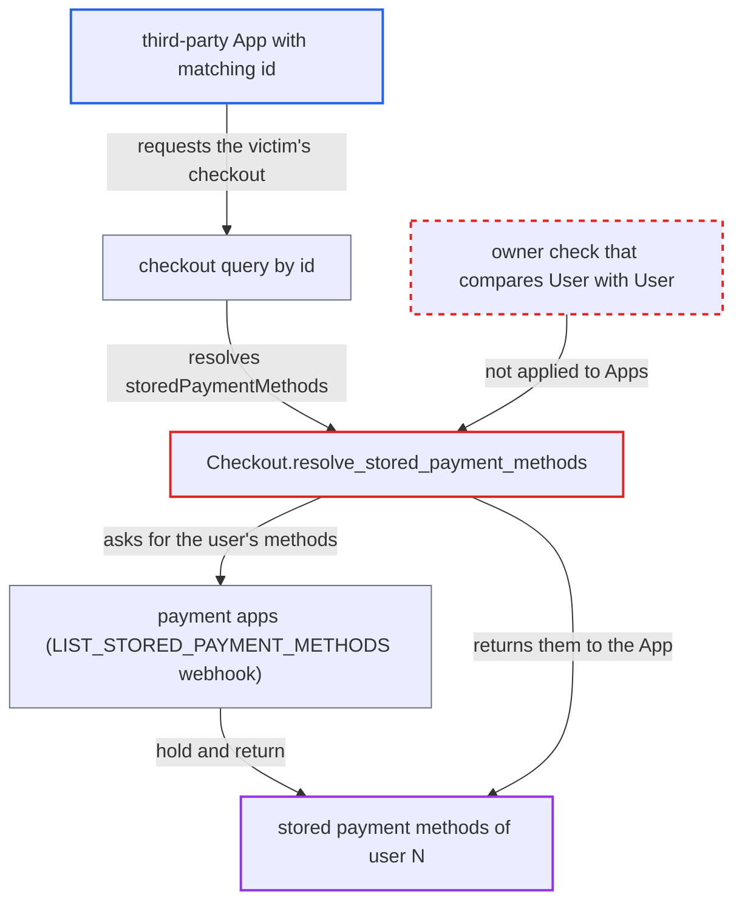

# Checkout.storedPaymentMethods owner check compares App id with User id

| Field | Value |
|---|---|
| ID | `find_01KxzFQanm48KqnmG7zqYqkf` |
| Severity | **Low** |
| Status | open |
| CWE | CWE-863 — Incorrect authorization |
| Created | 2026-10-27T21:24:43.495116Z |
| Claude Security | https://claude.ai/security/findings/find_01KxzFQanm48KqnmG7zqYqkf |

## Description

A third-party App can read the stored payment-method details of one customer, the one whose user id equals the App's own id. The details are card brand, last digits, expiry, name, gateway ids and provider data, and the API normally gives them only to the owning customer. The App needs one of the permissions `MANAGE_USERS`, `MANAGE_ORDERS`, `MANAGE_CHECKOUTS` or `HANDLE_PAYMENTS`. The flaw is in `Checkout.resolve_stored_payment_methods`, which compares an `App` id with a `User` id.

1. **attacker App** finds a checkout that belongs to the user whose id equals the App's own id. Apps with `MANAGE_USERS` or `MANAGE_ORDERS` can list the user's checkout ids through `user(id:){checkoutIds}`, and apps with `MANAGE_CHECKOUTS` or `HANDLE_PAYMENTS` can use `checkouts(filter:{customer:})`. ([`saleor/graphql/account/types.py:699-721`](https://github.com/cx-benchmark/saleor/blob/c982006cc04c77a97def93218dedac8d715eb041/saleor/graphql/account/types.py#L699-L721))
2. **attacker App** queries `checkout(id:)` for that checkout and asks for `storedPaymentMethods`. `checkout(id:)` returns any checkout in an active channel and allows sync webhooks, so the resolver's second gate is satisfied. ([`saleor/graphql/checkout/resolvers.py:36-75`](https://github.com/cx-benchmark/saleor/blob/c982006cc04c77a97def93218dedac8d715eb041/saleor/graphql/checkout/resolvers.py#L36-L75))
3. **request context** sets the requestor to the `App`. For an app-token request `get_user_or_app_from_context` returns `context.app or context.user`, and `request.user` is None, so the requestor is the `App`. ([`saleor/graphql/context.py:77-97`](https://github.com/cx-benchmark/saleor/blob/c982006cc04c77a97def93218dedac8d715eb041/saleor/graphql/context.py#L77-L97))
4. **the resolver `resolve_stored_payment_methods`** compares `requestor.id` with `root.node.user_id` and lets the request through. The check compares an `App` primary key with a `User` primary key. The two models use separate id sequences, so the values can be equal, and when they are equal the check passes. ([`saleor/graphql/checkout/types.py:1462-1495`](https://github.com/cx-benchmark/saleor/blob/c982006cc04c77a97def93218dedac8d715eb041/saleor/graphql/checkout/types.py#L1462-L1495))
5. **the plugin method `list_stored_payment_methods`** sends the sync `LIST_STORED_PAYMENT_METHODS` webhook for the victim's user id to every payment app. The payment apps reply with the user's stored methods, and the resolver returns them to the attacker App. ([`saleor/plugins/webhook/plugin.py:2834-2880`](https://github.com/cx-benchmark/saleor/blob/c982006cc04c77a97def93218dedac8d715eb041/saleor/plugins/webhook/plugin.py#L2834-L2880))

## Assessment

The attacker is a third-party App with `MANAGE_USERS`, `MANAGE_ORDERS`, `MANAGE_CHECKOUTS` or `HANDLE_PAYMENTS`, used to find a checkout of user N, where N is the App's own id. Staff with `MANAGE_APPS` can choose N by creating apps. The attack works only if customer N exists, has a checkout in an active channel, and has stored methods with an installed payment app. No action by the victim is needed.

Impact: The App reads the stored payment-method metadata of one customer per app id. Even staff cannot normally read this data. The report's code review shows no way to modify the methods or charge them.

## Recommendation

The owner check in `Checkout.resolve_stored_payment_methods` compares raw primary keys across two identity types, `App` and `User`. An App can therefore pass a check meant only for the customer who owns the checkout.

Fix criteria: Stored payment methods are returned only to an authenticated `User` whose identity equals `checkout.user`, and an `App` requestor always gets an empty list. To verify, query `checkout(id:){storedPaymentMethods}` as an App whose pk equals the checkout owner's user id. Confirm that `[]` is returned and that no `LIST_STORED_PAYMENT_METHODS` webhook is sent.

## Evidence

**https://github.com/cx-benchmark/saleor**

- [`saleor/graphql/checkout/types.py:1462-1495`](https://github.com/cx-benchmark/saleor/blob/c982006cc04c77a97def93218dedac8d715eb041/saleor/graphql/checkout/types.py#L1462-L1495)
- [`saleor/graphql/utils/__init__.py:204-207`](https://github.com/cx-benchmark/saleor/blob/c982006cc04c77a97def93218dedac8d715eb041/saleor/graphql/utils/__init__.py#L204-L207)
- [`saleor/graphql/context.py:77-97`](https://github.com/cx-benchmark/saleor/blob/c982006cc04c77a97def93218dedac8d715eb041/saleor/graphql/context.py#L77-L97)
- [`saleor/graphql/checkout/resolvers.py:36-75`](https://github.com/cx-benchmark/saleor/blob/c982006cc04c77a97def93218dedac8d715eb041/saleor/graphql/checkout/resolvers.py#L36-L75)
- [`saleor/graphql/account/types.py:699-721`](https://github.com/cx-benchmark/saleor/blob/c982006cc04c77a97def93218dedac8d715eb041/saleor/graphql/account/types.py#L699-L721)
- [`saleor/plugins/webhook/plugin.py:2834-2880`](https://github.com/cx-benchmark/saleor/blob/c982006cc04c77a97def93218dedac8d715eb041/saleor/plugins/webhook/plugin.py#L2834-L2880)
- [`saleor/graphql/account/utils.py:364-376`](https://github.com/cx-benchmark/saleor/blob/c982006cc04c77a97def93218dedac8d715eb041/saleor/graphql/account/utils.py#L364-L376)

