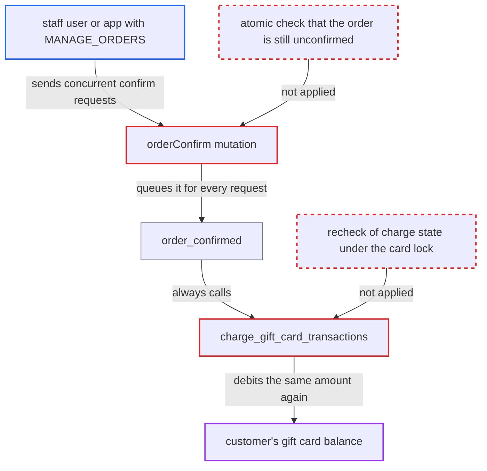

# Concurrent orderConfirm calls charge the same gift-card transaction more than once

| Field | Value |
|---|---|
| ID | `find_01HREvkYoBfQVHuV5p1JDxyx` |
| Severity | **Low** |
| Status | open |
| CWE | CWE-362 — Race condition |
| Created | 2026-10-27T21:44:32.125284Z |
| Claude Security | https://claude.ai/security/findings/find_01HREvkYoBfQVHuV5p1JDxyx |

## Description

A staff user or app with `MANAGE_ORDERS` can debit a customer's gift card several times for one order by sending `orderConfirm` requests at the same moment. This only affects channels with `automatically_confirm_all_new_orders=False`, and the loss is capped by the card's balance. The cause is that `charge_gift_card_transactions` checks "already charged" on an unlocked read and never rechecks it under the card lock. `orderConfirm` also lets several requests through.

1. **attacker with `MANAGE_ORDERS`** sends several `orderConfirm(id)` requests at once. The target is an order paid by gift card in a channel with manual confirmation, and the card holds at least twice the authorized amount. ([`saleor/graphql/order/mutations/order_confirm.py:47-117`](https://github.com/cx-benchmark/saleor/blob/c982006cc04c77a97def93218dedac8d715eb041/saleor/graphql/order/mutations/order_confirm.py#L47-L117))
2. **the mutation `orderConfirm`** reads the order status without a lock in each request. `get_instance` checks `is_unconfirmed()` on an unlocked read, so every request that reads the order before the first confirmation commits sees `UNCONFIRMED` and passes. ([`saleor/graphql/order/mutations/order_confirm.py:47-117`](https://github.com/cx-benchmark/saleor/blob/c982006cc04c77a97def93218dedac8d715eb041/saleor/graphql/order/mutations/order_confirm.py#L47-L117))
3. **the function `update_order_status`** locks the order and recomputes its status but does not refuse an already-confirmed order. It returns nothing the caller checks, so a second concurrent confirm goes on to the side effects. ([`saleor/order/utils.py:192-207`](https://github.com/cx-benchmark/saleor/blob/c982006cc04c77a97def93218dedac8d715eb041/saleor/order/utils.py#L192-L207))
4. **the mutation `orderConfirm`** queues `order_confirmed` on commit for every request that passed the read. Because no request is rejected, one order is confirmed several times. ([`saleor/graphql/order/mutations/order_confirm.py:47-117`](https://github.com/cx-benchmark/saleor/blob/c982006cc04c77a97def93218dedac8d715eb041/saleor/graphql/order/mutations/order_confirm.py#L47-L117))
5. **the function `order_confirmed`** calls `charge_gift_card_transactions` for each of those requests. The call is unconditional, with no order lock or status check around it. ([`saleor/order/actions.py:356-380`](https://github.com/cx-benchmark/saleor/blob/c982006cc04c77a97def93218dedac8d715eb041/saleor/order/actions.py#L356-L380))
6. **the function `charge_gift_card_transactions`** selects transactions to charge before any `CHARGE_REQUEST` event exists. The filter is an unlocked `SELECT` run when the loop starts, and the `CHARGE_REQUEST` row that would exclude the transaction is inserted only afterwards, so every concurrent caller still sees it as uncharged. ([`saleor/giftcard/gateway.py:287-306`](https://github.com/cx-benchmark/saleor/blob/c982006cc04c77a97def93218dedac8d715eb041/saleor/giftcard/gateway.py#L287-L306))
7. **the function `charge_gift_card_transactions`** locks the gift card row and subtracts the stale `authorized_value` from the balance. Under the lock it only checks that the balance covers `authorized_value`, never whether this transaction was already charged, so each winning caller debits the card again. ([`saleor/giftcard/gateway.py:323-345`](https://github.com/cx-benchmark/saleor/blob/c982006cc04c77a97def93218dedac8d715eb041/saleor/giftcard/gateway.py#L323-L345))
8. **the function `deduplicate_event`** fails to merge the duplicate `CHARGE_SUCCESS` events. It matches only on pspReference, and each gift card charge response carries a fresh `uuid4()` pspReference, so every extra event is stored and `charged_value` becomes a multiple of the authorized amount. ([`saleor/payment/utils.py:1154-1236`](https://github.com/cx-benchmark/saleor/blob/c982006cc04c77a97def93218dedac8d715eb041/saleor/payment/utils.py#L1154-L1236))

## Assessment

The attacker is a staff user or app with `MANAGE_ORDERS` for the channel. The channel must use manual order confirmation (`automatically_confirm_all_new_orders=False`), and a customer must have placed an order paid by gift card. The card must hold at least twice the authorized amount for the extra debits to succeed. The attacker sends several `orderConfirm(id)` requests to `/graphql/` at once. Each request that reads `UNCONFIRMED` and evaluates the charge queryset before the first `CHARGE_REQUEST` insert debits the card again. Winning this short timing window and the manual-confirm setting are outside the attacker's control. In auto-confirm channels, gift-card orders are created `UNFULFILLED` and `orderConfirm` refuses them, so this path does not apply there.

Impact: The customer's gift card is debited once more for each request that won the race, up to the card's balance. The transaction ends up with duplicate `CHARGE_SUCCESS` events, a `charged_value` that is a multiple of the authorized amount, and a negative `authorized_value`, and the order shows `OVERCHARGED`. Duplicate confirmation emails are also sent. The attacker does not receive the money, and staff with `HANDLE_PAYMENTS` can refund the excess.

## Recommendation

(1) The charge-once guard in `charge_gift_card_transactions` is a lock-free `Exists`/`charged_value` filter evaluated before the `CHARGE_REQUEST` marker is written. The balance lock never checks the transaction's charge state again, so concurrent callers all pass.

Fix criteria: A gift card transaction is debited at most once, however many callers run `charge_gift_card_transactions` concurrently. The already-requested or already-charged condition is evaluated atomically with the balance deduction, for example under a lock on the `TransactionItem` with a fresh read. Running the function concurrently for one order produces exactly one `CHARGE_REQUEST`/`CHARGE_SUCCESS` pair and exactly one balance deduction.

(2) `orderConfirm` checks `UNCONFIRMED` on an unlocked read and runs the confirmation side effects for every request that passed, so one order can be confirmed several times.

Fix criteria: The UNCONFIRMED-to-confirmed transition is checked and made atomically under the order lock. Only the request that made the transition queues `order_confirmed`, and the others return the invalid-status error. Concurrent `orderConfirm` calls yield one `ORDER_CONFIRMED` event and one gift card charge.

## Evidence

**https://github.com/cx-benchmark/saleor**

- [`saleor/giftcard/gateway.py:287-306`](https://github.com/cx-benchmark/saleor/blob/c982006cc04c77a97def93218dedac8d715eb041/saleor/giftcard/gateway.py#L287-L306)
- [`saleor/giftcard/gateway.py:323-345`](https://github.com/cx-benchmark/saleor/blob/c982006cc04c77a97def93218dedac8d715eb041/saleor/giftcard/gateway.py#L323-L345)
- [`saleor/graphql/order/mutations/order_confirm.py:47-117`](https://github.com/cx-benchmark/saleor/blob/c982006cc04c77a97def93218dedac8d715eb041/saleor/graphql/order/mutations/order_confirm.py#L47-L117)
- [`saleor/order/utils.py:192-207`](https://github.com/cx-benchmark/saleor/blob/c982006cc04c77a97def93218dedac8d715eb041/saleor/order/utils.py#L192-L207)
- [`saleor/order/actions.py:356-380`](https://github.com/cx-benchmark/saleor/blob/c982006cc04c77a97def93218dedac8d715eb041/saleor/order/actions.py#L356-L380)
- [`saleor/payment/utils.py:1154-1236`](https://github.com/cx-benchmark/saleor/blob/c982006cc04c77a97def93218dedac8d715eb041/saleor/payment/utils.py#L1154-L1236)
- [`saleor/checkout/complete_checkout.py:1446-1453`](https://github.com/cx-benchmark/saleor/blob/c982006cc04c77a97def93218dedac8d715eb041/saleor/checkout/complete_checkout.py#L1446-L1453)

