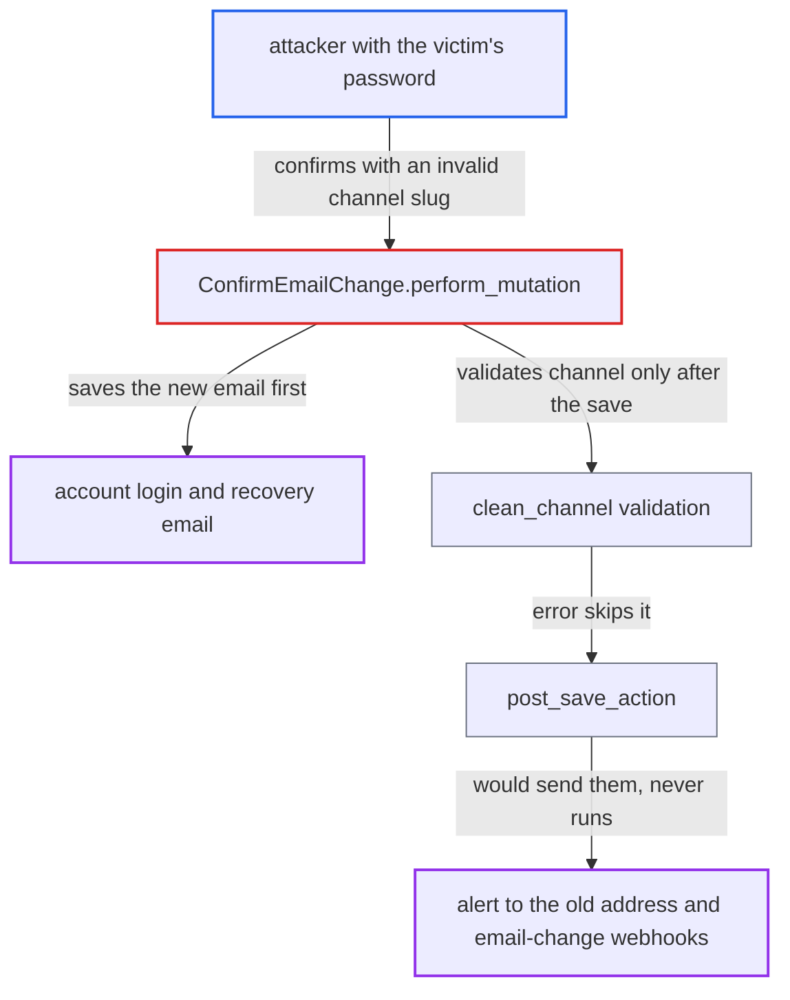

# confirmEmailChange commits new email before channel validation, suppressing old-address alert and events

| Field | Value |
|---|---|
| ID | `find_016DkFXuLBg8FFDobQFnETjd` |
| Severity | **Low** |
| Status | open |
| CWE | CWE-696 — Incorrect Behavior Order |
| Created | 2026-10-27T21:28:08.897869Z |
| Claude Security | https://claude.ai/security/findings/find_016DkFXuLBg8FFDobQFnETjd |

## Description

An attacker who already has a victim's password can move the account's login and recovery email to their own address without the old address being warned. The alert to the old address and the change webhooks are suppressed. The cause is that `ConfirmEmailChange.perform_mutation` saves the new email before `clean_channel` validates the caller-supplied channel, and nothing rolls the save back when validation fails.

1. **attacker** calls `requestEmailChange` with the victim's password and an address the attacker owns. The request needs the account password, so the attacker must already hold the victim's credentials. The confirmation token goes to the attacker's chosen address. ([`saleor/graphql/account/mutations/account/request_email_change.py:73-81`](https://github.com/cx-benchmark/saleor/blob/c982006cc04c77a97def93218dedac8d715eb041/saleor/graphql/account/mutations/account/request_email_change.py#L73-L81))
2. **attacker** calls `confirmEmailChange` with the token and a channel slug that does not exist. The attacker controls the `channel` argument, so an invalid or inactive slug can be chosen every time.
3. **the mutation `ConfirmEmailChange.perform_mutation`** checks the token, then sets the new email and saves the user. The save of `email`, `search_vector` and `updated_at` happens before the channel is validated. ([`saleor/graphql/account/mutations/account/confirm_email_change.py:130-137`](https://github.com/cx-benchmark/saleor/blob/c982006cc04c77a97def93218dedac8d715eb041/saleor/graphql/account/mutations/account/confirm_email_change.py#L130-L137))
4. **the function `clean_channel`** raises `ValidationError` for the unknown or inactive channel slug. It also raises when no slug is given and there is no default channel. ([`saleor/graphql/channel/utils.py:39-82`](https://github.com/cx-benchmark/saleor/blob/c982006cc04c77a97def93218dedac8d715eb041/saleor/graphql/channel/utils.py#L39-L82))
5. **the handler `BaseMutation.mutate`** catches the error and returns it as an `AccountError`. No transaction wraps the mutation, so the earlier save stays committed. ([`saleor/graphql/core/mutations.py:519-533`](https://github.com/cx-benchmark/saleor/blob/c982006cc04c77a97def93218dedac8d715eb041/saleor/graphql/core/mutations.py#L519-L533))
6. **the method `post_save_action`** never runs, so no old-address alert or events are sent. This skips `send_user_change_email_notification` to the old address, the `CUSTOMER_UPDATED` and `ACCOUNT_EMAIL_CHANGED` webhooks, and the gift-card and order re-association. ([`saleor/graphql/account/mutations/account/confirm_email_change.py:142-150`](https://github.com/cx-benchmark/saleor/blob/c982006cc04c77a97def93218dedac8d715eb041/saleor/graphql/account/mutations/account/confirm_email_change.py#L142-L150))

## Assessment

The attacker has the victim's password, for example from phishing or a leak. They log in as the victim and request an email change to an address they own. They then confirm it with a channel slug that does not exist or names an inactive channel. Leaving the slug out also works when there is no default channel. No action by the victim is needed. There is something to suppress only if an email plugin or app is subscribed to these notifications. Note: if the per-channel `UserEmailPlugin` is not enabled on every active channel, choosing such a channel already avoids the old-address email by a sanctioned path. Even then the webhooks are still emitted on that path, and this defect suppresses them as well.

Impact: The account's login and recovery email changes while the old address gets no alert and apps listening for `ACCOUNT_EMAIL_CHANGED` and `CUSTOMER_UPDATED` miss the change. The previous owner is not told, and `requestPasswordReset` now goes to the attacker's address. This gives no new data access, because the password was already known. The report rates it a limited integrity loss.

## Recommendation

`clean_channel` validates the caller-supplied channel after the new email is saved, and the mutation is not atomic. A channel error the caller triggers leaves the email changed and skips every post-save alert and event.

Fix criteria: All validation of caller input, including the channel slug, finishes before the email is written. Alternatively, the write and its post-save actions are atomic, so a later failure rolls the write back. Test: with a valid email-change token, call `confirmEmailChange` with a non-existent or inactive channel slug. The user's email must be unchanged and the token must still be usable. A successful change must always emit the old-address alert and the `ACCOUNT_EMAIL_CHANGED` and `CUSTOMER_UPDATED` events.

## Evidence

**https://github.com/cx-benchmark/saleor**

- [`saleor/graphql/account/mutations/account/confirm_email_change.py:130-137`](https://github.com/cx-benchmark/saleor/blob/c982006cc04c77a97def93218dedac8d715eb041/saleor/graphql/account/mutations/account/confirm_email_change.py#L130-L137)
- [`saleor/graphql/account/mutations/account/confirm_email_change.py:142-150`](https://github.com/cx-benchmark/saleor/blob/c982006cc04c77a97def93218dedac8d715eb041/saleor/graphql/account/mutations/account/confirm_email_change.py#L142-L150)
- [`saleor/graphql/channel/utils.py:39-82`](https://github.com/cx-benchmark/saleor/blob/c982006cc04c77a97def93218dedac8d715eb041/saleor/graphql/channel/utils.py#L39-L82)
- [`saleor/graphql/core/mutations.py:519-533`](https://github.com/cx-benchmark/saleor/blob/c982006cc04c77a97def93218dedac8d715eb041/saleor/graphql/core/mutations.py#L519-L533)
- [`saleor/account/notifications.py:128-147`](https://github.com/cx-benchmark/saleor/blob/c982006cc04c77a97def93218dedac8d715eb041/saleor/account/notifications.py#L128-L147)
- [`saleor/graphql/account/mutations/account/request_email_change.py:73-81`](https://github.com/cx-benchmark/saleor/blob/c982006cc04c77a97def93218dedac8d715eb041/saleor/graphql/account/mutations/account/request_email_change.py#L73-L81)

